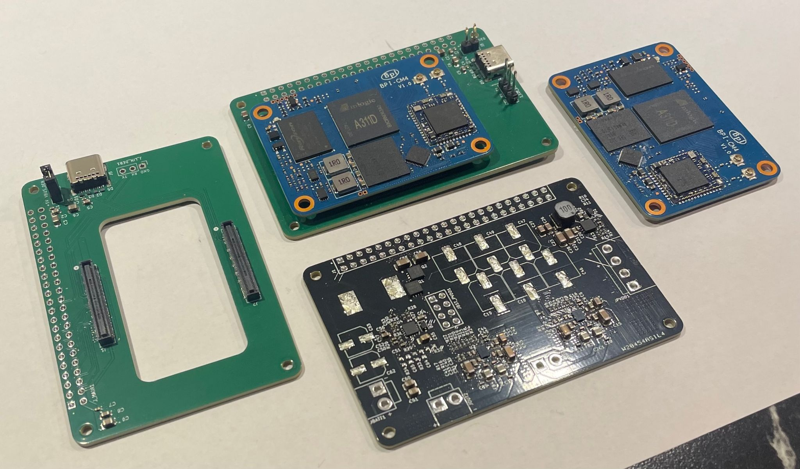
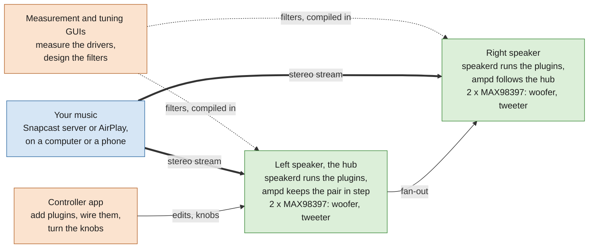
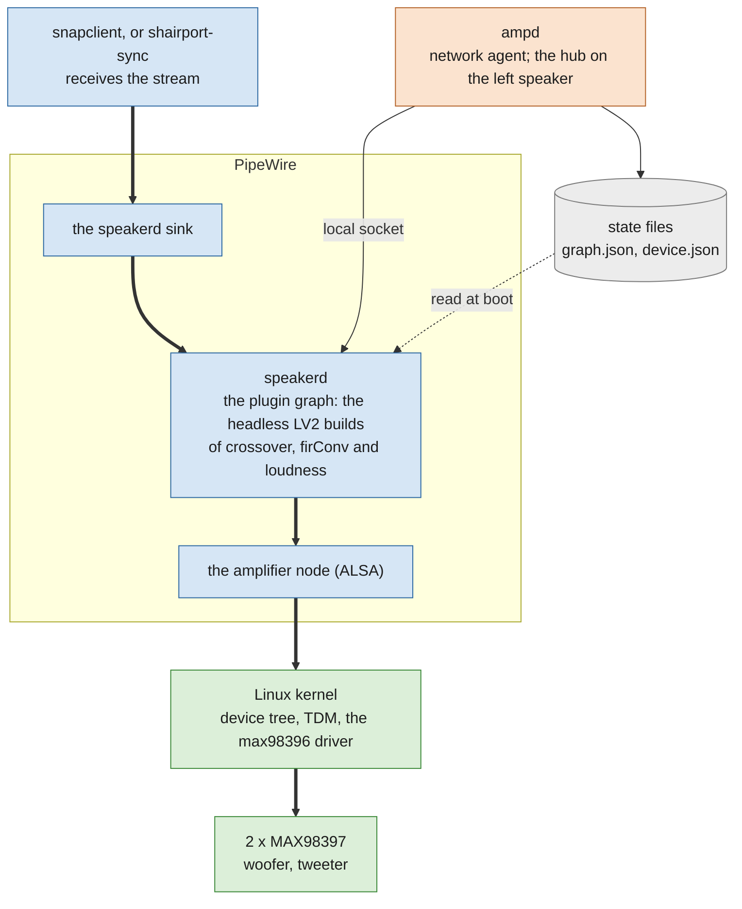

# BPI AMP Platform



A Linux audio streaming platform for **custom loudspeaker tuning**. Each speaker is a
BananaPi BPI-CM4 module on the two boards of this repository. It receives music over the
network, runs the speaker's crossover, correction and loudness filters as JUCE plugins inside
PipeWire, and drives a woofer and a tweeter with two MAX98397 class-D amplifiers. Two such
speakers make a stereo pair, tuned from one controller application on a computer.

## How it works

You play music as you always do. The speakers do the rest.

<!-- diagram: overview -->


Thick arrows carry audio, thin arrows carry settings, and dotted arrows carry what is read
once: the filters at build time, the state files at boot. Orange is control, blue is audio,
green is hardware, grey is files on disk.

- **Music arrives over the network.** A Snapcast server on a computer streams to both
  speakers in sync; AirPlay through shairport-sync is the alternative.
- **Each speaker processes its own channel.** `speakerd`, the headless plugin host, runs the
  plugin graph: a correction FIR, the crossover that splits the signal between the woofer and
  the tweeter, and the loudness contour. It plays with no network, no controller and no hub,
  from the settings on its own disk.
- **The pair is tuned from the controller app.** It looks and works like JUCE's
  AudioPluginHost: add plugins, wire them, open their editors and turn the knobs, and both
  speakers follow within milliseconds. It holds no audio: the graph lives on the speakers.
  `ampd` on the left speaker is the hub that keeps both in step; `ampd` on the right applies
  what the hub sends. Meters and level bars come straight from each speaker.
- **The filters come from measurements.** The Python GUIs measure the drivers with the
  near-field method and design the crossover and correction filters, which the plugins
  compile in.

### Inside a speaker

<!-- diagram: speaker -->


### The software blocks

| Block | What it does | Runs on | Where |
|---|---|---|---|
| Measurement and tuning GUIs | Measure a speaker's drivers, design its filters, export them as C++ headers | the development computer (Python) | [`dsp/python_dsp_tools`](dsp/python_dsp_tools) |
| The plugins | `crossover`, `firConv` (correction), `loudness`, `ampScope`. Each builds from one source as **complete**, **control** (the editor alone) and **headless** (the DSP alone) | speakers (headless), controller (control) | [`dsp/juce_plugins`](dsp/juce_plugins) |
| `speakerd` | The headless plugin host: the plugin graph inside PipeWire, loaded from the state files on disk | each speaker | [`dsp/juce_apps/speakerd`](dsp/juce_apps/speakerd) |
| `ampd` | The speaker's network agent: keeps and applies the settings. On the left speaker also the hub | each speaker | [`firmware/ampd`](firmware/ampd) |
| Controller | The plugin host GUI that edits the speakers' graph through the hub | the listener's computer | [`dsp/juce_apps/controller`](dsp/juce_apps/controller) |
| PipeWire and Snapcast | The speaker's audio server, and the network stream into it | each speaker | [`firmware/pipewire`](firmware/pipewire), [`firmware/snapcast-setup.sh`](firmware/snapcast-setup.sh) |
| Kernel side | Device tree, kernel config, the MAX98397 and sound-card drivers | each speaker | [`firmware`](firmware) |
| Installers | `setup.sh` installs the audio side of a speaker, component by component | the development computer, or the speaker | [`firmware/setup.sh`](firmware/setup.sh) |

The controller, `ampd` and `speakerd` speak [`docs/protocol.md`](docs/protocol.md). The design
is [`docs/remote-plugin-host.md`](docs/remote-plugin-host.md).

<table>
  <tr valign="top">
    <td width="50%"></td>
    <td width="50%"></td>
  </tr>
  <tr valign="top">
    <td><b>Tuning GUI:</b> driver responses, crossover sum and corrected output, every filter parameter live.</td>
    <td><b>The loudness plugin in the controller:</b> the real editor, running with no DSP, as a remote control of both speakers.</td>
  </tr>
</table>

## Where it stands

Steps 1 to 3 of the roadmap are built and tested: the three-target plugin build, `speakerd`,
and the controller with the hub, checked on every test run by a virtual pair of speakers. The
first deploy to a real board was on 2026-11-01: `speakerd` plays the factory graph at boot,
`snapclient` streams into it, `ampd` runs as the hub and the controller edits the graph live.
Step 4 (scope frames, the plugin catalogue, several controllers) is next. `tools/roadmap.py`
prints the current state.

## Hardware

Two boards, connected by a board-to-board connector: a **base board** carrying the BPI-CM4
module, with USB-C and a debug UART, and a **speaker amp board** with the two MAX98397
amplifiers on one TDM bus, a boost converter for their supply and a 5 V buck for the rest.
The KiCad projects and the details are in [`hardware/`](hardware/README.md).


## Firmware

The board runs Armbian with this repository's device tree, kernel config and amplifier
drivers, and PipeWire as its audio server. `firmware/setup.sh` installs the audio side of a
speaker, from the development machine or on the board. The bring-up steps and the installers
are in [`firmware/`](firmware/README.md).

## Developing

Everything but the boards themselves runs on a Linux x86_64 machine with no board attached,
and needs only Podman and git: the builds and both test rungs run in a development container
with the PipeWire version the boards run.

```sh
git clone --recurse-submodules https://github.com/AMuszkat/bpi_amp_platform
cd bpi_amp_platform
tools/test.sh all          # rung 1 (plugin-check) and rung 2 (the virtual pair)
tools/build.sh loudness    # one plugin or application, into build/
tools/container.sh         # a shell in the container
```

The first run builds the container image and JUCE, which takes a few minutes. For a board,
`tools/build.sh speakerd aarch64` cross-compiles into `build/aarch64/`, and
`firmware/setup.sh --mode target-remote` installs; nothing reaches a board unless the commit
has passed the tests. The Python measurement and tuning tools have their own quick start in
[`dsp/README.md`](dsp/README.md). The development process (the test rungs, the agents, the
hooks and CI) is in [`CLAUDE.md`](CLAUDE.md) and
[`docs/autonomous-development.md`](docs/autonomous-development.md).

## Repository layout

| Directory | Contents |
|---|---|
| [`hardware`](hardware/README.md) | KiCad projects: the carrier board and the amplifier board |
| [`firmware`](firmware/README.md) | Device tree, kernel config, amplifier drivers, PipeWire configuration, the installers and `ampd` |
| [`dsp`](dsp/README.md) | Measurement and tuning tools, the JUCE plugins, `speakerd`, the controller and `plugin-check` |
| [`docs`](docs) | The [remote plugin host](docs/remote-plugin-host.md) design, its [protocol](docs/protocol.md), the [block FIR](docs/p1-block-fir.md) and the [development setup](docs/autonomous-development.md) |
| [`tests/vpair`](tests/vpair/README.md) | Two virtual speakers on one machine, for developing and testing without boards |
| [`tools`](tools) | The build, test, container and board scripts; they work without Claude |

## License

The software under [`dsp/`](dsp) is free software under the GNU Affero General Public License
v3.0; see [`dsp/LICENSE`](dsp/LICENSE).
