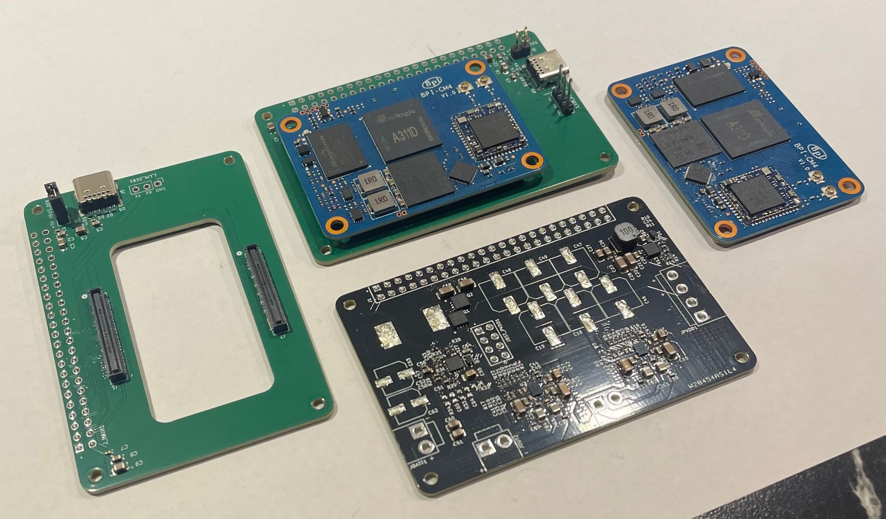

# BPI AMP Platform



The BPI AMP Platform is a Linux-based audio streaming platform built for **custom loudspeaker
tuning**. A BananaPi BPI-CM4 module receives audio over the network (AirPlay through
shairport-sync, or synchronized multi-room streams through Snapcast), processes it in PipeWire
and drives two MAX98397 class-D smart amplifiers.

The loudspeaker DSP lives in the companion repository
**[bpi_amp_dsp_tuning](https://github.com/AMuszkat/bpi_amp_dsp_tuning)**. It measures a
speaker, designs crossover and correction filters for it, and runs them on the board as JUCE
audio plugins in the PipeWire graph.

## Repository layout

| Directory | Contents |
|---|---|
| [`hardware/base_board`](hardware/base_board) | KiCad project: carrier board for the BPI-CM4 module |
| [`hardware/speaker_amp`](hardware/speaker_amp) | KiCad project: amplifier and power board |
| [`firmware`](firmware) | Device tree, kernel config, amplifier and sound-card drivers, PipeWire config and board setup scripts |

## Hardware

The platform has two boards connected by a 46-pin (2×23) board-to-board connector: a
**base board** that carries the compute module, and a **speaker amp board** with the
amplifiers and the power supply.


### Base board

- Carries the **BananaPi BPI-CM4** (Amlogic A311D) on two 100-pin DF40 board-to-board
  connectors.
- **USB-C** port on the module's USB OTG interface, ESD protected. It can serve as a login
  console over USB (see `usb-serial-console-setup.sh`). Jumper J3 links the USB VBUS to the
  5 V rail.
- 3-pin **debug UART** header (J_LIN_DEB1).
- No SD-card slot: the module is installed to its eMMC beforehand (see
  [First boot](#1-first-boot-one-time)).

### Speaker amp board

- **Amplifiers:** two MAX98397 smart class-D amplifiers (U1, U2), one per speaker output
  (JOUT1, JOUT2). They share one TDM bus from the module's TDM_A interface: BCLK, FS and D0
  carry the audio to both amps, and D1 returns their voltage and current sense data. Each amp
  is configured over I²C, with reset, IRQ and LV_EN on module GPIOs, and the two are linked
  through their ICC pins.
- **PVDD** (the amplifiers' power stage supply) comes either from an external supply on
  JPVDD1 or from the on-board boost converter, selected with the jumpers on JBST_PVDD1.
- **Boost converter:** an LTC3786 synchronous boost controller (BSZ024N04LS6 MOSFETs,
  4.7 µH inductor) raises the battery or DC input on JBATT1 to PVDD. The module enables it
  and reads its power-good signal. The board has unpopulated footprints for trimming the
  output voltage from the module by PWM.
- **5 V buck:** an MP9943 converts PVDD to 5 V for the amplifiers' VBAT supply and, through
  the board-to-board connector, for the base board and the module.
- The amplifiers' **1.8 V** logic supply comes from the module.

### 3D models

Most vendor 3D models used by the boards are not in the repo. The PCBs reference them as
`${BPI_AMP_3DMODELS}/<file>`. To see them in the 3D viewer, download the models and point
`BPI_AMP_3DMODELS` at that folder in KiCad (*Preferences → Configure Paths*). Models that ship
with the repo (in `hardware/speaker_amp/speaker_amp_library.pretty`) load without it.

## Firmware

> **Status: bring-up and debugging.** The firmware currently sits on top of a stock Armbian
> (Debian) install: a device tree, a kernel config, locally built amplifier drivers and setup
> scripts. Proper BSP support through Yocto or the Armbian build framework is planned.

### 1. First boot (one time)

The base board has no SD-card slot, so the BPI-CM4 gets its operating system once on Banana
Pi's CM4IO baseboard:

1. Write the Armbian (Debian) image for the BananaPi CM4IO to an SD card.
2. Mount the BPI-CM4 on the **BPI-CM4IO** baseboard, insert the card and boot.
3. Transfer the system to the module's eMMC with `armbian-install`, then power off.
4. Move the module to the BPI AMP base board. From now on it boots from eMMC.

### 2. Host setup

The board address and login are per-developer settings and stay out of git, in
`firmware/local.mk` (gitignored). The device tree is built in a kernel source tree matching
the board's kernel series:

```sh
cd firmware
cp local.mk.example local.mk            # set BOARD_HOST and BOARD_USER
git clone --depth 1 --branch v6.12.22 \
    https://git.kernel.org/pub/scm/linux/kernel/git/stable/linux.git linuxMainLine
cp defconfig linuxMainLine/arch/arm64/configs/defconfig
make -C linuxMainLine ARCH=arm64 CROSS_COMPILE=aarch64-linux-gnu- defconfig
```

You need an arm64 cross toolchain and the usual kernel build tools (on Debian/Ubuntu:
`gcc-aarch64-linux-gnu flex bison bc`), plus ssh access to the board as root for installing.

### 3. Device tree: `firmware/Makefile`

`dtbs` and `install_dtbs` are currently the only working targets of the main Makefile:

```sh
make dtbs           # build meson-g12b-bananapi-cm4-cm4io.dtb from the .dts/.dtsi in firmware/
make install_dtbs   # copy it to the board's /boot over ssh
```

Set `TARGET_KERNEL1` in the Makefile to the board's kernel version (`uname -r` on the board),
because `install_dtbs` writes to `/boot/dtb-<version>/amlogic/`. Reboot the board to load the
new device tree. The other targets (`image`, `modules`, `install`, `all`, ...) do not work yet.

### 4. Amplifier drivers: `firmware/localBuild`

The drivers are built natively on the board against its running kernel. Install the kernel
headers on the board first (Armbian: `sudo apt install linux-headers-current-meson64`), set
`TARGET_KERNEL` in `localBuild/Makefile` to the board's `uname -r`, then run from the host:

```sh
cd firmware/localBuild
make max98396    # MAX98396/MAX98397 codec driver
make axg_card    # Amlogic AXG sound-card machine driver
make all         # dummy codec, for TDM bring-up without amplifiers
```

Each target copies the sources to the board, builds them there, copies the `.ko` back and
installs it into the board's module tree.

### 5. Board setup and tools

| File | Purpose |
|---|---|
| [`snapcast-setup.sh`](firmware/snapcast-setup.sh) | Synchronized network audio: Snapcast over PipeWire, server on the host and client on the board |
| [`pipewire/pipewire.conf`](firmware/pipewire/pipewire.conf) | PipeWire configuration for the board, including the AirPlay loopback |
| [`usb-serial-console-setup.sh`](firmware/usb-serial-console-setup.sh) | Login console over the USB-C port |
| [`wifi-driver-setup.sh`](firmware/wifi-driver-setup.sh) | Pins the RTL8822CS WiFi to one driver and disables power saving |
| [`max98397-diag.py`](firmware/max98397-diag.py) | Reads and clears the amplifiers' fault registers over I²C (runs on the board) |

The scripts take `--target-host [user@]host`, or read `BOARD_HOST` and `BOARD_USER` from the
environment. Detailed developer notes, including the amplifier telemetry work, are in
[`firmware/CLAUDE.md`](firmware/CLAUDE.md).
