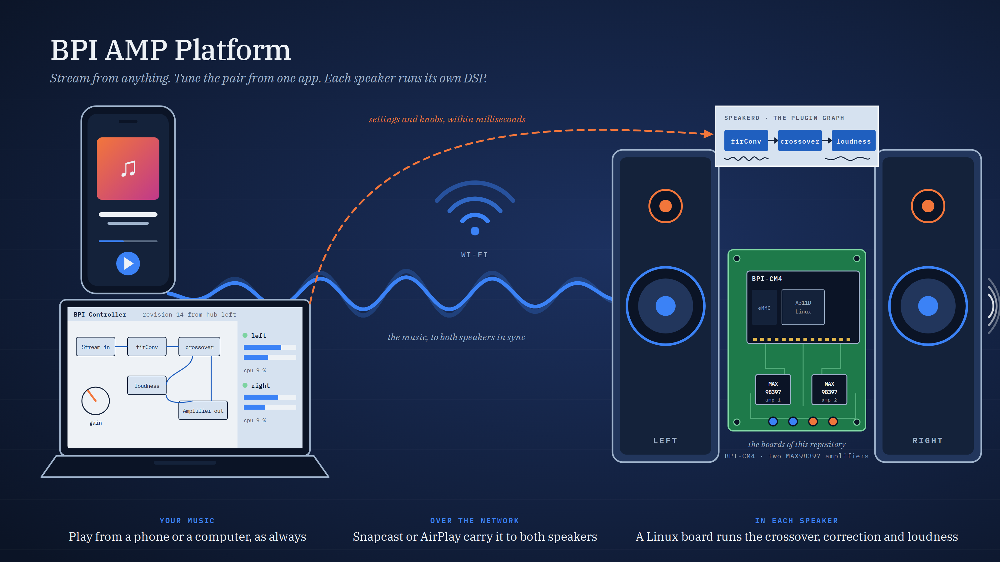
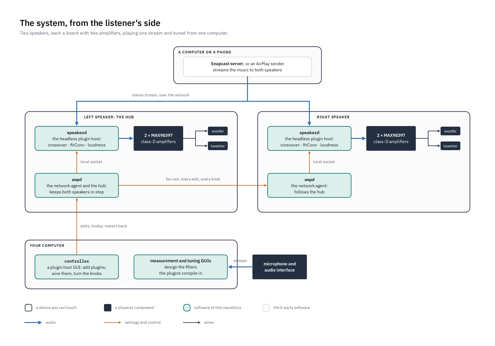
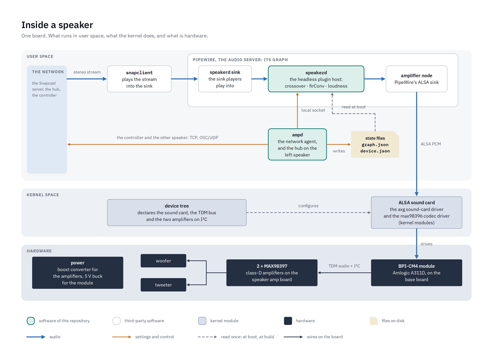
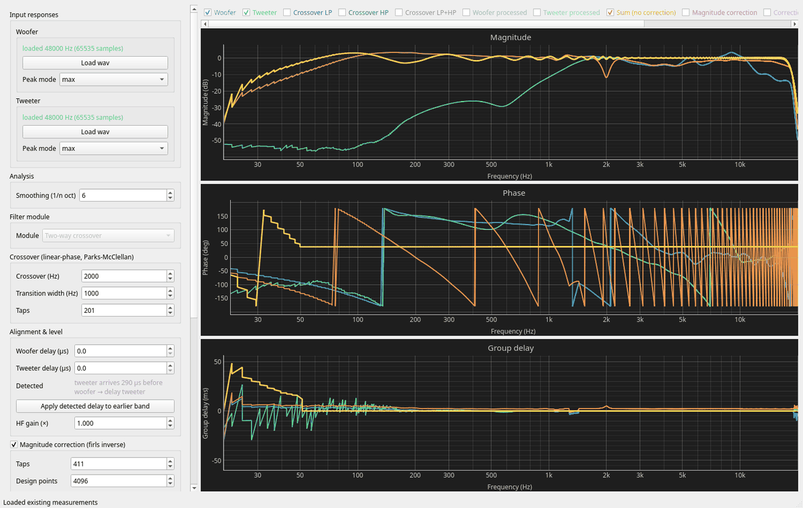
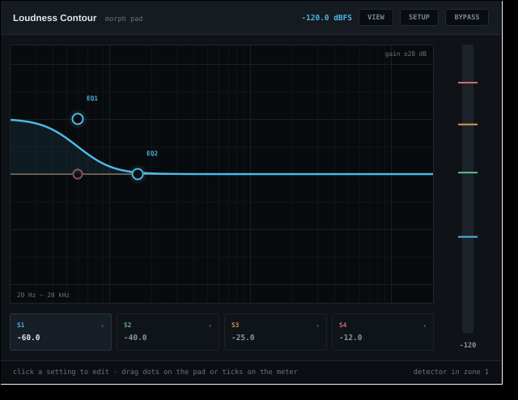
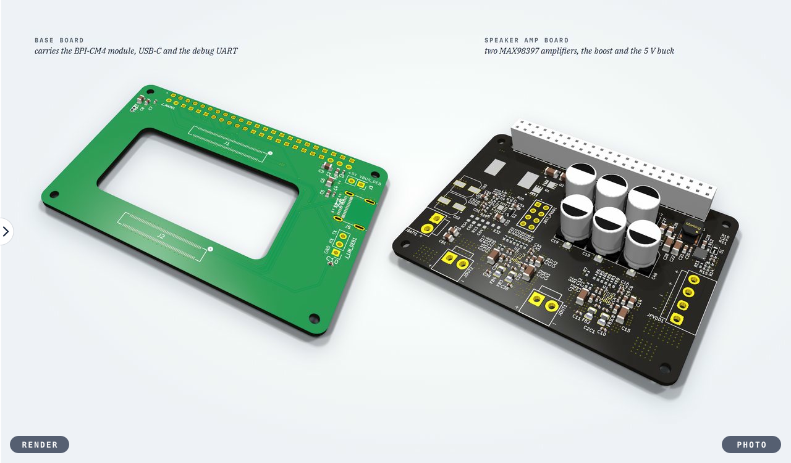

# BPI AMP Platform



The BPI AMP Platform is an open hardware and software stack for building and tuning custom
active loudspeakers. Each loudspeaker contains a BananaPi BPI-CM4 compute module on two
purpose-built boards. The speaker receives music over the network, applies its own tuning in
real time, and drives a woofer and a tweeter through two MAX98397 class-D amplifiers. Two
speakers form a stereo pair, tuned together from a single desktop application.

## Overview

Music is played as usual, from a computer or a phone; the speakers take care of the rest.



- **Network streaming.** Snapcast streams the music to both speakers in sync. AirPlay is also
  supported, through shairport-sync.
- **Processing in each speaker.** Each speaker processes its own channel. Its audio engine,
  `speakerd`, runs a chain of plugins: a correction filter, a crossover that divides the signal
  between the woofer and the tweeter, and a loudness contour. A speaker keeps playing from the
  settings stored on it, with no network or controller connected.
- **Tuning from a computer.** The controller application works like a familiar plugin host:
  plugins are added, connected and adjusted in their own editors, and both speakers follow
  within milliseconds. The settings are kept on the speakers, not in the application. The
  `ampd` service on the left speaker acts as the hub that keeps the pair in step; the right
  speaker applies what the hub sends. Level meters are read directly from each speaker.
- **Filters from measurements.** A set of Python tools measures each driver and designs the
  crossover and correction filters, which are then built into the plugins.

### Inside a speaker

Each speaker runs a layered stack: the platform's applications and PipeWire in user space,
the Linux audio drivers in the kernel, and the hardware beneath them.



The diagrams on this page are generated from [`docs/diagrams/`](docs/diagrams).

## Software modules

| Module | Purpose | Runs on | Location |
|---|---|---|---|
| Measurement and tuning tools | Measure a speaker's drivers, design its filters and export them for the plugins | the development computer (Python) | [`dsp/python_dsp_tools`](dsp/python_dsp_tools) |
| Audio plugins | `crossover`, `firConv` (correction), `loudness` and `ampScope`. The first three are each built in three variants from one source: **complete**, **control** (the editor only) and **headless** (the signal processing only) | the speakers (headless), the controller (control) | [`dsp/juce_plugins`](dsp/juce_plugins) |
| `speakerd` | The speaker's audio engine: hosts the plugin chain inside PipeWire, from the settings stored on the speaker | each speaker | [`dsp/juce_apps/speakerd`](dsp/juce_apps/speakerd) |
| `ampd` | The speaker's network service: stores and applies its settings; on the left speaker, also the hub of the pair | each speaker | [`firmware/ampd`](firmware/ampd) |
| Controller | The desktop application for tuning the pair through the hub | the listener's computer | [`dsp/juce_apps/controller`](dsp/juce_apps/controller) |
| PipeWire and Snapcast | The speaker's audio server, and the network stream that feeds it | each speaker | [`firmware/pipewire`](firmware/pipewire), [`firmware/snapcast-setup.sh`](firmware/snapcast-setup.sh) |
| Kernel support | Device tree, kernel configuration, and the amplifier and sound-card drivers | each speaker | [`firmware`](firmware) |
| Installers | `setup.sh` installs the audio software of a speaker, one component at a time | the development computer, or the speaker | [`firmware/setup.sh`](firmware/setup.sh) |

The controller, `ampd` and `speakerd` communicate through the protocol described in
[`docs/protocol.md`](docs/protocol.md). The overall design is described in
[`docs/remote-plugin-host.md`](docs/remote-plugin-host.md).

<table>
  <tr valign="top">
    <td width="50%"></td>
    <td width="50%"></td>
  </tr>
  <tr valign="top">
    <td><b>Tuning tool:</b> driver responses, the crossover sum and the corrected output, with every filter parameter adjustable live.</td>
    <td><b>The loudness plugin in the controller:</b> the plugin's own editor, acting as a remote control for both speakers.</td>
  </tr>
</table>

## Project status

The first three steps of the roadmap are complete and tested: the plugins in their three
variants, the `speakerd` audio engine, and the controller with the hub. Every test run checks
them against a pair of virtual speakers. On 1 November 2026 the platform was first installed
on a real board, which now starts `speakerd` at boot and plays the music Snapcast streams to it.
Running `ampd` and the controller on real boards is the next stage of that installation. Step 4
of the roadmap (oscilloscope data, a catalogue of the plugins on each speaker, and several
controllers at once) is next. `tools/roadmap.py` reports the current state.

## Hardware

The platform uses two boards joined by a board-to-board connector: a **base board** that
carries the BPI-CM4 module, with a USB-C port and a debug serial port, and a **speaker amp
board** with the two MAX98397 amplifiers, a boost converter for their supply and a 5 V
regulator for the rest of the system. The KiCad projects and their details are in
[`hardware/`](hardware/README.md).



The picture alternates between a render of the KiCad projects
([`hardware/render/`](hardware/README.md#renders)) and a photograph of the boards as built
([`all.jpeg`](all.jpeg)).


## Firmware

The board runs Armbian Linux with this repository's device tree, kernel configuration and
amplifier drivers, and PipeWire as its audio server. `firmware/setup.sh` installs the audio
software of a speaker, either from the development computer or on the board itself. The
bring-up procedure and the installers are described in [`firmware/`](firmware/README.md).

## Development

All development and testing, apart from work on the boards themselves, takes place on a Linux
x86_64 computer with no board attached. Only Podman and git are required: the builds and the
tests run in a development container with the same PipeWire version as the boards.

```sh
git clone --recurse-submodules https://github.com/AMuszkat/bpi_amp_platform
cd bpi_amp_platform
tools/test.sh all          # the complete test suite
tools/test.sh changed      # while working: the checks that cover the files changed
tools/build.sh loudness    # build one plugin or application into build/
tools/container.sh         # open a shell in the development container
```

The first run builds the container image and the JUCE framework, which takes a few minutes.
A focused check then takes between a few seconds and two minutes, and the complete suite about
two minutes. For a board, `tools/build.sh speakerd aarch64` cross-compiles into
`build/aarch64/`, and `firmware/setup.sh --mode target-remote` installs the result. Run
`tools/test.sh all` before installing on a board: nothing enforces it.

The Python measurement and tuning tools have their own quick start in
[`dsp/README.md`](dsp/README.md). The development process, including the test levels, the
development agents and continuous integration, is described in [`CLAUDE.md`](CLAUDE.md) and
[`docs/autonomous-development.md`](docs/autonomous-development.md).

## Repository layout

| Directory | Contents |
|---|---|
| [`hardware`](hardware/README.md) | KiCad projects: the base board and the amplifier board |
| [`firmware`](firmware/README.md) | Device tree, kernel configuration, amplifier drivers, PipeWire configuration, the installers and `ampd` |
| [`dsp`](dsp/README.md) | Measurement and tuning tools, the JUCE plugins, `speakerd`, the controller and the plugin test tool |
| [`docs`](docs) | The [system design](docs/remote-plugin-host.md), its [protocol](docs/protocol.md), the [block FIR filter](docs/p1-block-fir.md), the [development setup](docs/autonomous-development.md) and the [diagrams](docs/diagrams) |
| [`tests/vpair`](tests/vpair/README.md) | Two virtual speakers on one computer, for development and testing without boards |
| [`tools`](tools) | Build, test, container and board scripts |

## License

The software under [`dsp/`](dsp) is free software, licensed under the GNU Affero General Public
License v3.0; see [`dsp/LICENSE`](dsp/LICENSE).
