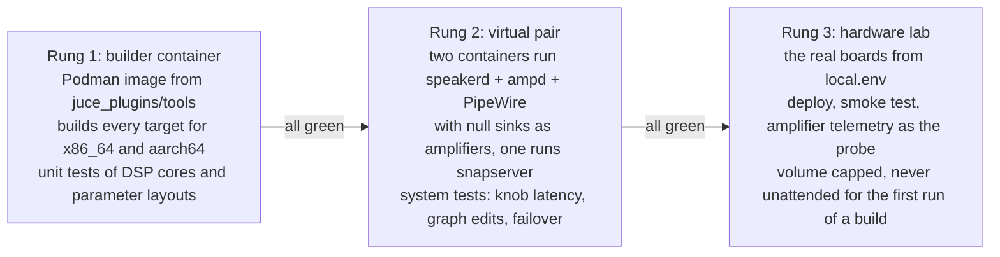
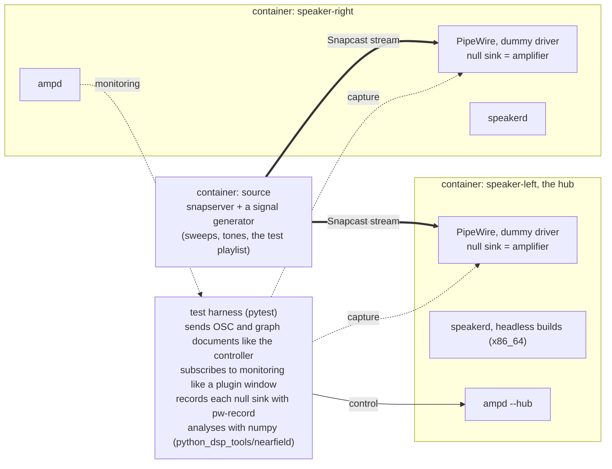
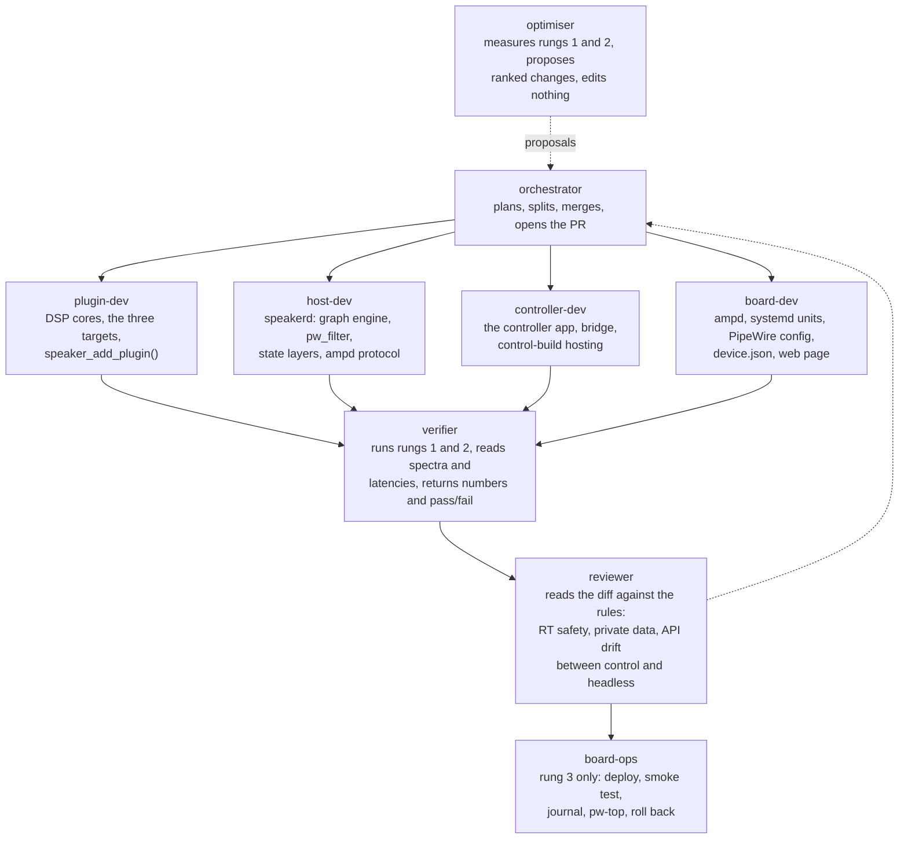
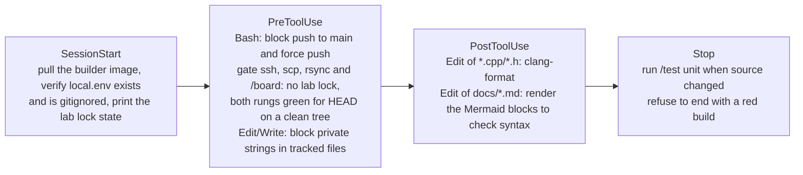
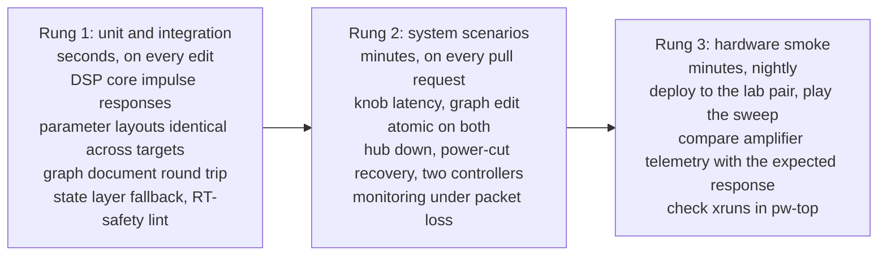
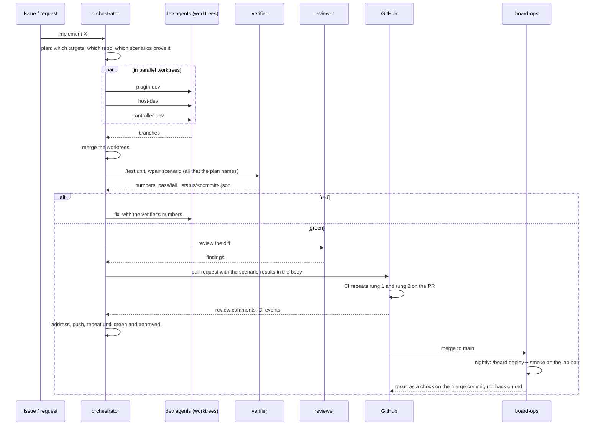

# Autonomous setup, development and test of the remote plugin host

*Proposal. It describes the agents, skills, hooks, environments and tests that would let an AI
coding agent build, deploy and verify the architecture in [remote-plugin-host.md](remote-plugin-host.md)
with no human in the loop for the routine work, and with hard limits on what it may touch.*

The architecture spans two sides of this repository (`dsp/` for the plugins, `speakerd` and
the controller; `firmware/` for `ampd`, PipeWire and the boards), one cross-compiler
container, and real hardware with amplifiers attached to real drivers. Autonomy therefore has
three problems to solve, in this order: **where** an agent can run and test anything without
hardware, **what** it is allowed to do, and only then **who** (which agent, skill or hook) does
which step.

## 1. Three environments, climbed in order

Nothing reaches a real speaker that has not passed the rung below. The rungs are also the
only places an agent ever executes anything.

<!-- diagram: ladder -->

**Rung 1, the builder container.** The existing Podman image already cross-compiles the
plugins. It gains x86_64 builds of the headless targets and of `speakerd`, and a `ctest` run.
Everything here is deterministic and needs no audio device.

**Rung 2, the virtual pair.** This is the piece that makes autonomy possible, because it is a
complete system with no hardware. Three containers on one bridge network:

<!-- diagram: vpair -->

PipeWire runs in a container with its `support.node.driver` dummy driver and a
`null-audio-sink`, so `speakerd` processes real buffers at the real quantum and the harness
records what the amplifier would have received. The same compose file runs on a developer
machine, in CI and inside an agent's session. The containers are x86_64 so the whole rung
runs at full speed; the aarch64 binaries are only exercised on rung 3.

The bridge network between the containers goes through `tc netem`, so a scenario can add
Wi-Fi-like delay, jitter and packet loss. The `ampScope` Demo source runs inside the
headless build, so the monitoring path, scope frames and triggered records included, is
tested without an amplifier.

**What exists today** ([`tests/vpair/`](../tests/vpair/README.md)): the two virtual speakers
run as processes rather than containers, each with its own PipeWire, WirePlumber and D-Bus
session and a null-sink amplifier, so the rung already runs where containers cannot (the
cloud sessions agents work in have no container runtime). A Python harness plays into and
records from each speaker, and three tests prove the audio path: a tone arrives at both
amplifier channels with its frequency and level intact, on each speaker, and the speakers
are independent. On a machine with Podman both speakers run inside the development
container described below, on bookworm's PipeWire 0.3.65 and WirePlumber 0.4.13, the
versions the boards run; natively where there is no container runtime. `speakerd`
(`dsp/juce_apps/speakerd`) runs on the speakers in seven scenarios, which compare what it
plays with its own offline render of the same document through the complete build:
`speakerd_same_sound` (the headless build gives the complete build's gain within 0.05 dB from
40 Hz to 6 kHz, level detector included), `speakerd_state_layers` (a broken layer falls back
to the next, said in the log and heard), `passthrough_safety` (with no plugin or no layer
the tweeter gets exact zeros and the woofer is capped at -20 dBFS, for left, right and mono,
also with the input above full scale, which is shown to reach `speakerd` and checked
sample for sample in the render), `speakerd_start_order` (it plays when the amplifier or
PipeWire start after it, when the amplifier comes back, and with no network),
`speakerd_restart` (stopped under a playing stream it leaves the amplifier silent and the
stream on its sink, and the next one adopts both), `speakerd_second_instance` (a second one
on the same PipeWire refuses) and `speakerd_quantum_change` (the quantum changes while a
stream plays and the sound comes back each time). `speakerd_device_limits` and
`speakerd_import` check the output limits and the import of an AudioPluginHost session that a
board needs, and three more test the board side of `firmware/` on the virtual speakers:
`firmware_speakerd_install`, `speakerd_crash_restart` and `speakerd_installed` (rung 3 below). `tools/test.sh vpair` records the tests it
skipped, and why, with the result.

Step 3 adds `ampd` (`firmware/ampd/`) on each virtual speaker, next to its speakerd: the left is
the hub on 127.0.1.1, the right its agent on 127.0.1.2 (one network namespace, two loopback
addresses, the protocol's ports), and harness clients act as controllers (the control link and
OSC) and as plugin windows (the monitor link). Six scenarios drive speakerd 0.3.0 and hear the
result: `knob_latency` (an OSC value to the hub, heard on both speakers; the speakers' graphs run on
independent clocks, so the 5 ms between the captures is checked at a quantum of 128, where it
measures ampd and speakerd rather than the phase of two clocks, which can be a whole quantum, 21.3 ms,
at the boards' 1024; there only the 60 ms is asserted), `graph_edit` (a revision adding a node and a
connection, no gap longer than the fade, no click; a revision one speaker does not answer, or a
stand-in speakerd fails, rolled back on the other), `hub_down`, `meter_values` (with the Mine pin and
loudness's `mon_levelDb`), `ampd_restart` and `ampd_persistence`. Three run ampd against a stand-in
speakerd that speaks only the local link (`tests/vpair/stand_in_speakerd.py`), so they test the
hub's and the agent's logic with no audio: `ampd_protocol`, `two_controllers` and
`firmware_ampd_install`. One runs the real controller (`dsp/juce_apps/controller`, in its script
test mode, `harness.ScriptedController`) against the real pair, with nothing of the harness in
between: `controller_end_to_end` (it connects with the pair's secret and gets the hub's state, its
knob is heard on both speakers within 60 ms, its edits are applied on both and heard, a revision one
speaker refuses is undone in it, its plugin window's monitors and the speakers panel's levels come
from the chosen speaker, another secret is refused, and its GUI is captured under Xvfb). One
measures `ampd`'s monitor relay on the real pair: `monitor_fanout` (eight plugin windows of one
speaker's `output/level` at 20 Hz, subscribed at different phases, on the hub and on an agent,
each get every value within 5 ms of `speakerd` sampling it at the 99th percentile, at their own
rate). Two measure the plugins on the board's own chain (the Mine pin through `loudness_headless`,
`firConv` and the crossover, its bands to the woofer and the tweeter): `chain_cost` (speakerd's
own timing of each node at quantum 1024 puts firConv under 5 % of the cycle on average and the
crossover under 1.5 %) and `plugin_identity` (`plugin-versions.sh list` gives each plugin the
source id that the documented git command gives, every bundle's `buildinfo.ttl` says its plugin's
version and that source id, and speakerd says which build each node runs, live, at an apply and
in the render; an older build, and a half-written `buildinfo.ttl`, play the same samples and are
said to have no build identity). The Snapcast source and `tc netem` come next; the compose file
comes with them, for CI.

**Rung 1 today** (`tools/test.sh unit`) is `dsp/juce_apps/plugin-check`: it builds a plugin's
complete, control and headless targets and checks that they fit together (same parameters,
state that moves between them, identical sound). Beside it run four more checks (section 5): the
block FIR test (`dsp/juce_plugins/tests/blockfir`: the block FIR that firConv and the crossover
share is bit for bit a reference FIR whose arithmetic the test spells out, on x86_64 and on
aarch64 under `qemu-aarch64-static`, and within -120 dB of `juce::dsp::FIR::Filter`); the build
identity check (`dsp/juce_plugins/tests/buildinfo/check.sh`: loudness's bundles, x86_64 and
aarch64, carry the `buildinfo.ttl` this tree builds, their binary's `bpi-build-info` string
agrees, and the manifest does not name the file); the version tool's test
(`dsp/juce_plugins/tests/plugin-versions/run.sh`: `plugin-versions.sh check` and `list` against a
scratch git repository); and the controller's bridge against its fake hub.

**The development container** is the builder image itself. Besides the aarch64 toolchain
it carries what rungs 1 and 2 need on x86_64: the PipeWire headers `speakerd` builds
against (native and `:arm64`), PipeWire, WirePlumber and D-Bus for the virtual pair,
numpy for its harness, and Xvfb, openbox and ImageMagick for the editor check.
`tools/container.sh` keeps one long-running container per checkout and git worktree, with
the checkout mounted at its own path, and `tools/build.sh`, `tools/test.sh`,
`tests/vpair/vpair.sh` and the harness move into it themselves. A developer machine needs
Podman and git and nothing else; CI and the cloud sessions run the same scripts natively
(`BPI_CONTAINER=0`, or no Podman).

**Rung 3, the hardware lab.** The boards named in the gitignored `local.env`, reached over ssh
with the existing `make`/`build-podman.sh -install` paths. The probe is the amplifier itself:
the MAX98397 voltage sense capture that `ampScope` reads gives the output waveform without a
microphone, so a sweep sent through Snapcast can be compared with the expected crossover
response on each driver. Until that capture path is confirmed on the hardware, the fallback
is a USB audio interface wired to the amplifier outputs through a divider.

**What exists today** for rung 3 is the way onto a board, not yet tried on one
(`firmware/CLAUDE.md`). `firmware/setup.sh` installs a speaker's audio side by component, in
boot order: the PipeWire drop-in with the persistent `speakerd` sink, snapclient routed into
it, and `speakerd` (`ampd` comes with step 3). `firmware/speakerd-setup.sh` installs `speakerd`
as a versioned systemd user service with rollback, capped on every install, whose wrapper
restarts it on last known good after a crash and on factory after three. Both copy one bundle
to the board and run their local mode there; they build nothing. Nothing is routed into
`speakerd` unless the running PipeWire has the drop-in's sink. `tools/board.sh`, the script of
the `/board` skill (`.claude/skills/board`), builds the aarch64 artifacts and deploys, runs a
smoke test that makes no sound (it plays, capped, through the drop-in's sink, linked, clocked
by the amplifier, no restart or xrun for a while), reads the journal and rolls back, and
refuses while the lab is locked or unless both rungs are green for the commit, run on a clean
tree; the installers' remote modes apply the same gate themselves. Their local mode is
tested on the virtual pair, their remote mode through a stand-in `ssh` that runs the board's
side on the same machine; neither has run on a board yet, and the first deploy is a person's
(section 8, and the staged procedure in `firmware/CLAUDE.md`). The smoke test does not yet
compare the amplifier telemetry with the expected response.

## 2. The rules an agent runs under

These are enforced by hooks (section 4), not by instructions, because instructions can be
forgotten and hooks cannot.

| Rule | Why | Enforced by |
|---|---|---|
| No hostname, IP, user name or home path in any tracked file | the repository is public | `PreToolUse` on Edit/Write and a pre-commit check |
| Nothing is deployed to rung 3 unless rung 2 is green for the same commit | an agent cannot hear a broken crossover | `PreToolUse` gate on the deploy skill |
| Every deploy caps the master gain and mutes the tweeter path until the first smoke test passes | a wrong graph must not reach a tweeter at full level | the deploy skill itself (every install writes the cap into `device.json`, and smoke checks that `speakerd` enforces it), and `PreToolUse` on Bash, which refuses any command that lifts it (`--person-present`) |
| A lab lock file stops every hardware action | a human may be measuring, or the boards may be on a bench | `PreToolUse` on any ssh to a board |
| No `git push` to `main`, no force push, no history rewrite | agents work on branches and open pull requests | `PreToolUse` on Bash |
| No allocation, lock or syscall in anything that runs on the audio thread | a xrun is a click on a speaker | the reviewer agent, plus a RT-safety check in `ctest` |
| Agents never change a board's network, Wi-Fi driver or boot configuration | those scripts exist and a failed run strands the board | the board skill only exposes audio-side actions |

## 3. The agents

One orchestrator and eight specialists. Each has the tools it needs and nothing else; the
"tools" column is what its `.claude/agents/<name>.md` definition grants.

<!-- diagram: agents -->

| Agent | Area | Tools | Never does |
|---|---|---|---|
| `orchestrator` | all | Agent, Read, Grep, Glob, git on branches | writes code itself |
| `plugin-dev` | `dsp/juce_plugins/` | Read, Edit, Write, Bash in the builder container | touches `speakerd` or the controller |
| `host-dev` | `dsp/juce_apps/speakerd/` | same | changes the plugin parameter layouts |
| `controller-dev` | `dsp/juce_apps/controller/` | same, plus a headless X server for GUI screenshots | changes the wire protocol without `host-dev` |
| `board-dev` | `firmware/`, `tests/vpair/` | Read, Edit, Write, Bash for the virtual pair | ssh to real boards |
| `verifier` | all | Bash for rungs 1 and 2, Read | edits source |
| `reviewer` | all | Read, Grep, Glob | edits source, runs anything |
| `board-ops` | `firmware/` | the board skill only | edits source, runs on a locked lab |
| `optimiser` | all | Read, Grep, Glob, Bash for rungs 1 and 2 | edits source, records a test status, touches a board |

All nine definitions are in `.claude/agents/`, with these tool grants and rules;
`board-ops` works only through the `/board` skill (`tools/board.sh`). The `optimiser`
implements nothing: it measures where the time and the margins go and returns ranked
proposals, each with its evidence, owner and the scenario that would prove it, for the
orchestrator or an area agent to take up, or the finding that nothing is worth changing.

The split between `plugin-dev`, `host-dev` and `controller-dev` follows the three build
targets. They work in separate git worktrees so that the orchestrator can run them in
parallel on one feature and merge the results.

## 4. Skills and hooks

Skills are the verbs. Each is a `SKILL.md` with the steps plus the scripts it runs, so an
agent never improvises a `pw-cli` or `ssh` line.

| Skill | What it does | Used by |
|---|---|---|
| `/build <plugin\|app> [target]` | builds complete, control or headless, or `speakerd`/controller, for x86_64 or aarch64, in the builder container; every LV2 bundle it builds carries `buildinfo.ttl`, its plugin's version and source identity | all dev agents |
| `/test unit` | `ctest` in the container: DSP cores against exported coefficients, control and headless parameter and monitor layouts identical, state-layer loading, graph diff, scope view model against recorded captures | verifier |
| `/vpair up\|down\|scenario <name>` | brings the virtual pair up with a given build and runs one scenario from `tests/scenarios/` | verifier, orchestrator |
| `/measure <capture> <expected>` | compares a recorded sweep with the expected response: magnitude error per band, crossover point, knob-to-change latency, monitor frame age | verifier |
| `/pw-inspect` | `pw-dump`, `pw-top` and `pw-link -l` on a virtual speaker or a board, summarised as the node graph | all |
| `/board status\|deploy\|smoke\|journal\|rollback` | the only way to touch rung 3 (the board of `firmware/local.mk`); refuses when the lab lock exists or rung 2 is not green | board-ops |
| `/juce` | the JUCE knowledge base in `dsp/docs/juce-knowledge/` | dev agents |
| `/release` | builds every target, writes the catalogue (each plugin's version and source identity, and what step 4's catalogue compares), tags | orchestrator |

Hooks are the gates. They live in `.claude/settings.json` of each repository and run
scripts from `.claude/hooks/`.

<!-- diagram: hooks -->

**What exists today.** The hooks are in place: `.claude/hooks/pre-edit.py` and the commit
check in `pre-bash.py` refuse private data (the rule is `private-data-check.py`, with the
documentation address ranges and the placeholders as exceptions); `pre-bash.py` refuses
pushes to `main` and force pushes, and gates every command that could reach a board (`ssh`,
`scp`, `rsync`, the `-install` and `--target-host` paths of the build scripts) on the lab
lock and on a green test status for the exact commit with a clean tree; `post-edit.py`
checks the Mermaid diagrams of an edited document when `tools/mermaid-check` is installed;
`stop.py` runs the virtual pair tests when their files, `firmware/ampd/` or
`dsp/juce_apps/` changed. The skills `/build`, `/test`, `/vpair` and `/pw-inspect` exist
with their scripts in `tools/`; `/test` writes the status file the gate reads. `/board` exists
too (`tools/board.sh`); `/measure` and `/release` do not exist yet: `/measure` follows `ampd`,
`/release` step 4's catalogue.

The deploy gate is the one that matters most. It reads `tests/.status/<commit>.json`, which
`/test` writes after a run of both rungs, and refuses the deploy if the file is missing, red,
for another commit or from a run on a dirty tree, or if the tree is dirty now; while
`.claude/lab.lock` exists it refuses everything. Only a person can override the test status,
never the lock: they run the one command in their own shell with the variable set, as in
`BPI_DEPLOY_OVERRIDE=1 tools/board.sh deploy`, and the override is logged in
`tests/.status/overrides.log`. An agent cannot: the hook refuses any command of its that sets
the variable. `tools/board.sh` and the installers' remote modes apply the same gate
themselves, for a person's shell where no hook runs.

## 5. The tests

<!-- diagram: pyramid -->

Rung 1 (`tools/test.sh unit`) runs `plugin-check` on every plugin that declares its targets,
the controller's bridge against its fake hub, and three checks of the plugins' code and build:

- **The block FIR test** (`dsp/juce_plugins/tests/blockfir`): the block FIR that firConv
  and the crossover share is bit for bit a reference FIR defined in the test, whose arithmetic is
  explicit (taps in ascending order, each multiply-add fused through `std::fma` on aarch64), on
  x86_64 and on aarch64 under `qemu-aarch64-static`, for the four real coefficient sets (firConv's
  pre-low-pass of 61 taps and inverse of 2001, the crossover's low and high bands of 259 each), in
  blocks of 1024 and of random sizes from 1 to 1024; and against `juce::dsp::FIR::Filter` on the
  same input and coefficients its worst difference is below -120 dB re the output's peak.
- **The build identity check** (`dsp/juce_plugins/tests/buildinfo/check.sh`), after plugin-check
  of each plugin that declares its targets (loudness): the bundle of each of its three targets
  that plugin-check builds (x86_64, in plugin-check's build tree), and `loudness_headless`
  cross-built for aarch64 (`tools/build.sh loudness aarch64 headless`) together with its copy in
  that build's own `copied/lv2`, carry exactly the `buildinfo.ttl` this tree builds (the version
  and source identity of `plugin-versions.sh list`), the binary's `bpi-build-info` string says
  the same and the binary is code for that machine, and `manifest.ttl` does not name the file.
  Only that build tree writes `copied/lv2`, so its copy proves that `buildinfo.ttl` is written
  before JUCE's copy step; the copies in `~/.lv2` are not checked, because any other build in
  the same HOME may have written them since.
- **The version tool's test** (`dsp/juce_plugins/tests/plugin-versions/run.sh`):
  `plugin-versions.sh check` and `list` against a scratch git repository. An unchanged tree
  passes; a changed plugin whose version was not raised fails, and untracked files and a change
  in a shared folder it declares count as changes; a raised version passes, and so does a new
  plugin; a bad ref or an unreadable declaration is exit status 2; and `list` equals the
  documented git command.

The rung 2 scenarios, each a pytest module driving the harness, are the acceptance tests of
the architecture:

| Scenario | Pass when |
|---|---|
| `knob_latency` | a parameter sent to the hub is audible in both captures within 60 ms; at a quantum of 128 the two captures also differ by less than 5 ms. At the boards' 1024 the two speakers' graph clocks can be up to one quantum (21.3 ms) apart, so only the 60 ms holds there (approved by the person; sample-accurate timing across speakers is a later step). A change is set aside only on evidence that does not come from the change itself: the recorder's lost-sample check, "not steady before the send", or an xrun or late cycle recorded for speakerd-dsp or the recorder in that window (pw-profiler, which this test uses; speakerd's own late-cycle and position-jump counts are also available, in its `status` and its `speakerd/timing` stream and log, and are not used here). "Not at its new level 3 ms after it began", "a dropout after the change" and "not a clean change" with no recorded xrun are failures, not set-asides. Up to 30 changes are sent, at least 5 must be measured, each measured change within 60 ms, and less than 5 ms apart at quantum 128 (approved by the person) |
| `graph_edit` | adding a node and a connection changes both captures in the same revision, with no gap longer than the fade and no click above a threshold; a revision one speaker fails is rejected and rolled back on the other |
| `graph_rejected` | a document naming a plugin missing on one speaker is refused and nothing changes |
| `hub_down` | the right speaker keeps playing its revision when the left container is stopped, and switches to the L+R mix if configured |
| `power_cut` | a speaker killed mid-write boots on last known good, and on factory after a corrupted factory-candidate |
| `two_controllers` | changes from two harness clients interleave and both see the same final state |
| `catalogue` | a graph whose control and headless builds of a plugin disagree in what step 4's catalogue compares (the source identity or an interface hash, `docs/remote-plugin-host.md` section 7) is refused |
| `speakerd_same_sound` | `speakerd` running a plugin's headless build gives every test tone the gain of the complete build's offline render within 0.05 dB on both amplifier channels, and that gain is not 0 dB |
| `speakerd_state_layers` | a broken current layer plays last known good, and with both broken factory, each said in the log and recognised by its sound |
| `speakerd_start_order` | `speakerd` started before its amplifier or its PipeWire, or with no network, links and plays the complete build's sound once they are there, and again when the amplifier comes back |
| `passthrough_safety` | with every plugin removed, the tweeter capture is silent and the woofer capture is capped |
| `speakerd_restart` | `speakerd` stopped while a stream plays leaves the amplifier silent and the stream on its sink, and a new `speakerd` adopts the sink under the running stream and plays the same sound |
| `speakerd_second_instance` | a second `speakerd` on the same PipeWire says another one runs and exits, and the first plays on unaffected |
| `speakerd_quantum_change` | with a stream playing, the quantum changes and comes back, and after each change the gain is the render's again, with nothing non-finite or above full scale reaching the amplifier |
| `speakerd_device_limits` | with `device.json` limits of -20 dB and the tweeter muted, live and in the render, the tweeter is exact zeros and the woofer is the unlimited capture minus 20 dB; a +6 dBFS input or a +20 dB boost never puts a sample above -20 dBFS (-40 in passthrough); a `device.json` without limits, with a misspelt key, broken or missing says so and plays the same way capped |
| `speakerd_import` | AudioPluginHost's example session, imported, renders sample for sample like the same settings given as parameters, also with `--prefer-headless`; malformed sessions and one that sends the input straight to the tweeter are refused, with nothing on stdout |
| `firmware_speakerd_install` | the installer's local mode lays out the documented tree with `device.json` capped (-20 dB, tweeter muted), caps again on every install and every rollback, rolls back both ways, and refuses, before it changes anything, without a role, while an AudioPluginHost runs or anything would start one again at boot or login, a speakerd older than the one that enforces the limits, a `device.json` speakerd would reject, and a factory graph (new or kept) that reaches the tweeter other than through a crossover's high band; `limits` turns the tweeter on only when no layer does; routing into `speakerd` needs a snapclient unit that reads client-rt.conf; uninstall stops snapclient when the routing it restores names a node the running PipeWire lacks; under systemd it fails unless `speakerd` runs and says exactly its limits after its start, also when `limits` or `rollback` restart a running one; setup.sh refuses to restart PipeWire under a running AudioPluginHost; smoke reports speakerd's timing (per node, the graph, the cycle) from its status before and after the window or, its local link busy, its log, fails when the graph's longest cycle took more than half its cycle or a cycle was late in the window, and warns on position jumps in it, late cycles before it, timing not measured and a clock read above 150 ns (system calls), reading a passthrough minute line (no node) too; the remote mode and the board script quote every argument |
| `speakerd_crash_restart` | the installed unit starts speakerd on current, on last known good after a crash (a real speakerd killed by SIGSEGV), on factory after three crashes within 60 s, on passthrough after three more on factory, and never while an AudioPluginHost runs |
| `speakerd_installed` | on a speaker set up like a board, the persistent `speakerd` sink exists before speakerd and never drives while the amplifier exists, speakerd plays through it with the tweeter at exact zeros and the woofer at the render minus 20 dB, the deployed bundle runs and not a copy of the same version in `~/.lv2`, and the smoke test passes (speakerd's timing included: the graph within half its cycle, no late cycle while watched), and fails when the amplifier is the default sink; with a PipeWire that does not load the drop-in, nothing is routed into `speakerd` and smoke, `sink` and `install` refuse |
| `meter_values` | a level monitor subscribed on each speaker tracks a stepped test tone within 1 dB, and reports the left and right levels separately; with the Mine pin each speaker plays its own side (a mono speaker (FL + FR) / 2); loudness's `mon_levelDb` is compared with its detector applied to the input (JUCE's BallisticsFilter, 100 ms attack and 300 ms release, which reads a steady sine about 1.3 dB over its RMS), not with the raw input level, within 1 dB |
| `monitor_freshness` | with 5 % packet loss and 20 ms jitter, every frame drawn is less than 50 ms old at the 99th percentile, and the speaker never holds more than one pending frame per stream |
| `scope_resolution` | a scope frame from the speaker is identical to the frame the complete build computes from the same Demo capture |
| `triggered_record` | under the same loss, a single-trigger record fetched by the controller is bit-identical to the speaker's ring buffer |
| `monitor_rt_safety` | opening and closing 100 plugin windows during playback causes no xrun and no change in the null-sink capture |
| `ampd_restart` | killing `ampd` leaves the audio capture uninterrupted, and open windows resubscribe within 2 s |
| `monitor_fanout` | on the real pair (`speakerd` and `ampd`), a tone playing, eight monitor clients of one speaker's `output/level` at 20 Hz, subscribed at staggered times over more than one period so that their phases differ, on the hub's speaker and then on an agent's: over a 10 s window from 1 s after the last subscription, the value age at the client (its arrival on the monotonic clock minus the value's `t`, `speakerd`'s monotonic clock: one clock on one machine) is under 5 ms at the 99th percentile over all eight clients, and each client's rate is within 30 % of what it asked for. Each client's rate and age (median, p90, p99, maximum) and `ampd`'s CPU over the window are printed. A relay that sends each client's values on a clock of its own, as `ampd` 0.1.0's did, makes a value wait for its client's phase: about 50 ms at the 99th percentile |
| `ampd_persistence` | after parameter changes and a speakerd restart, speakerd boots on `graph.json` with the changed values (its render's gain within 0.05 dB), written at most once a second while values change; `graph.lkg.json` follows a revision that played `--lkg-after` seconds with no speakerd restart, and a restart starts that time again |
| `tweeter_rule` | with a speaker's tweeter on (device.json), a revision that reaches the tweeter other than through a crossover's high band (straight, a crossover's low band, a bypassed crossover) is rejected and nothing changes, on the hub's speaker and on an agent's; a crossover's high band is applied; with the tweeter muted, all are applied |
| `speakerd_tweeter_rule` | `speakerd` as on a board, with the tweeter on, refuses a breaking layer (and plays the next) and a breaking apply (the old graph plays on); the same documents get the same verdicts and named outputs from `speakerd` and `firmware/speakerd/tweeter_rule.py` |
| `drag_during_revision` | a knob moved while another controller's revision is being applied keeps its last value in every `graph.json` and every controller, and a restarted `speakerd` plays it |
| `ampd_protocol` | against stand-in speakerds, `ampd` does what `docs/protocol.md` says: parameters with the hub's seq to both speakers and every controller, errors for what it cannot address, revisions all or nothing with the roll back and the 10 s timeout, an offline speaker caught up, a newer agent revision adopted, gestures and their 5 s, the local link's busy, restart and fall back, the monitor union and per-client rates (also a client beside a faster one, and one subscribing again at another rate, the union unchanged), and on the hub's monitor link and an agent's alike a new subscription given the newest value at once, nothing after an unsubscribe, no value twice, and nothing of `speakerd`'s relayed but a value of a subscribed stream of at most 64 KiB (a longer one, one with NaN, another stream's, another op's: none reaches a client, which stays connected), persistence; the pair's secret proven on every control and monitor hello, OSC only from authenticated addresses, the limits (document size, subscriptions, a huge number, exact stream names), values set during an apply kept, the tweeter rule on the hub and on an agent; the handshake proven both ways, an agent believing nothing from a hub that does not prove the secret, OSC only with a live controller's token from its address (others dropped and counted, a replayed token too), agents ignoring OSC; a line before the peer proved the secret, and on the monitor link, is at most 64 KiB (a 100 KiB hello closes the connection on the control and monitor links and at an agent, a 60 KiB one is welcomed); a legal 24 MiB document reaches a controller that does not read for a while, with the values after it (the 1 MiB limit counts what queues besides documents); the known answer of `tests/vpair/auth_vector.json` (client and server proof, K, OSC token) computed from protocol.md's definitions and by ampd's functions |
| `controller_end_to_end` | the real controller (built by `tools/build.sh controller`, in its script test mode) against the real pair, both speakers with speakerd and ampd and the pair's secret, the Mine pin through loudness, a stereo 200 Hz tone 12 dB apart: (a) it connects with the secret file, is synced and proven on the hub's revision with the hub's document on its canvas, both speakers online on layer current, both monitor links connected, and nothing either side refused, ignored or answered with an error (its `--trace`, both ampd logs); (b) nine `set`s are echoed and each is heard on both speakers within 60 ms of the send (knob_latency's onset and set-asides, at least 5 measured), both graph.json hold the last value; a 1 s `drag` is heard on both through at least 10 intermediate 20 ms blocks and ends at the render's level within 0.1 dB, its value in both graph.json, the hub's state and the controller; (c) `add`, a `set` on the new node, `disconnect` and two `connect-pins` are applied (revisions 2 to 5) on both graph.json and heard (the woofers silent, then back at the render's level within 0.1 dB), and its state is the hub's; with the right's device.json turning the tweeter on, a straight connection to the tweeter is rejected with "right: the tweeter is on here (device.json)", undone in the controller, rolled back on the left, and its state is the hub's; (d) with a window open, `mon_levelDb` from the chosen speaker (left, then right) is loudness's detector model of that side within 1 dB and the subscription moves; `output/level` from each speaker is its own side's level within 1 dB, 12 dB apart, the muted tweeters under -100 dBFS; (e) with another secret it is refused (not proven, not synced, the refusal shown, no plugin node), the hub logs it, and no secret is printed; (f) one `--gui` run under Xvfb and openbox with a stepping tone: synced, both level bars fed, the loudness window's meter moving more than 6 dB, and its screenshot and the X screen written to `build/e2e-controller/` |
| `firmware_ampd_install` | `ampd-setup.sh` and setup.sh's ampd component lay out the documented `ampd.json` (with the pair's secret, mode 600, never printed) and unit, refuse an agent with no hub address and a missing or malformed secret before any change (the secret file read as the controller reads it: exactly one trailing `\n` or `\r\n` dropped, nothing else), and status and smoke say whether ampd runs and is connected to speakerd and, on an agent, to the hub |
| `chain_cost` | the board's chain (the Mine pin through `loudness_headless`, `firConv` and the crossover, its low band to the woofer and its high band to the tweeter) on a virtual speaker at its 48 kHz and quantum 1024, noise playing: over a 20 s window after 5 s of settling, `speakerd`'s own timing (`speakerd/timing` on the local link, each value weighted by its cycles) puts firConv's mean share of the cycle under 5 % and the crossover's under 1.5 %. With `juce::dsp::FIR::Filter` they cost 15.1 % and 3.8 % on x86_64, the shared block FIR about 1.0 % and 0.27 %: the limits are 3 and 2.5 times under the old cost and about five times over the new, so a slower or busier CI runner fails the old code by more and passes the new. The window must be a measurement (at least 80 % of its cycles, each node measured in 80 % of them, the quantum unchanged, the woofer above -60 dBFS); the maxima, late cycles and position jumps are printed, not asserted: they measure the machine's scheduler, not the chain |
| `plugin_identity` | `plugin-versions.sh list` prints `<plugin> <version> <source-id>` once for each plugin and nothing else, each version its `project(... VERSION)`; no source id is `unknown` (the virtual pair has git), and each is the 12 hex characters that the test computes itself with the command of `dsp/juce_plugins/README.md` ("Versions and source identity": `git rev-parse` of the plugin's folder, each folder of its `SHARED` in order, `cmake/` and the JUCE gitlink, through `git hash-object --stdin`, a folder not yet in HEAD the empty tree), with `-dirty`, for every path alike, exactly when `git status --porcelain` over those paths prints anything; the bundles of `loudness_headless`, `loudness`, `firConv` and `crossover` carry `buildinfo.ttl` exactly as specified with their plugin's version and that source id, which their `manifest.ttl` does not name (it stays as JUCE writes it: no LV2 host reads `buildinfo.ttl`); `speakerd` says `plugin node <uid>: <URI>, version <version>, source <source-id>, bundle <dir>` once for each node of the chain, the bundle the one it was given, on both speakers at start, again at an apply, and in the render; a copy of firConv's bundle without `buildinfo.ttl`, given alone, renders the original's samples from layer current and says `no build identity (an older build)`, and one with a half-written `buildinfo.ttl` renders the same samples and says `(buildinfo.ttl unreadable)` |

Rung 3 adds one smoke test, not a copy of rung 2: deploy, play the sweep, compare the
telemetry capture with the expected crossover response within a tolerance, and check `pw-top`
for xruns. It runs nightly and after every merge to `main`, never on an unreviewed branch.

## 6. The feature loop

How one task flows, from an issue to a merged pull request, with no human until review.

<!-- diagram: loop -->

Two pieces of infrastructure make this run unattended:

- **CI in GitHub Actions** builds every target and runs rungs 1 and 2 on each pull request
  and push to `develop` (`.github/workflows/ci.yml`: it installs the packages, caches the
  JUCE install by submodule commit, runs `tools/test.sh unit` and `tools/test.sh vpair`,
  and keeps the reports and screenshots as artifacts). Rung 2 needs no containers, so it
  runs on ordinary runners.
- **Scheduled tasks** run the nightly rung 3 smoke, a weekly dependency check (JUCE submodule,
  PipeWire version on the boards, Snapcast release) that opens an issue with the diff, and a
  weekly "replay the scenarios against `main`" run that catches drift between `dsp/` and
  `firmware/`.
  Each fires into a fresh session with the orchestrator's instructions.

## 7. What has to exist before any of this works

In order, because each unlocks the next:

1. **The virtual pair** (`tests/vpair/`, the harness, the first scenarios). Without it no
   agent can test anything, so it comes first, even before `speakerd` exists. Its first
   version is in place: two virtual speakers, the harness and three audio-path tests.
2. **The hooks**, because agents will start touching boards the moment a deploy script exists.
   In place (`.claude/hooks/`, wired in `.claude/settings.json`).
3. **The skills**, replacing ad-hoc shell. `/build`, `/test`, `/vpair` and `/pw-inspect` are in
   place, and so is `/board` (`tools/board.sh`); `/measure` follows `ampd`, `/release` step 4's
   catalogue.
4. **The agent definitions** and the `CLAUDE.md` map of the repository with the rules. In
   place (`.claude/agents/`, the root `CLAUDE.md`).
5. **CI** running rungs 1 and 2 on pull requests. In place (`.github/workflows/ci.yml`), not
   yet seen running: it needs Actions enabled on the repository.
6. **Scheduled tasks** for rung 3, last, once the lab pair has run a week of manual deploys
   through the same skill without surprises.

## 8. What stays human

- Any change to a board's network, boot or Wi-Fi configuration.
- The first deploy of a new `speakerd` to real hardware, and anything that raises the volume
  cap.
- Approving pull requests. An agent may review, never approve.
- Listening. The harness measures; it does not judge whether a crossover sounds right.
