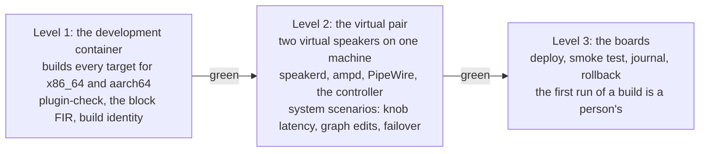
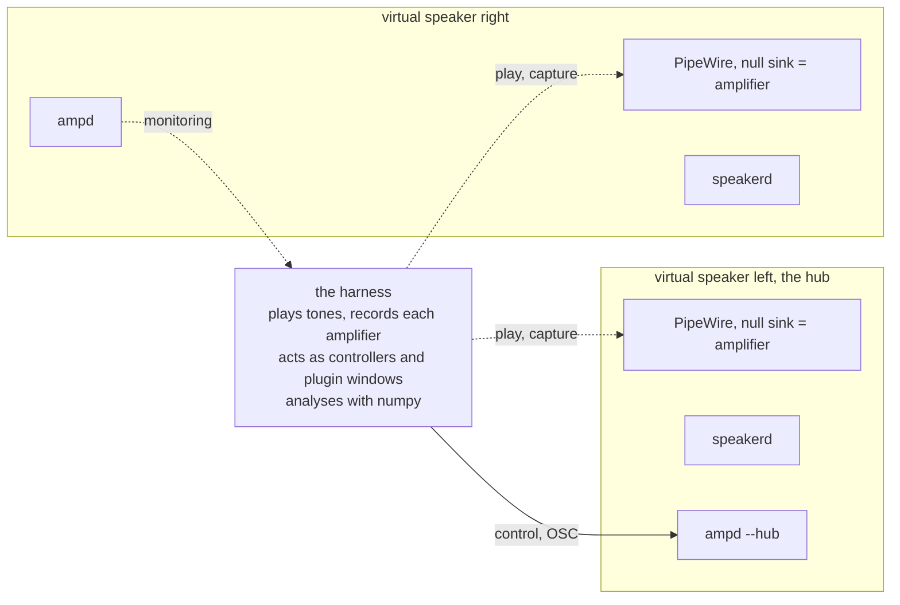
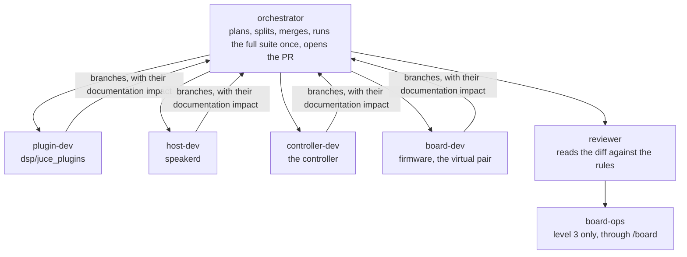
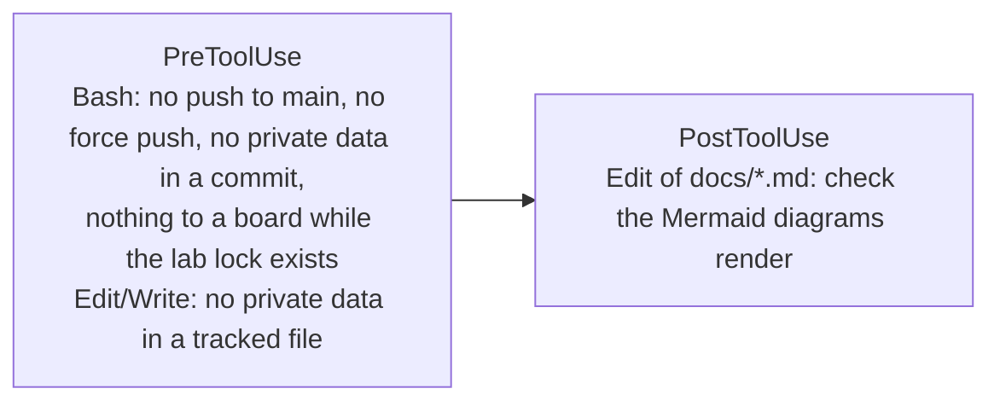
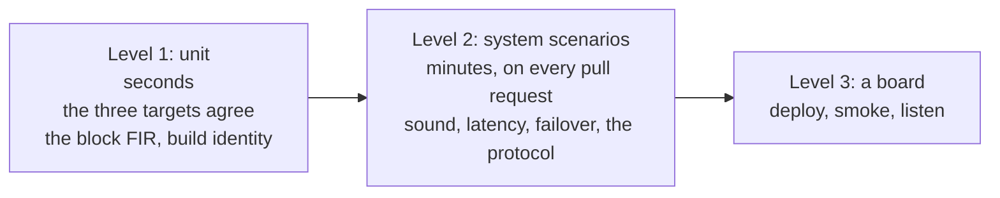
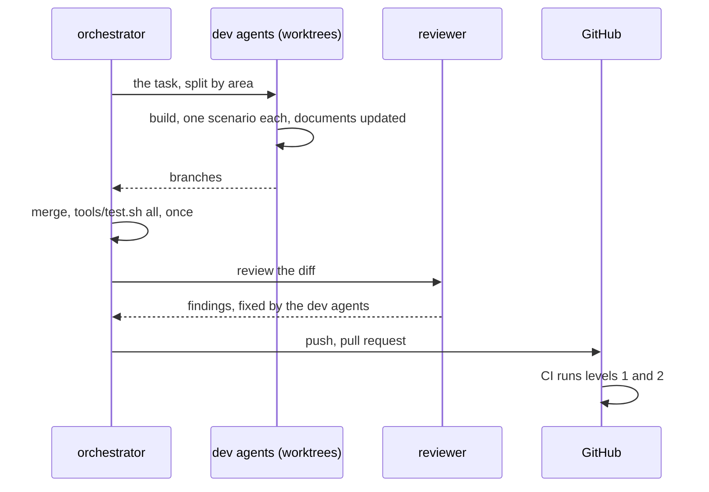

# Autonomous development of the remote plugin host

How AI coding agents build, test and deploy the architecture of
[remote-plugin-host.md](remote-plugin-host.md) with no person in the loop for the routine work,
and what they may never touch.

## 1. Three test levels

Everything an agent runs happens at one of three levels. Code climbs them in order.

<!-- diagram: ladder -->

**Level 1** (`tools/test.sh unit`) runs in the development container, the builder image of
`dsp/juce_plugins/tools/Containerfile`: `plugin-check` builds each plugin's complete, control and
headless targets and checks that they fit together; the block FIR test, the build identity check,
the version tool's test and the controller's bridge test run beside it (section 4).

**Level 2** (`tools/test.sh vpair`) is the virtual pair, [`tests/vpair/`](../tests/vpair/README.md):
two virtual speakers as processes on one machine, each with its own PipeWire and a null-sink
amplifier, running the real `speakerd` and `ampd`, the left as the hub. A Python harness plays
into them, records what the amplifier would get, acts as controllers and plugin windows, and
also runs the real controller against them. It runs in the container where Podman exists and
natively in CI and in cloud sessions.

<!-- diagram: vpair -->

**Level 3** is a real board, reached only through `tools/board.sh` (the `/board` skill): it
builds the aarch64 artifacts, deploys with the installers of `firmware/`, runs a smoke test
that makes no sound, reads the journal and rolls back. The first deploy of a build is a
person's (`firmware/CLAUDE.md`, "First deploy"). The smoke test does not yet compare the
amplifier's telemetry with the expected response: that probe is planned, not built.

## 2. The rules

| Rule | Why | Enforced by |
|---|---|---|
| No hostname, IP, user name or home path in a tracked file | the repository is public | the pre-edit hook and the commit check |
| Nothing reaches a board while `.claude/lab.lock` exists | the boards may be on a bench | the pre-bash hook, `tools/board.sh` and the installers |
| No test gate on a deploy (2026-11-02, the person's decision): run the tests before deploying, but nothing refuses a deploy | the person deploys what they choose | nothing |
| No output cap (2026-11-01); while the tweeter is on, only a crossover's high band reaches it | a wrong graph must not reach a tweeter | the installer, `ampd` and `speakerd` (the tweeter rule) |
| No push to `main`, no force push | agents work on branches and open pull requests | the pre-bash hook |
| No allocation, lock or syscall on the audio thread | an xrun is a click | the reviewer |
| No change to a board's network, Wi-Fi or boot configuration | a failed run strands the board | `/board` exposes only audio-side actions |

## 3. The agents and the skills

One orchestrator, four area developers, a reviewer, board-ops and render-dev; their
definitions are in `.claude/agents/`.

<!-- diagram: agents -->

| Agent | Area | Never does |
|---|---|---|
| `orchestrator` | all: plans, merges, runs the full suite once | writes code |
| `plugin-dev` | `dsp/juce_plugins/` | touches `speakerd` or the controller |
| `host-dev` | `dsp/juce_apps/speakerd/` | changes a plugin's parameter layout |
| `controller-dev` | `dsp/juce_apps/controller/` | changes the protocol without `host-dev` |
| `board-dev` | `firmware/`, `tests/vpair/` | ssh to a board |
| `reviewer` | all, read only | edits, runs anything |
| `board-ops` | a board, through `/board` | edits source, works on a locked lab |
| `render-dev` | `hardware/render/`, `docs/diagrams/`, the pictures | edits the KiCad projects, anything that runs on a speaker |

Each area agent updates the documents its change affects in the same commit and ends its
report with its documentation impact. The rules in the `CLAUDE.md` files and everything in
`.claude/` stay the person's. While working, an agent builds what it changed and runs only
the scenario that covers it; the full suite runs once, on the merged branch, before the push.

Skills are the verbs, each a `SKILL.md` with the script it runs in `tools/`, so no agent
improvises a `pw-cli` or `ssh` line: `/build`, `/test` (`unit`, `vpair`, `all`, `affected`),
`/vpair`, `/pw-inspect`, `/board`, `/juce`, `/render`, `/roadmap`. Planned and not built:
`/measure` (a capture against the expected response) and `/release` (the plugin catalogue).

Hooks enforce the rules. `.claude/settings.json` runs them from `.claude/hooks/`:

<!-- diagram: hooks -->

No hook runs tests. `/test` records each run in `tests/.status/<commit>.json`, and
`tools/status.py gate` says whether a commit is green, in full (both levels on a clean tree) or
by an affected run (`/test affected`: only the level 2 modules that cover the files changed since
a commit green in full, by `tests/impact.json`). Nothing enforces it.

## 4. The tests

<!-- diagram: pyramid -->

**Level 1** runs `plugin-check` on every plugin that declares its three targets, and:

- **the block FIR test** (`dsp/juce_plugins/tests/blockfir`): the block FIR firConv and the
  crossover share is bit for bit a reference FIR, on x86_64 and on aarch64 under qemu;
- **the build identity check** (`dsp/juce_plugins/tests/buildinfo`): every bundle carries the
  `buildinfo.ttl` of this tree, with its plugin's version and source identity;
- **the version tool's test** (`dsp/juce_plugins/tests/plugin-versions`): a changed plugin
  whose version was not raised fails;
- **the controller's bridge test** against a fake hub, and **`tools/tests/test_status_gate.py`**
  (what green is, and the hook's lab lock).

Two plugin tests are standalone: firConv's response test and the level-matched bypass test
(`dsp/juce_plugins/tests/firconv-response`, `.../bypass`).

**Level 2** is the virtual pair's scenarios, one Python module each in `tests/vpair/`. Each
module's docstring says exactly what it proves and the thresholds it uses; the README there
lists them. In short:

| Scenarios | Prove that |
|---|---|
| `audio_path`, `speakerd_same_sound`, `speakerd_state_layers`, `speakerd_start_order`, `speakerd_restart`, `speakerd_second_instance`, `speakerd_quantum_change`, `passthrough_safety`, `speakerd_device_limits`, `speakerd_import` | `speakerd` plays what the complete build renders, within 0.05 dB; falls back layer by layer; survives PipeWire, amplifier and quantum changes; plays safe with nothing loaded; holds `device.json`'s limits; imports an AudioPluginHost session |
| `knob_latency`, `graph_edit`, `hub_down`, `two_controllers`, `drag_during_revision`, `ampd_protocol`, `ampd_restart`, `ampd_persistence`, `tweeter_rule`, `speakerd_tweeter_rule` | a knob is heard on both speakers within 60 ms; an edit is applied on both or on neither; the hub's and the agent's logic follow `docs/protocol.md`, the pair's secret included; `graph.json` persists what played; the tweeter rule holds |
| `meter_values`, `monitor_fanout`, `board_cpu` | the monitors report the right levels, reach every window within 5 ms, and the board's CPU stream behaves |
| `controller_end_to_end` | the real controller, against the real pair: connects, is heard, edits, is refused with another secret, and its GUI under Xvfb |
| `chain_cost`, `plugin_identity` | the board's chain costs what the block FIR promises; every bundle and `speakerd` say which build they are |
| `firmware_speakerd_install`, `firmware_ampd_install`, `speakerd_crash_restart`, `speakerd_installed` | the installers of `firmware/` lay out, check, refuse, roll back and uninstall as documented, on a speaker set up like a board; the unit's wrapper falls back after crashes |

Planned and not built: `graph_rejected`, `power_cut`, `catalogue`, `monitor_freshness`,
`scope_resolution`, `triggered_record`, `monitor_rt_safety`.

**Level 3** is one smoke test on a board, not a copy of level 2: deploy, play, check that
`speakerd` plays the right layer through the right sink with no restart, xrun or late cycle,
and listen.

## 5. The feature loop

<!-- diagram: loop -->

CI (`.github/workflows/ci.yml`) runs levels 1 and 2 on every pull request and push to
`develop`, and checks that a changed plugin raised its version. Planned: a nightly level 3 run
and a weekly dependency check.

## 6. What stays human

- Any change to a board's network, boot or Wi-Fi configuration.
- The first deploy of a new `speakerd` to a board.
- Approving pull requests. An agent may review, never approve.
- Listening. The harness measures; it does not judge whether a crossover sounds right.
