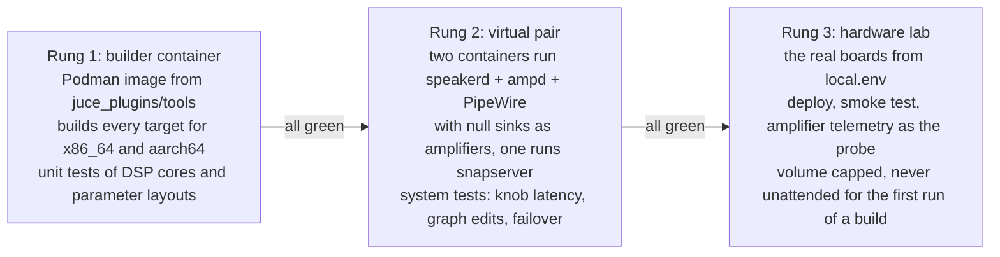
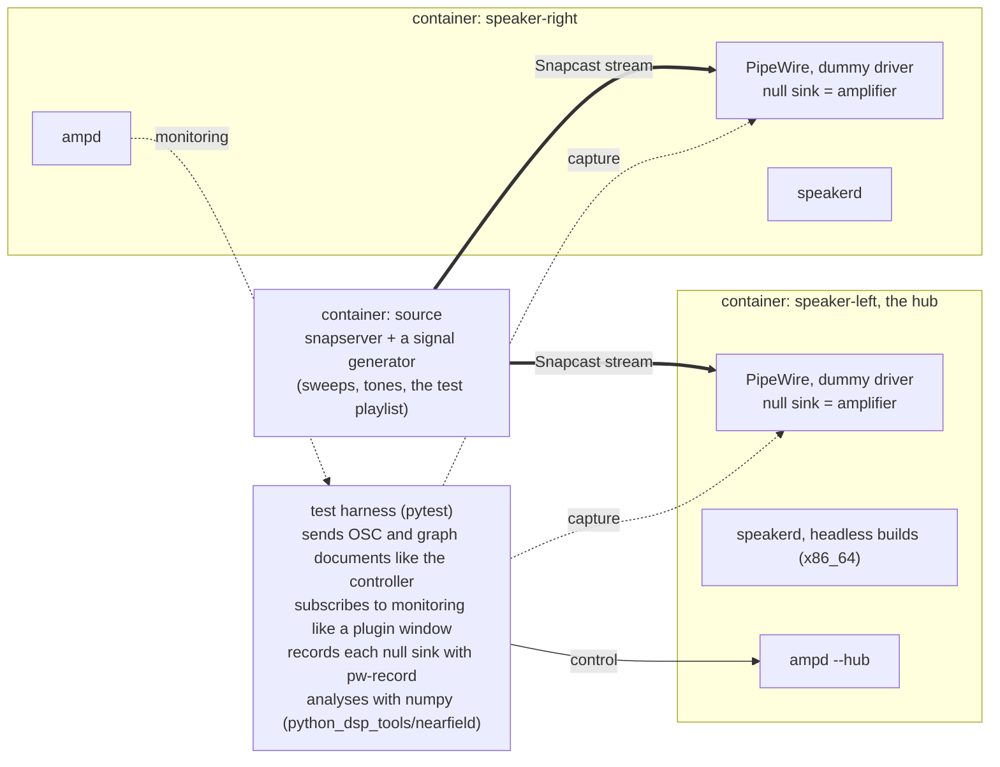
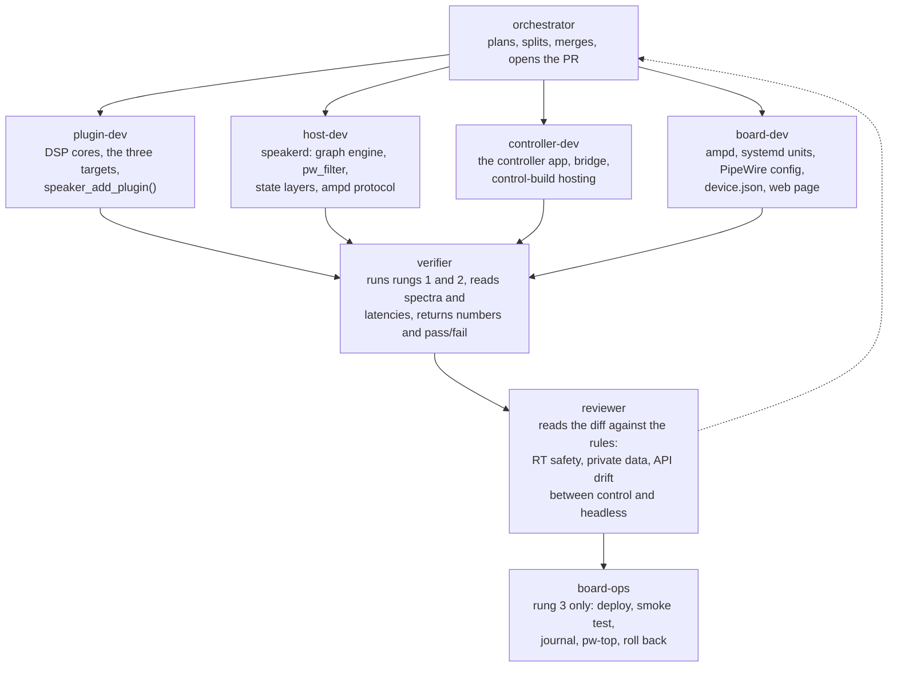
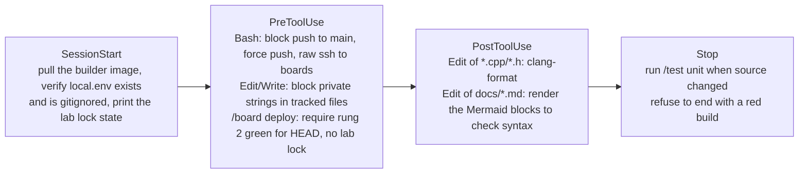
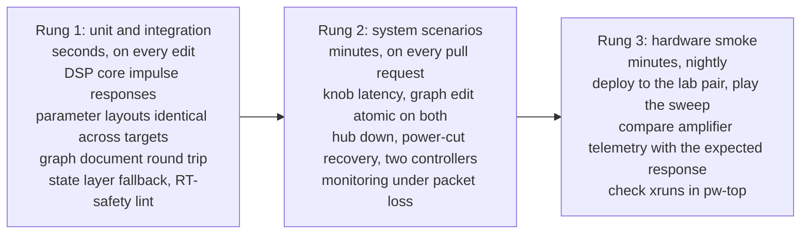
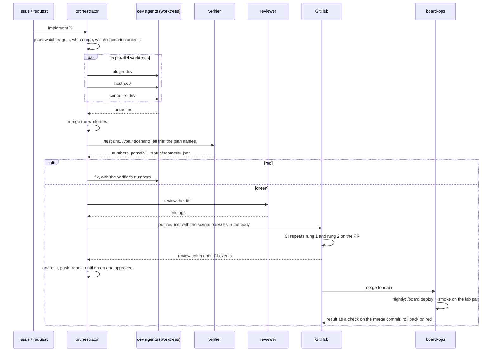

# Autonomous setup, development and test of the remote plugin host

*Proposal. It describes the agents, skills, hooks, environments and tests that would let an AI
coding agent build, deploy and verify the architecture in [remote-plugin-host.md](remote-plugin-host.md)
with no human in the loop for the routine work, and with hard limits on what it may touch.*

The architecture spans two sides of this repository (`dsp/` for the plugins, `speakerd` and
the controller; `firmware/` for `ampd`, PipeWire and the boards), one cross-compiler
container, and real hardware with amplifiers attached to real drivers. Autonomy therefore has
three problems to solve, in this order: **where** an agent can run and test anything without
hardware, **what** it is allowed to do, and only then **who** (which agent, skill or hook) does
which step.

## 1. Three environments, climbed in order

Nothing reaches a real speaker that has not passed the rung below. The rungs are also the
only places an agent ever executes anything.

<!-- diagram: ladder -->

**Rung 1, the builder container.** The existing Podman image already cross-compiles the
plugins. It gains x86_64 builds of the headless targets and of `speakerd`, and a `ctest` run.
Everything here is deterministic and needs no audio device.

**Rung 2, the virtual pair.** This is the piece that makes autonomy possible, because it is a
complete system with no hardware. Three containers on one bridge network:

<!-- diagram: vpair -->

PipeWire runs in a container with its `support.node.driver` dummy driver and a
`null-audio-sink`, so `speakerd` processes real buffers at the real quantum and the harness
records what the amplifier would have received. The same compose file runs on a developer
machine, in CI and inside an agent's session. The containers are x86_64 so the whole rung
runs at full speed; the aarch64 binaries are only exercised on rung 3.

The bridge network between the containers goes through `tc netem`, so a scenario can add
Wi-Fi-like delay, jitter and packet loss. The `ampScope` Demo source runs inside the
headless build, so the monitoring path, scope frames and triggered records included, is
tested without an amplifier.

**What exists today** ([`tests/vpair/`](../tests/vpair/README.md)): the two virtual speakers
run as processes rather than containers, each with its own PipeWire, WirePlumber and D-Bus
session and a null-sink amplifier, so the rung already runs where containers cannot (the
cloud sessions agents work in have no container runtime). A Python harness plays into and
records from each speaker, and three tests prove the audio path: a tone arrives at both
amplifier channels with its frequency and level intact, on each speaker, and the speakers
are independent. On a machine with Podman both speakers run inside the development
container described below, on bookworm's PipeWire 0.3.65 and WirePlumber 0.4.13, the
versions the boards run; natively where there is no container runtime. `speakerd`
(`dsp/juce_apps/speakerd`) runs on the speakers in seven scenarios, which compare what it
plays with its own offline render of the same document through the complete build:
`speakerd_same_sound` (the headless build gives the complete build's gain within 0.05 dB from
40 Hz to 6 kHz, level detector included), `speakerd_state_layers` (a broken layer falls back
to the next, said in the log and heard), `passthrough_safety` (with no plugin or no layer
the tweeter gets exact zeros and the woofer is capped at -20 dBFS, for left, right and mono,
also with the input above full scale, which is shown to reach `speakerd` and checked
sample for sample in the render), `speakerd_start_order` (it plays when the amplifier or
PipeWire start after it, when the amplifier comes back, and with no network),
`speakerd_restart` (stopped under a playing stream it leaves the amplifier silent and the
stream on its sink, and the next one adopts both), `speakerd_second_instance` (a second one
on the same PipeWire refuses) and `speakerd_quantum_change` (the quantum changes while a
stream plays and the sound comes back each time). `tools/test.sh vpair` records the tests it
skipped, and why, with the result. `ampd`, the Snapcast source and `tc netem` come next; the
compose file comes with them, for CI.

**Rung 1 today** is `dsp/juce_apps/plugin-check`: it builds a plugin's
complete, control and headless targets and checks that they fit together (same parameters,
state that moves between them, identical sound).

**The development container** is the builder image itself. Besides the aarch64 toolchain
it carries what rungs 1 and 2 need on x86_64: the PipeWire headers `speakerd` builds
against (native and `:arm64`), PipeWire, WirePlumber and D-Bus for the virtual pair,
numpy for its harness, and Xvfb, openbox and ImageMagick for the editor check.
`tools/container.sh` keeps one long-running container per checkout and git worktree, with
the checkout mounted at its own path, and `tools/build.sh`, `tools/test.sh`,
`tests/vpair/vpair.sh` and the harness move into it themselves. A developer machine needs
Podman and git and nothing else; CI and the cloud sessions run the same scripts natively
(`BPI_CONTAINER=0`, or no Podman).

**Rung 3, the hardware lab.** The boards named in the gitignored `local.env`, reached over ssh
with the existing `make`/`build-podman.sh -install` paths. The probe is the amplifier itself:
the MAX98397 voltage sense capture that `ampScope` reads gives the output waveform without a
microphone, so a sweep sent through Snapcast can be compared with the expected crossover
response on each driver. Until that capture path is confirmed on the hardware, the fallback
is a USB audio interface wired to the amplifier outputs through a divider.

## 2. The rules an agent runs under

These are enforced by hooks (section 4), not by instructions, because instructions can be
forgotten and hooks cannot.

| Rule | Why | Enforced by |
|---|---|---|
| No hostname, IP, user name or home path in any tracked file | the repository is public | `PreToolUse` on Edit/Write and a pre-commit check |
| Nothing is deployed to rung 3 unless rung 2 is green for the same commit | an agent cannot hear a broken crossover | `PreToolUse` gate on the deploy skill |
| Every deploy caps the master gain and mutes the tweeter path until the first smoke test passes | a wrong graph must not reach a tweeter at full level | the deploy skill itself, checked by the gate |
| A lab lock file stops every hardware action | a human may be measuring, or the boards may be on a bench | `PreToolUse` on any ssh to a board |
| No `git push` to `main`, no force push, no history rewrite | agents work on branches and open pull requests | `PreToolUse` on Bash |
| No allocation, lock or syscall in anything that runs on the audio thread | a xrun is a click on a speaker | the reviewer agent, plus a RT-safety check in `ctest` |
| Agents never change a board's network, Wi-Fi driver or boot configuration | those scripts exist and a failed run strands the board | the board skill only exposes audio-side actions |

## 3. The agents

One orchestrator and six specialists. Each has the tools it needs and nothing else; the
"tools" column is what its `.claude/agents/<name>.md` definition grants.

<!-- diagram: agents -->

| Agent | Area | Tools | Never does |
|---|---|---|---|
| `orchestrator` | all | Agent, Read, Grep, Glob, git on branches | writes code itself |
| `plugin-dev` | `dsp/juce_plugins/` | Read, Edit, Write, Bash in the builder container | touches `speakerd` or the controller |
| `host-dev` | `dsp/juce_apps/speakerd/` | same | changes the plugin parameter layouts |
| `controller-dev` | `dsp/juce_apps/controller/` | same, plus a headless X server for GUI screenshots | changes the wire protocol without `host-dev` |
| `board-dev` | `firmware/`, `tests/vpair/` | Read, Edit, Write, Bash for the virtual pair | ssh to real boards |
| `verifier` | all | Bash for rungs 1 and 2, Read | edits source |
| `reviewer` | all | Read, Grep, Glob | edits source, runs anything |
| `board-ops` | `firmware/` | the board skill only | edits source, runs on a locked lab |

All eight definitions are in `.claude/agents/`, with these tool grants and rules;
`board-ops` says so and stops until the `/board` skill exists.

The split between `plugin-dev`, `host-dev` and `controller-dev` follows the three build
targets. They work in separate git worktrees so that the orchestrator can run them in
parallel on one feature and merge the results.

## 4. Skills and hooks

Skills are the verbs. Each is a `SKILL.md` with the steps plus the scripts it runs, so an
agent never improvises a `pw-cli` or `ssh` line.

| Skill | What it does | Used by |
|---|---|---|
| `/build <plugin\|app> [target]` | builds complete, control or headless, or `speakerd`/controller, in the builder container; prints the version hash | all dev agents |
| `/test unit` | `ctest` in the container: DSP cores against exported coefficients, control and headless parameter and monitor layouts identical, state-layer loading, graph diff, scope view model against recorded captures | verifier |
| `/vpair up\|down\|scenario <name>` | brings the virtual pair up with a given build and runs one scenario from `tests/scenarios/` | verifier, orchestrator |
| `/measure <capture> <expected>` | compares a recorded sweep with the expected response: magnitude error per band, crossover point, knob-to-change latency, monitor frame age | verifier |
| `/pw-inspect` | `pw-dump`, `pw-top` and `pw-link -l` on a virtual speaker or a board, summarised as the node graph | all |
| `/board <name> status\|deploy\|smoke\|journal\|rollback` | the only way to touch rung 3; refuses when the lab lock exists or rung 2 is not green | board-ops |
| `/juce` | the JUCE knowledge base in `dsp/docs/juce-knowledge/` | dev agents |
| `/release` | builds every target, writes the catalogue with version hashes, tags | orchestrator |

Hooks are the gates. They live in `.claude/settings.json` of each repository and run
scripts from `.claude/hooks/`.

<!-- diagram: hooks -->

**What exists today.** The hooks are in place: `.claude/hooks/pre-edit.py` and the commit
check in `pre-bash.py` refuse private data (the rule is `private-data-check.py`, with the
documentation address ranges and the placeholders as exceptions); `pre-bash.py` refuses
pushes to `main` and force pushes, and gates every command that could reach a board (`ssh`,
`scp`, `rsync`, the `-install` and `--target-host` paths of the build scripts) on the lab
lock and on a green test status for the exact commit with a clean tree; `post-edit.py`
checks the Mermaid diagrams of an edited document when `tools/mermaid-check` is installed;
`stop.py` runs the virtual pair tests when their files, `firmware/ampd/` or
`dsp/juce_apps/` changed. The skills `/build`, `/test`, `/vpair` and `/pw-inspect` exist
with their scripts in `tools/`; `/test` writes the status file the gate reads. `/measure`,
`/board` and `/release` wait for `speakerd`, `ampd` and the version hash.

The deploy gate is the one that matters most. It reads `tests/.status/<commit>.json`, which
the verifier writes after a rung 2 run, and refuses the deploy if the file is missing, red or
for another commit. A human can override it only by deleting the lab lock and setting an
environment variable for that one session, and the override is logged.

## 5. The tests

<!-- diagram: pyramid -->

The rung 2 scenarios, each a pytest module driving the harness, are the acceptance tests of
the architecture:

| Scenario | Pass when |
|---|---|
| `knob_latency` | a parameter sent to the hub is audible in both captures within 60 ms, and the two captures differ by less than 5 ms |
| `graph_edit` | adding a node and a connection changes both captures in the same revision, with no gap longer than the fade and no click above a threshold |
| `graph_rejected` | a document naming a plugin missing on one speaker is refused and nothing changes |
| `hub_down` | the right speaker keeps playing its revision when the left container is stopped, and switches to the L+R mix if configured |
| `power_cut` | a speaker killed mid-write boots on last known good, and on factory after a corrupted factory-candidate |
| `two_controllers` | changes from two harness clients interleave and both see the same final state |
| `catalogue` | a version-hash mismatch between a control and a headless build is refused |
| `speakerd_same_sound` | `speakerd` running a plugin's headless build gives every test tone the gain of the complete build's offline render within 0.05 dB on both amplifier channels, and that gain is not 0 dB |
| `speakerd_state_layers` | a broken current layer plays last known good, and with both broken factory, each said in the log and recognised by its sound |
| `speakerd_start_order` | `speakerd` started before its amplifier or its PipeWire, or with no network, links and plays the complete build's sound once they are there, and again when the amplifier comes back |
| `passthrough_safety` | with every plugin removed, the tweeter capture is silent and the woofer capture is capped |
| `speakerd_restart` | `speakerd` stopped while a stream plays leaves the amplifier silent and the stream on its sink, and a new `speakerd` adopts the sink under the running stream and plays the same sound |
| `speakerd_second_instance` | a second `speakerd` on the same PipeWire says another one runs and exits, and the first plays on unaffected |
| `speakerd_quantum_change` | with a stream playing, the quantum changes and comes back, and after each change the gain is the render's again, with nothing non-finite or above full scale reaching the amplifier |
| `meter_values` | a level monitor subscribed on each speaker tracks a stepped test tone within 1 dB, and reports the left and right levels separately |
| `monitor_freshness` | with 5 % packet loss and 20 ms jitter, every frame drawn is less than 50 ms old at the 99th percentile, and the speaker never holds more than one pending frame per stream |
| `scope_resolution` | a scope frame from the speaker is identical to the frame the complete build computes from the same Demo capture |
| `triggered_record` | under the same loss, a single-trigger record fetched by the controller is bit-identical to the speaker's ring buffer |
| `monitor_rt_safety` | opening and closing 100 plugin windows during playback causes no xrun and no change in the null-sink capture |
| `ampd_restart` | killing `ampd` leaves the audio capture uninterrupted, and open windows resubscribe within 2 s |

Rung 3 adds one smoke test, not a copy of rung 2: deploy, play the sweep, compare the
telemetry capture with the expected crossover response within a tolerance, and check `pw-top`
for xruns. It runs nightly and after every merge to `main`, never on an unreviewed branch.

## 6. The feature loop

How one task flows, from an issue to a merged pull request, with no human until review.

<!-- diagram: loop -->

Two pieces of infrastructure make this run unattended:

- **CI in GitHub Actions** builds every target and runs rungs 1 and 2 on each pull request
  and push to `develop` (`.github/workflows/ci.yml`: it installs the packages, caches the
  JUCE install by submodule commit, runs `tools/test.sh unit` and `tools/test.sh vpair`,
  and keeps the reports and screenshots as artifacts). Rung 2 needs no containers, so it
  runs on ordinary runners.
- **Scheduled tasks** run the nightly rung 3 smoke, a weekly dependency check (JUCE submodule,
  PipeWire version on the boards, Snapcast release) that opens an issue with the diff, and a
  weekly "replay the scenarios against `main`" run that catches drift between `dsp/` and
  `firmware/`.
  Each fires into a fresh session with the orchestrator's instructions.

## 7. What has to exist before any of this works

In order, because each unlocks the next:

1. **The virtual pair** (`tests/vpair/`, the harness, the first scenarios). Without it no
   agent can test anything, so it comes first, even before `speakerd` exists. Its first
   version is in place: two virtual speakers, the harness and three audio-path tests.
2. **The hooks**, because agents will start touching boards the moment a deploy script exists.
   In place (`.claude/hooks/`, wired in `.claude/settings.json`).
3. **The skills**, replacing ad-hoc shell. `/build`, `/test`, `/vpair` and `/pw-inspect` are in
   place; `/measure` and `/board` follow `speakerd` and `ampd`, `/release` the version hash.
4. **The agent definitions** and the `CLAUDE.md` map of the repository with the rules. In
   place (`.claude/agents/`, the root `CLAUDE.md`).
5. **CI** running rungs 1 and 2 on pull requests. In place (`.github/workflows/ci.yml`), not
   yet seen running: it needs Actions enabled on the repository.
6. **Scheduled tasks** for rung 3, last, once the lab pair has run a week of manual deploys
   through the same skill without surprises.

## 8. What stays human

- Any change to a board's network, boot or Wi-Fi configuration.
- The first deploy of a new `speakerd` to real hardware, and anything that raises the volume
  cap.
- Approving pull requests. An agent may review, never approve.
- Listening. The harness measures; it does not judge whether a crossover sounds right.
