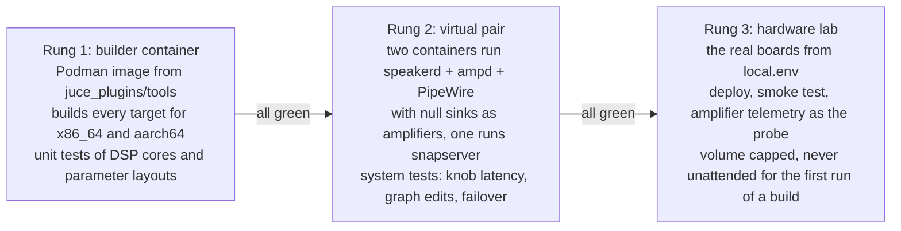
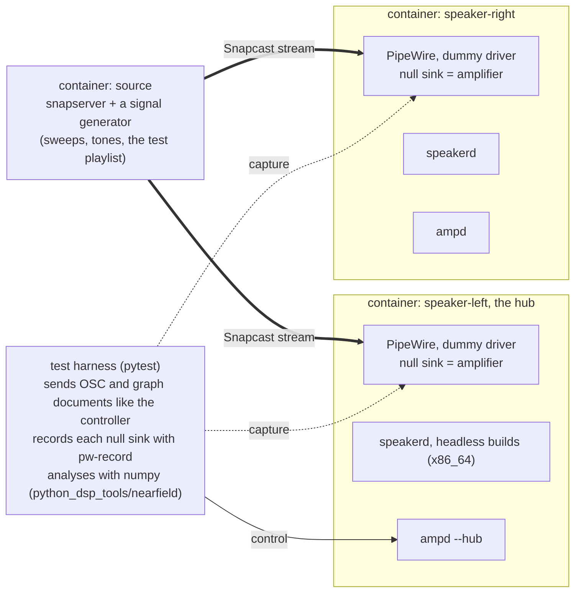
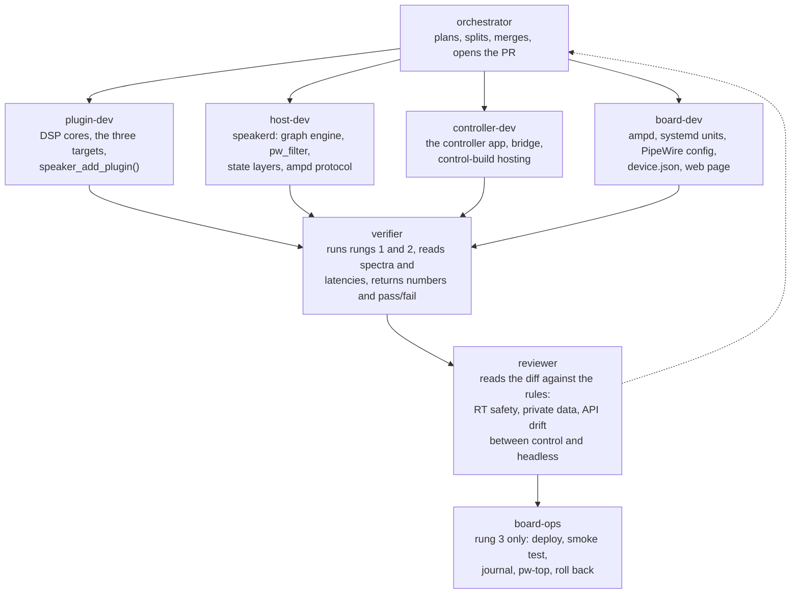
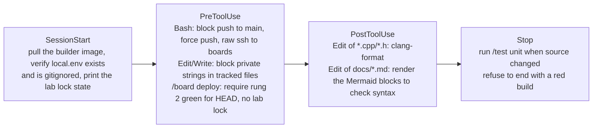
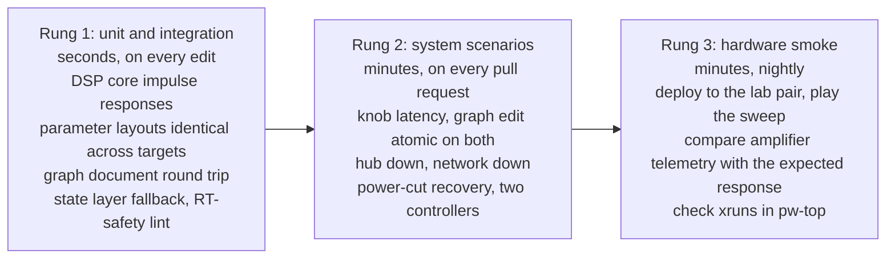
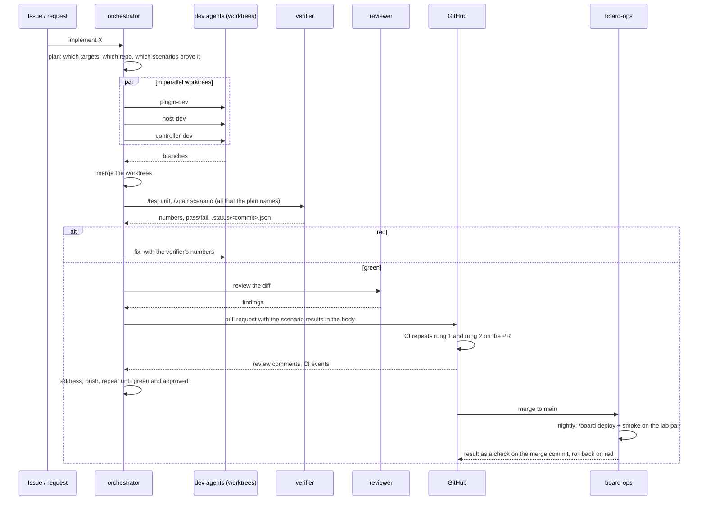

# Autonomous setup, development and test of the remote plugin host

*Proposal. It describes the agents, skills, hooks, environments and tests that would let an AI
coding agent build, deploy and verify the architecture in [remote-plugin-host.md](remote-plugin-host.md)
with no human in the loop for the routine work, and with hard limits on what it may touch.*

The architecture spans two repositories (`bpi_amp_dsp_tuning` for the plugins, `speakerd` and
the controller; `bpi_amp_platform` for `ampd`, PipeWire and the boards), one cross-compiler
container, and real hardware with amplifiers attached to real drivers. Autonomy therefore has
three problems to solve, in this order: **where** an agent can run and test anything without
hardware, **what** it is allowed to do, and only then **who** (which agent, skill or hook) does
which step.

## 1. Three environments, climbed in order

Nothing reaches a real speaker that has not passed the rung below. The rungs are also the
only places an agent ever executes anything.

<!-- diagram: ladder -->

**Rung 1, the builder container.** The existing Podman image already cross-compiles the
plugins. It gains x86_64 builds of the headless targets and of `speakerd`, and a `ctest` run.
Everything here is deterministic and needs no audio device.

**Rung 2, the virtual pair.** This is the piece that makes autonomy possible, because it is a
complete system with no hardware. Three containers on one bridge network:

<!-- diagram: vpair -->

PipeWire runs in a container with its `support.node.driver` dummy driver and a
`null-audio-sink`, so `speakerd` processes real buffers at the real quantum and the harness
records what the amplifier would have received. The same compose file runs on a developer
machine, in CI and inside an agent's session. The containers are x86_64 so the whole rung
runs at full speed; the aarch64 binaries are only exercised on rung 3.

**Rung 3, the hardware lab.** The boards named in the gitignored `local.env`, reached over ssh
with the existing `make`/`build-podman.sh -install` paths. The probe is the amplifier itself:
the MAX98397 voltage sense capture that `ampScope` reads gives the output waveform without a
microphone, so a sweep sent through Snapcast can be compared with the expected crossover
response on each driver. Until that capture path is confirmed on the hardware, the fallback
is a USB audio interface wired to the amplifier outputs through a divider.

## 2. The rules an agent runs under

These are enforced by hooks (section 4), not by instructions, because instructions can be
forgotten and hooks cannot.

| Rule | Why | Enforced by |
|---|---|---|
| No hostname, IP, user name or home path in any tracked file | both repositories are public | `PreToolUse` on Edit/Write and a pre-commit check |
| Nothing is deployed to rung 3 unless rung 2 is green for the same commit | an agent cannot hear a broken crossover | `PreToolUse` gate on the deploy skill |
| Every deploy caps the master gain and mutes the tweeter path until the first smoke test passes | a wrong graph must not reach a tweeter at full level | the deploy skill itself, checked by the gate |
| A lab lock file stops every hardware action | a human may be measuring, or the boards may be on a bench | `PreToolUse` on any ssh to a board |
| No `git push` to `main`, no force push, no history rewrite | agents work on branches and open pull requests | `PreToolUse` on Bash |
| No allocation, lock or syscall in anything that runs on the audio thread | a xrun is a click on a speaker | the reviewer agent, plus a RT-safety check in `ctest` |
| Agents never change a board's network, Wi-Fi driver or boot configuration | those scripts exist and a failed run strands the board | the board skill only exposes audio-side actions |

## 3. The agents

One orchestrator and six specialists. Each has the tools it needs and nothing else; the
"tools" column is what its `.claude/agents/<name>.md` definition grants.

<!-- diagram: agents -->

| Agent | Repository | Tools | Never does |
|---|---|---|---|
| `orchestrator` | both | Agent, Read, Grep, Glob, git on branches | writes code itself |
| `plugin-dev` | `bpi_amp_dsp_tuning` | Read, Edit, Write, Bash in the builder container | touches `speakerd` or the controller |
| `host-dev` | `bpi_amp_dsp_tuning` | same | changes the plugin parameter layouts |
| `controller-dev` | `bpi_amp_dsp_tuning` | same, plus a headless X server for GUI screenshots | changes the wire protocol without `host-dev` |
| `board-dev` | `bpi_amp_platform` | Read, Edit, Write, Bash for the virtual pair | ssh to real boards |
| `verifier` | both | Bash for rungs 1 and 2, Read | edits source |
| `reviewer` | both | Read, Grep, Glob | edits source, runs anything |
| `board-ops` | `bpi_amp_platform` | the board skill only | edits source, runs on a locked lab |

The split between `plugin-dev`, `host-dev` and `controller-dev` follows the three build
targets. They work in separate git worktrees so that the orchestrator can run them in
parallel on one feature and merge the results.

## 4. Skills and hooks

Skills are the verbs. Each is a `SKILL.md` with the steps plus the scripts it runs, so an
agent never improvises a `pw-cli` or `ssh` line.

| Skill | What it does | Used by |
|---|---|---|
| `/build <plugin\|app> [target]` | builds complete, control or headless, or `speakerd`/controller, in the builder container; prints the version hash | all dev agents |
| `/test unit` | `ctest` in the container: DSP cores against exported coefficients, control and headless parameter layouts identical, state-layer loading, graph diff | verifier |
| `/vpair up\|down\|scenario <name>` | brings the virtual pair up with a given build and runs one scenario from `tests/scenarios/` | verifier, orchestrator |
| `/measure <capture> <expected>` | compares a recorded sweep with the expected response: magnitude error per band, crossover point, knob-to-change latency | verifier |
| `/pw-inspect` | `pw-dump`, `pw-top` and `pw-link -l` on a virtual speaker or a board, summarised as the node graph | all |
| `/board <name> status\|deploy\|smoke\|journal\|rollback` | the only way to touch rung 3; refuses when the lab lock exists or rung 2 is not green | board-ops |
| `/juce` | the JUCE knowledge base that already exists in `bpi_amp_dsp_tuning` | dev agents |
| `/release` | builds every target, writes the catalogue with version hashes, tags | orchestrator |

Hooks are the gates. They live in `.claude/settings.json` of each repository and run
scripts from `.claude/hooks/`.

<!-- diagram: hooks -->

The deploy gate is the one that matters most. It reads `tests/.status/<commit>.json`, which
the verifier writes after a rung 2 run, and refuses the deploy if the file is missing, red or
for another commit. A human can override it only by deleting the lab lock and setting an
environment variable for that one session, and the override is logged.

## 5. The tests

<!-- diagram: pyramid -->

The rung 2 scenarios, each a pytest module driving the harness, are the acceptance tests of
the architecture:

| Scenario | Pass when |
|---|---|
| `knob_latency` | a parameter sent to the hub is audible in both captures within 60 ms, and the two captures differ by less than 5 ms |
| `graph_edit` | adding a node and a connection changes both captures in the same revision, with no gap longer than the fade and no click above a threshold |
| `graph_rejected` | a document naming a plugin missing on one speaker is refused and nothing changes |
| `hub_down` | the right speaker keeps playing its revision when the left container is stopped, and switches to the L+R mix if configured |
| `power_cut` | a speaker killed mid-write boots on last known good, and on factory after a corrupted factory-candidate |
| `two_controllers` | changes from two harness clients interleave and both see the same final state |
| `catalogue` | a version-hash mismatch between a control and a headless build is refused |
| `passthrough_safety` | with every plugin removed, the tweeter capture is silent and the woofer capture is capped |

Rung 3 adds one smoke test, not a copy of rung 2: deploy, play the sweep, compare the
telemetry capture with the expected crossover response within a tolerance, and check `pw-top`
for xruns. It runs nightly and after every merge to `main`, never on an unreviewed branch.

## 6. The feature loop

How one task flows, from an issue to a merged pull request, with no human until review.

<!-- diagram: loop -->

Two pieces of infrastructure make this run unattended:

- **CI in GitHub Actions** builds every target in the builder image and runs rung 2 on each
  pull request. Rung 2 only needs containers, so it runs on ordinary runners. The workflow
  caches the JUCE build and uploads the plugin bundles and `speakerd` as artifacts with their
  version hashes.
- **Scheduled tasks** run the nightly rung 3 smoke, a weekly dependency check (JUCE submodule,
  PipeWire version on the boards, Snapcast release) that opens an issue with the diff, and a
  weekly "replay the scenarios against `main`" run that catches drift between the two repos.
  Each fires into a fresh session with the orchestrator's instructions.

## 7. What has to exist before any of this works

In order, because each unlocks the next:

1. **The virtual pair** (`tests/vpair/compose.yaml`, the harness, two scenarios). Without it
   no agent can test anything, so it comes first, even before `speakerd` exists: the first
   version runs today's AudioPluginHost headless check and a null graph.
2. **The hooks**, because agents will start touching boards the moment a deploy script exists.
3. **The skills**, replacing ad-hoc shell: `/build`, `/vpair`, `/measure`, `/board`.
4. **The agent definitions** and the `CLAUDE.md` map of both repositories with the rules.
5. **CI** running rungs 1 and 2 on pull requests.
6. **Scheduled tasks** for rung 3, last, once the lab pair has run a week of manual deploys
   through the same skill without surprises.

## 8. What stays human

- Any change to a board's network, boot or Wi-Fi configuration.
- The first deploy of a new `speakerd` to real hardware, and anything that raises the volume
  cap.
- Approving pull requests. An agent may review, never approve.
- Listening. The harness measures; it does not judge whether a crossover sounds right.
