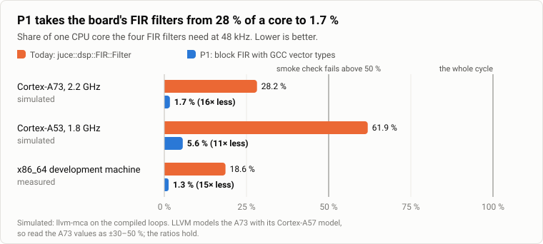
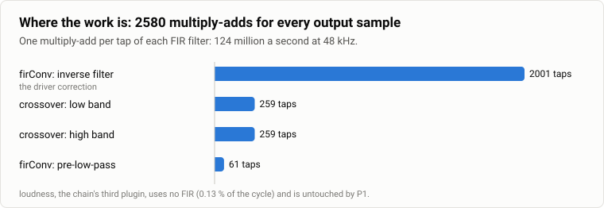
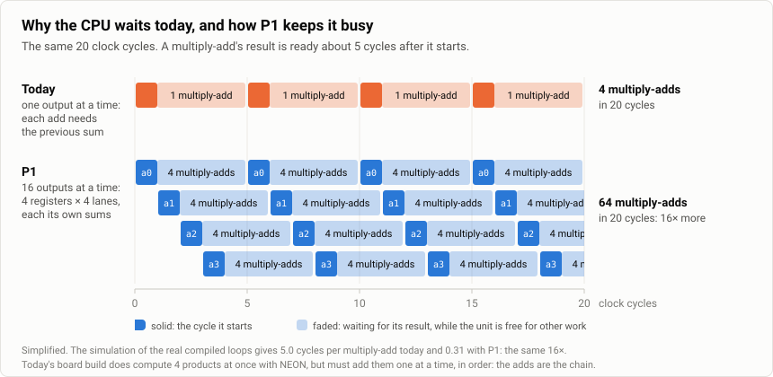
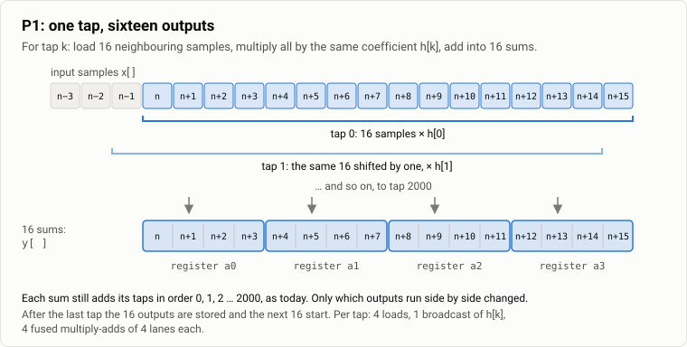
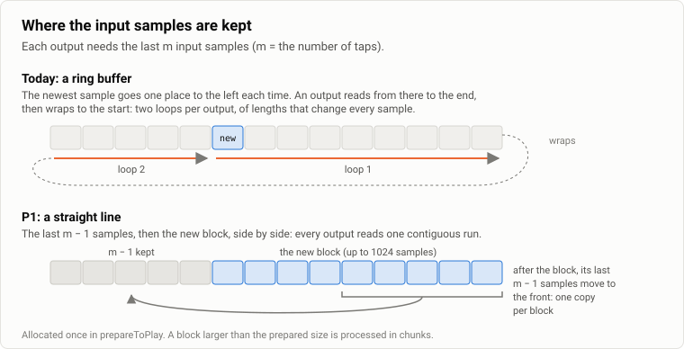
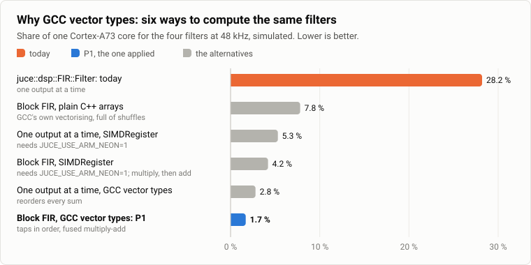
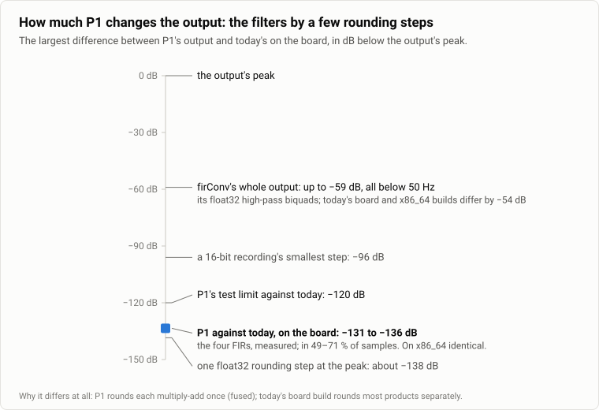

# P1: the FIR filters as a block FIR

*Explainer for P1 of the first optimiser report (October 2026). P1 is built: firConv and
crossover use it from version 0.0.2 (section 10.2 of [remote-plugin-host.md](remote-plugin-host.md)).
The board's numbers come from a benchmark of its real filters and a pipeline simulation, the
x86_64 numbers from measurements; see [How the numbers were obtained](#how-the-numbers-were-obtained).*

`firConv` and `crossover` run every sample through four FIR filters. Today they use JUCE's
`juce::dsp::FIR::Filter`, which computes one output sample at a time. P1 replaces it with a
**block FIR** that computes sixteen outputs at once. The filters, the coefficients and the
order of the arithmetic inside each output stay the same; the board's processor does about
sixteen times less work. The block FIR is `speaker::BlockFir`, one header in
`dsp/juce_plugins/shared/blockfir/` that both plugins compile.



| Share of one core, 48 kHz | Today | P1 | |
|---|---|---|---|
| Cortex-A73 at 2.2 GHz, the board's fast cores (simulated) | 28.2 % | 1.7 % | 16× less |
| Cortex-A53 at 1.8 GHz, the board's small cores (simulated) | 61.9 % | 5.6 % | 11× less |
| x86_64 development machine (measured) | 18.6 % | 1.3 % | 15× less |

Measured again with P1 built, on the x86_64 development machine:

| Share of one core, 48 kHz | Today | P1 |
|---|---|---|
| The four FIRs alone, blocks of 1024 (the block FIR test, `--time`) | 18.6 % | 1.3 % |
| firConv in a virtual speaker's audio cycle (`chain_cost`) | 15.1 % | 1.1 % |
| crossover in a virtual speaker's audio cycle (`chain_cost`) | 3.8 % | 0.3 % |

## Where the work is



A FIR filter makes each output a weighted sum of the last *m* input samples, one
multiply-add per tap:

```
y[n] = h[0]·x[n] + h[1]·x[n-1] + … + h[m-1]·x[n-m+1]
```

The four filters have 2580 taps between them, so every output sample costs 2580
multiply-adds: 124 million a second at 48 kHz. Nearly everything the audio thread spends on
the board's chain goes here.

## Why today's code is slow

JUCE's filter keeps one running sum per output and adds the taps to it one after the other.
Every add needs the previous sum, so the additions form a chain. The board's processor can
*start* a new floating-point operation every cycle, but each result is only ready about five
cycles later; along a chain it starts one, waits, starts the next.

The compiler cannot break the chain: floating-point addition is not associative, so adding
the taps in another order would change the result, and without `-ffast-math` it keeps the
order. The board build does use NEON here, computing four products at once, but it still adds
them to the sum one at a time.



## What P1 does

Neighbouring outputs do not depend on each other, so P1 works on sixteen of them at once. For
each tap it loads sixteen neighbouring samples, multiplies them all by that tap's coefficient
and adds them into sixteen running sums, held in four NEON registers of four lanes. Each lane
is one output, and it still adds its taps in the order 0, 1, 2 …; only which outputs run side
by side changed.



The four registers are four independent chains. While one waits for its result the others
start, so the processor starts a 4-wide multiply-add almost every cycle (the lower half of the
timeline above). Each instruction does four multiply-adds instead of one, and each tap's
coefficient is loaded once for sixteen outputs instead of once for one.

The last few outputs of a block that is not a multiple of sixteen go through the same vector
code on zero-padded samples, not through a plain loop: the compiler would turn a plain loop
into today's form, and those outputs would round differently from the rest.

## Where the samples are kept



Today the samples sit in a ring buffer, so every output is read in two pieces of changing
length. P1 keeps them in a straight line: the last *m* − 1 samples, then the new block. After
the block, its last *m* − 1 samples are copied to the front, once per block. The buffer is
allocated in `prepareToPlay`; nothing allocates, locks or makes a system call on the audio
thread, and a block larger than the prepared size is processed in chunks.

## Why GCC vector types, and not JUCE's `SIMDRegister`

Six ways of computing the same filters were built with the board's compiler and compared:



| Variant | Cortex-A73 (simulated) | Cortex-A53 (simulated) | x86_64 (measured) | Output against today on the board |
|---|---|---|---|---|
| `juce::dsp::FIR::Filter`: today | 28.2 % | 61.9 % | 18.6 % | the reference |
| Block FIR, plain C++ arrays | 7.8 % | 27.1 % | 4.8 % | at most −131 dB |
| One output at a time, `SIMDRegister` | 5.3 % | 10.3 % | 1.8 % | at most −114 dB |
| Block FIR, `SIMDRegister` | 4.2 % | 10.3 % | 1.2 % | at most −139 dB |
| One output at a time, GCC vector types | 2.8 % | 9.5 % | 1.8 % | at most −114 dB |
| **Block FIR, GCC vector types: P1** | **1.7 %** | **5.6 %** | **1.3 %** | **at most −131 dB** |

- **`SIMDRegister` does not exist in the board build.** JUCE 8.0.12 enables its NEON code
  only when the compiler defines `__ARM_NEON__`, the 32-bit ARM spelling; GCC on 64-bit ARM
  defines `__ARM_NEON`. Forcing it on with `JUCE_USE_ARM_NEON=1` makes `SIMDRegister`
  available, but its multiply-add is a separate multiply and add, 2.5× slower than GCC's
  vector types here.
- **Without vector types**, plain arrays let the compiler vectorise on its own, and it produces
  code full of lane shuffles: still 3.6× faster than today, 4.6× slower than P1.
- **One output at a time with vector types** is fast too, but it splits every sum into
  sixteen partial sums and adds them at the end, which changes every output's rounding (up to
  −114 dB) and costs extra for short filters.

## What happens to the sound



Each output adds its taps in the same order as today. What differs is rounding: P1 rounds each
multiply-add once (a fused multiply-add), while today's board build rounds the products
separately for most taps and fuses the rest, in a pattern that changes with the ring buffer's
position. On the board the FIRs' outputs differ in 49–71 % of samples, by at most −131 dB
below the peak: a few rounding steps of a 32-bit float. On x86_64 they are identical. The tuning,
the coefficients `firConv` and `crossover` carry, does not change.

**firConv's whole output moves more, below 50 Hz.** On the board, firConv's output differs from
today's by up to about −55 dB below its peak, nearly all of it under 50 Hz (−59 dB with a
louder input, at −6 dBFS). The cause is not the FIR:
after the first FIR come firConv's high-pass biquads, float32 filters with poles very close to
z = 1. They turn any change of rounding before them, even one rounding step, into a different
pattern of their own low-frequency rounding noise. Today's board build already differs from the
x86_64 build by −55 dB in the same way. From 100 Hz up the difference stays at least 76 dB
below the output. The firConv response test, `dsp/juce_plugins/tests/firconv-response/run.sh`,
plots the plugin's magnitude response on x86_64 and on aarch64 against the response its
coefficients were designed for: both builds are within 0.016 dB of it from 20 Hz to 20 kHz. crossover has no such filter: its output keeps the FIRs'
difference, −130 to −133 dB.

**firConv 0.0.3 removes that noise.** It runs the high-pass biquads in double precision, so
their rounding no longer piles up. Against 0.0.2 its output moves by −60 dB below the peak on
x86_64 and −58 dB on the board, nearly all of it under 50 Hz: that is the noise going away.
Its x86_64 and board builds now differ by −92 dB below the peak instead of −55 dB, 93 % of it
above 20 kHz, where the inverse FIR boosts the first FIR's own rounding. From 20 Hz to 20 kHz
the difference stays at least 84 dB below the output. What is left of firConv's error against
its exact design is the rounding of its coefficients to 32-bit floats in `filters.hpp`, the same
in every build: both builds are within 0.011 dB of the design from 20 Hz to 20 kHz.

P1's tests check the FIRs bit for bit, and the plugins' outputs only where rounding allows:

| Test (rung 1 and rung 2) | Result | Limit |
|---|---|---|
| Against a reference FIR with its arithmetic spelled out, x86_64 and aarch64 under qemu, blocks of 1024 and of random sizes | identical, bit for bit | identical |
| Against `juce::dsp::FIR::Filter`, x86_64 | identical | −120 dB |
| Against `juce::dsp::FIR::Filter`, aarch64, the four filters | −131.5 to −135.9 dB, in 49–71 % of samples | −120 dB |
| `chain_cost` on the virtual pair, at the board's quantum of 1024 | firConv 1.1 %, crossover 0.3 % | 5 % and 1.5 %, which today's code fails |

## What else gets better

- **Graph edits.** `speakerd` computes one second of silence through a new graph before
  swapping it in. With the chain's FIRs that took 0.19 s on x86_64 (an edit took 277–299 ms
  against about 100 ms with loudness alone), and several times longer on the board; P1 makes
  it about sixteen times cheaper. Start-up shortens the same way.
- **Headroom for step 4**: more plugins, scope frames, longer filters.
- **A lower latency becomes affordable.** A quantum of 512 instead of 1024 halves the buffering
  delay but doubles the per-cycle overhead; it is only worth trying with this headroom.
- **The small cores could run the chain**: 5.6 % of an A53 instead of 61.9 %, which would fail
  the smoke check today.

## How the numbers were obtained

- **The benchmark.** The board's real coefficients through each of the six implementations,
  compiled by the board's cross-compiler (GCC 12, `-O3`, as the plugins are) in four builds:
  x86_64; aarch64 as the board builds it today; with `JUCE_USE_ARM_NEON=1`; with the
  compiler's NEON switched off. Every output was compared with JUCE's filter, the aarch64
  builds under qemu. (A scratch benchmark, not kept in the repository; P1's tests keep
  checking the output.)
- **After the change.** The block FIR test times both implementations
  (`dsp/juce_plugins/tests/blockfir/run.sh --time`), and the virtual pair's `chain_cost` scenario
  reads each plugin node's share of the audio cycle from `speakerd`'s own timing. Both agree
  with the benchmark on x86_64.
- **The simulation.** `llvm-mca` 18 on each variant's compiled inner loop, for a Cortex-A73 and
  a Cortex-A53 at 2.2 and 1.8 GHz. LLVM has no model of its own for the A73 and uses its
  Cortex-A57 model, so read the A73's absolute values as ±30–50 %; the ratios hold. The A53
  has its own model. Only the inner loop is simulated, which is negligible for the 2001-tap
  filter and matters a little for the 61-tap one.
- **The calibration.** The same simulation of the x86_64 build (Zen 4 model) predicted the
  measured times within 5 % for today's filter and for P1.
- **At 44.1 kHz**, the rate `firmware/pipewire/pipewire.conf` sets today, every share is 8 %
  lower.
- **The board will tell.** `/board smoke` reports each plugin node's share of the cycle on the
  real speaker after the first deploy.
