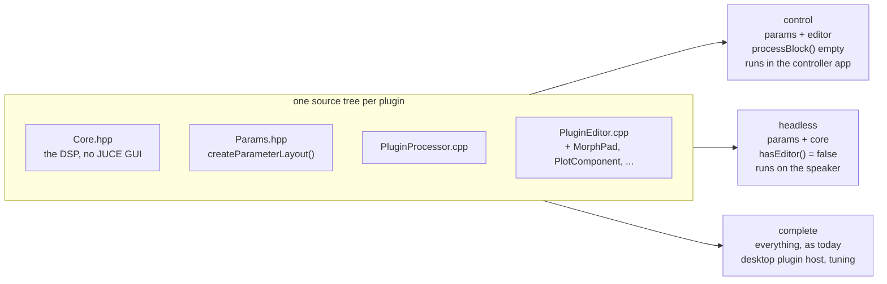
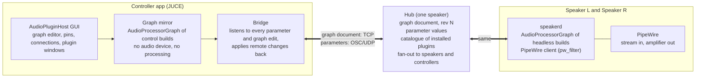
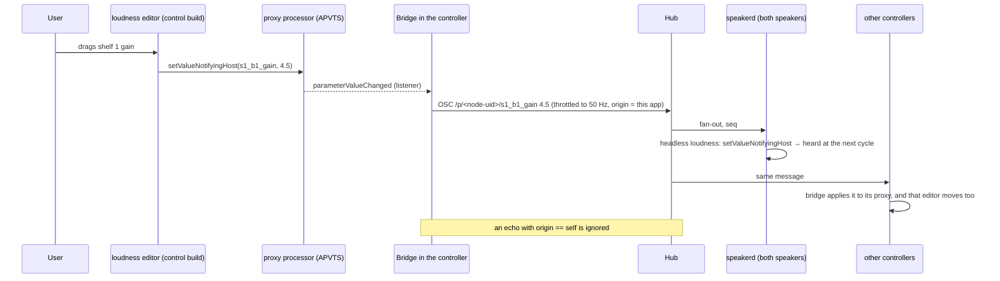
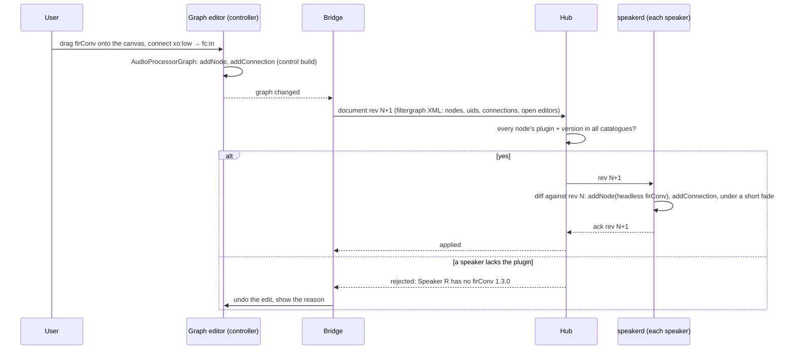
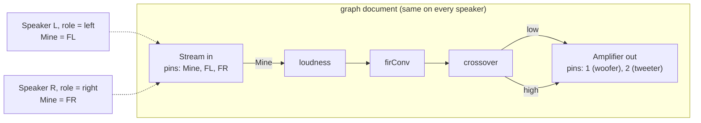
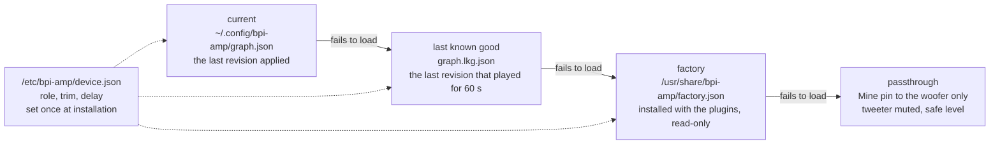
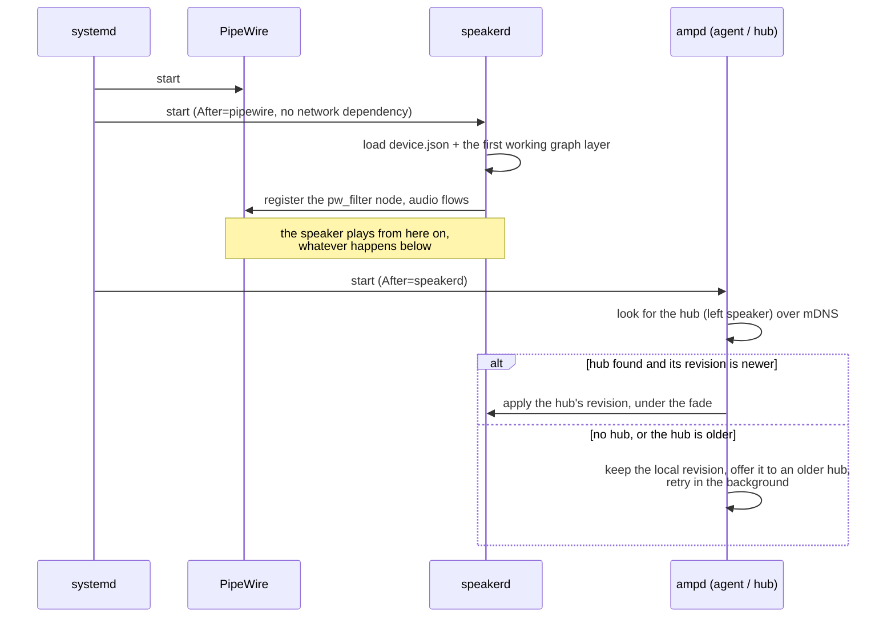
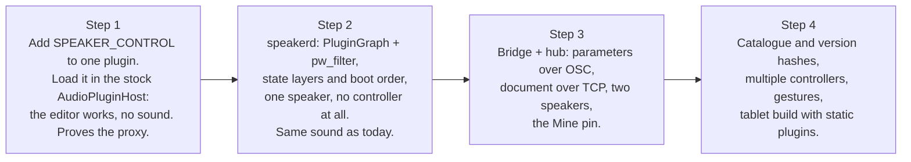

# Remote plugin host: controlling the speakers like a plugin host

*Design proposal. Nothing in this document is implemented yet.*

A stereo set made of this platform is two complete boards, each running the same JUCE
plugins on its own copy of the audio graph. This document proposes how to tune and rewire
both from one place, and how the speakers keep working when that place is gone.

The requirements:

1. A controller application that looks and works like JUCE's AudioPluginHost. You add plugins,
   drag connections between pins, open a plugin's GUI and turn its knobs. No audio runs in the
   controller: the graph and the parameters live on the speakers, and the GUIs are the real
   plugin editors acting as remote controls.
2. Every plugin is built from one source tree into three targets: **control**, **headless**
   and **complete**.
3. The speakers run headless, with no X11 and no plugin host window.
4. The speakers boot, play and keep their settings without the controller, without a hub and
   without a network.

A change made in the controller must be heard on both speakers within tens of milliseconds.
Plugin settings are shared by the pair; a few settings (which channel a speaker plays, its
trim and delay) belong to one speaker.

## 1. Why this fits JUCE well

JUCE already draws the line this design needs. An `AudioProcessor` owns the parameters
(`AudioProcessorValueTreeState`) and `processBlock()`. An `AudioProcessorEditor` only reads
and writes those parameters through attachments. The editor never calls the DSP. So:

- a **control** build is the unchanged editor on top of a *proxy* processor: same parameter
  layout, empty `processBlock()`, no DSP code compiled in;
- a **headless** build is the processor with the DSP and no editor (`hasEditor()` false);
- the **complete** build is what you have today.

And the host side splits the same way. AudioPluginHost is a GUI (`GraphEditorPanel`,
`PluginWindow`) over a graph engine (`PluginGraph`, which is JUCE's `AudioProcessorGraph`)
plus a document format (`.filtergraph`: nodes with uids, per-channel connections, open
editors). The controller keeps the GUI and the document; the speaker keeps the engine and the
document. The document, sent over the network, is what makes them the same graph.

<!-- diagram: split -->


## 2. The pieces

<!-- diagram: overview -->


**Controller app.** A copy of `extras/AudioPluginHost` with three changes: the audio device
and the processing thread are removed (the graph is never prepared or run), the plugin list
is filtered to control builds, and a bridge object is attached. Everything the user sees is
the existing host: the same canvas, pins, connection dragging, the same plugin windows.

**Control builds.** Ordinary plugins (LV2 or VST3) the controller loads like any host. The
proxy processor keeps the APVTS, so the editors work untouched. The bridge does not live in
the plugin: the host already sees every parameter of every node, so one bridge in the host
forwards them all. A control build knows nothing about the network.

**Agent and hub.** A small daemon, `ampd`, runs on every speaker next to `speakerd`. It
persists the state, applies updates, advertises the speaker over mDNS and, on exactly one
speaker, acts as the **hub**: the one place that holds the truth. The truth has two parts, the
**graph document** with a revision number and the **parameter values** keyed by node uid and
parameter ID. The hub also keeps the **catalogue** (which plugin builds, at which version
hash, each speaker has installed) and refuses a graph that references a plugin a speaker lacks.

**speakerd.** AudioPluginHost's graph engine without the GUI, running as a native PipeWire
client through `pw_filter`, so it sits inside the PipeWire graph cycle and adds no buffering.
Going through the ALSA compatibility layer instead, as AudioPluginHost does today, would add
one or two periods of latency before the plugins even run. It loads headless builds through
JUCE's own LV2 or VST3 hosting. That matters: JUCE's LV2 wrapper exposes parameters as patch
properties, not as LV2 control ports, so PipeWire's own `module-filter-chain` could load the
plugins but never change a parameter. JUCE hosting understands its own parameters, and the DSP
stays JUCE from end to end.

## 3. A knob in a fake GUI

<!-- diagram: knob -->


The gesture calls (`beginChangeGesture` / `endChangeGesture`) travel as well, so the hub can
mark a parameter "being dragged by controller X" and other controllers can grey it out rather
than fight over it.

## 4. Editing the graph

Graph edits are rarer and must be atomic, so they go over TCP as a new document revision.

<!-- diagram: graph -->


`AudioProcessorGraph` can add and remove nodes and connections while running, so a
structural change on the speaker is a diff, not a rebuild. The engine rebuilds its internal
render sequence on the audio thread's next cycle. A 30 ms fade on the output node covers the
one cycle where the sequence changes.

## 5. One graph, two speakers, two channels

The graph is shared by every speaker in the group, but one speaker plays left and the other
right. Today that is a wire from the FL or FR pin of the input node. Keep that mental model and
make the input node role-aware:

<!-- diagram: input -->


The **Mine** pin resolves per speaker from its device role (left, right, or a sum for a mono
speaker). Wiring FL or FR explicitly still works, for a graph that is deliberately asymmetric.
Trim and delay per speaker are parameters of the input node and are device state, not group
state. The controller shows the group graph; a small per-speaker panel (role, trim, delay,
mute) sits beside it.

## 6. Build system

`speaker_add_plugin()` grows one option and produces three CMake targets from the same call:

```cmake
speaker_add_plugin(loudness
    CODE     Loud
    INPUTS   1
    OUTPUTS  1
    CORE     Core.hpp Params.hpp            # shared by all targets
    DSP      PluginProcessor.cpp            # excluded from control
    EDITOR   PluginEditor.cpp MorphPad.cpp  # excluded from headless
    TARGETS  complete control headless)
```

| Target | Defines | Sources | Modules | Format | Deployed to |
|---|---|---|---|---|---|
| `loudness` | `SPEAKER_COMPLETE` | all | as today | LV2, VST3 | desktop plugin host |
| `loudness_control` | `SPEAKER_CONTROL` | core, editor, a generated proxy processor | gui + audio_processors | LV2, VST3, or **statically linked** into the controller | the controller app |
| `loudness_headless` | `SPEAKER_HEADLESS` | core, dsp | audio_processors only | LV2 (JUCE wrapper) | `~/.lv2` on the speakers |

The proxy processor is generic: it is the same `PluginProcessor` class compiled with
`processBlock()` stubbed and the core header not included, which is what `SPEAKER_CONTROL`
does. The identity (`CODE`, LV2 URI) is suffixed per target so a host never confuses them.
Every target embeds a **version hash** of the source tree; the catalogue carries it, and the
hub only applies a graph when control and headless hashes agree, so a GUI can never show a
parameter the speaker does not have.

Static linking matters for a **phone or tablet**: a JUCE controller app builds for iOS and
Android, where plugins cannot be loaded dynamically. There the control builds are compiled in
as internal plugins, the same mechanism AudioPluginHost uses for its own "Audio Input" node.
The desktop controller can load them dynamically or statically, your choice.

## 7. Working without the controller

**Requirement.** A speaker must boot, play and keep its settings with no controller app
running, no hub reachable and no network at all. The controller is for changing things, never
for running them.

The design already puts the truth on the speakers. Making the requirement hold needs four
explicit rules.

**Rule 1: every speaker carries everything it needs to play.** Three layers of state live on
each speaker, and `speakerd` loads the first one that works:

<!-- diagram: state -->


- **Current** is written on every accepted change, atomically (write a temporary file,
  `fsync`, rename), so a power cut can never leave half a file.
- **Last known good** is promoted from current once a revision has played for a minute
  without a crash or an xrun storm. A bad graph sent from the controller therefore costs one
  restart, not a silent speaker.
- **Factory** ships with the plugin build, so a freshly flashed speaker plays its measured
  tuning out of the box.
- **Passthrough** is the last resort when no plugin loads at all. With no crossover running,
  a full-range signal would reach the tweeter, so this mode sends the Mine pin to the woofer
  output only, mutes the tweeter and caps the level. It should also be loud in the logs and
  show on the identify LED or chime.

The device file is local and never comes from the hub. A speaker always knows whether it is
left or right, even alone on a shelf.

**Rule 2: nothing on the audio path waits for the network.** The boot order is fixed and
local:

<!-- diagram: boot -->


**Rule 3: the hub is a speaker, and a pair has a fixed leader.** The left speaker is the hub.
A pair needs no election; dynamic election is only needed with more than two speakers. The
controller app only ever connects to the hub. Closing the app changes
nothing; the hub keeps the state and keeps serving it. When the controller reconnects, it
loads the hub's state; it never pushes its own old copy.

**Rule 4: what you need day to day works without the app.** Volume, mute, preset and source
are reachable without the controller app:

- a knob, button or IR receiver on the hub speaker, through the same code path as the app;
- the small web page the hub serves, for a phone with nothing installed;
- the last volume is persisted like every other value, and comes back at a safe ceiling
  after a power cycle.

**What happens when something is missing:**

| Missing | What the speakers do |
|---|---|
| Controller app | Nothing changes. Both speakers play their current revision. |
| Network | Each speaker plays its current revision with its own role. No new changes until it returns. Audio from Snapcast stops (it is network audio), a local input keeps working. |
| Hub (left speaker off) | The right speaker keeps its revision. With `partner-lost = sum` in its device file it switches to an L+R mix, so a single speaker still plays the whole song. |
| Right speaker off | The hub keeps working, the app shows the speaker as offline, changes queue and are applied when it returns. |
| Both speakers rebooted, out of sync | The hub's revision wins when they meet. If the right speaker is newer (it was changed while the left was off), the hub adopts it, because revisions carry a timestamp and an origin. |
| A graph that crashes `speakerd` | systemd restarts it on last known good within a second. After three crashes in a minute it starts on factory and tells the hub. |

**One dependency to keep in mind.** The requirement covers the control side. On the audio
side, Snapcast still needs its server. If that server is a computer, the speakers are silent
when it is off, controller or not. Running `snapserver` on the hub speaker removes that dependency; it is a separate decision
and not part of this design yet.

## 8. Native or web?

Native, and specifically JUCE. The whole point of the fake GUIs is to reuse the editors you
already have (`MorphPad`, the plot components, `ampScope`'s views). A web controller would
mean rewriting each of them in JavaScript and keeping the two in step forever. A JUCE
controller runs on Linux, macOS, Windows, iOS and Android from the same code.

A web page keeps one job: a small status and preset page served by the hub, for the phone that
has nothing installed. It shows the chain, master volume, mute and presets. It does not try to
be the plugin host.

## 9. Alternative considered: hosting in PipeWire's filter-chain

PipeWire's `module-filter-chain` can host LV2 plugins itself, one chain per stage, with
controls changed at runtime through `pw-cli set-param`. It was the first candidate for the
speaker side and is worth recording why it lost.

| | PipeWire filter-chain | This proposal |
|---|---|---|
| Host on the speaker | `module-filter-chain`, one process per stage | `speakerd`, JUCE graph engine as a PipeWire client |
| Headless plugin | hand-written LV2 with control ports | JUCE build without editor, unchanged parameter mechanism |
| Graph model | linear list of stages with links | free-form `AudioProcessorGraph`, per-channel pins, same as AudioPluginHost |
| Controller | web page with generated forms | the AudioPluginHost GUI with the real editors as remotes |
| Crash isolation | per stage process | one process; a plugin crash restarts `speakerd` on last known good (sub-second, under mute) |
| Without the controller | plays the persisted pipeline | plays current, then last known good, then factory, then passthrough |
| Parameter path | LV2 control ports only (needs the rewrite) | JUCE parameters, unchanged |
| Per-stage load in `pw-top` | yes | no; `speakerd` reports per-node timing itself |

The filter-chain route needs every plugin rewritten as a thin LV2 with control ports around
a shared DSP core, plus a stage manager that regenerates configs and restarts processes on
every graph change, and it cannot express a free-form graph with per-channel pins. This
proposal instead owns a headless host. Most of that host is `extras/AudioPluginHost` minus
the GUI plus one `pw_filter` audio device, which is a bounded piece of work, and it is the
same engine the controller runs, so graph behaviour cannot drift between the two. The
filter-chain route keeps two real advantages, per-stage crash isolation and per-stage load in
`pw-top`, which `speakerd` has to provide itself.

## 10. Where the code lives

| Piece | Repository | Path |
|---|---|---|
| DSP cores, the three plugin targets, `speaker_add_plugin()` | `bpi_amp_dsp_tuning` | `juce_plugins/` |
| `speakerd` and the controller app (both JUCE applications, same build system) | `bpi_amp_dsp_tuning` | `juce_apps/speakerd/`, `juce_apps/controller/` |
| `ampd`, its systemd units, `device.json`, the factory graph, the web page | `bpi_amp_platform` | `firmware/ampd/` |
| PipeWire configuration and board setup | `bpi_amp_platform` | `firmware/pipewire/`, `firmware/*.sh` |

Board addresses, user names and deploy targets stay in the gitignored `local.env` and
`local.mk` files, as the two repositories already require.

## 11. Roadmap

<!-- diagram: roadmap -->


Step 1 is an afternoon and tells you immediately whether the editors survive being detached
from their DSP. Step 2 is the first point where a speaker runs with no X11, and it is built
to run with no controller from day one: the controller only appears in step 3.
