# Remote plugin host: controlling the speakers like a plugin host

*Design document. Steps 1 to 3 of the roadmap are implemented. Step 1: `loudness` builds as
complete, control and headless targets, checked by `dsp/juce_apps/plugin-check`. Step 2:
`speakerd` (`dsp/juce_apps/speakerd`) runs the headless builds inside PipeWire, from the first
state layer that loads, with no controller, and sounds like the complete build; it cross-compiles
for the boards, caps its output from `device.json` and imports a board's AudioPluginHost session.
Step 3: `ampd` (`firmware/ampd`) is the network agent and the hub, the controller app
(`dsp/juce_apps/controller`) is the plugin host GUI, and they speak [protocol.md](protocol.md)
(version 1, authenticated). The virtual pair in `tests/vpair/` checks all of it on every run,
the real controller against the real pair included. Every target of every plugin embeds its
plugin's version and source identity, in its binary and in its LV2 bundle's `buildinfo.ttl`, and
`speakerd` logs them for each node it runs (section 7); firConv and crossover share one block
FIR from `dsp/juce_plugins/shared/` (section 10.2). Section 10 is the software architecture one
level below this document's system view. Step 4 onwards is still a proposal.*

A stereo set made of this platform is two complete boards, each running the same JUCE
plugins on its own copy of the audio graph. This document proposes how to tune and rewire
both from one place, and how the speakers keep working when that place is gone.

The requirements:

1. A controller application that looks and works like JUCE's AudioPluginHost. You add plugins,
   drag connections between pins, open a plugin's GUI and turn its knobs. No audio runs in the
   controller: the graph and the parameters live on the speakers, and the GUIs are the real
   plugin editors acting as remote controls.
2. Every plugin is built from one source tree into three targets: **control**, **headless**
   and **complete**.
3. The speakers run headless, with no X11 and no plugin host window.
4. The speakers boot, play and keep their settings without the controller, without a hub and
   without a network.
5. Plugin GUIs in the controller show live data from the speakers: meters, level bars, plots
   and scope traces, at the same resolution as the complete build.

A change made in the controller must be heard on both speakers within tens of milliseconds.
Plugin settings are shared by the pair; a few settings (which channel a speaker plays, its
trim and delay) belong to one speaker.

## Architecture at a glance

<!-- diagram: glance -->
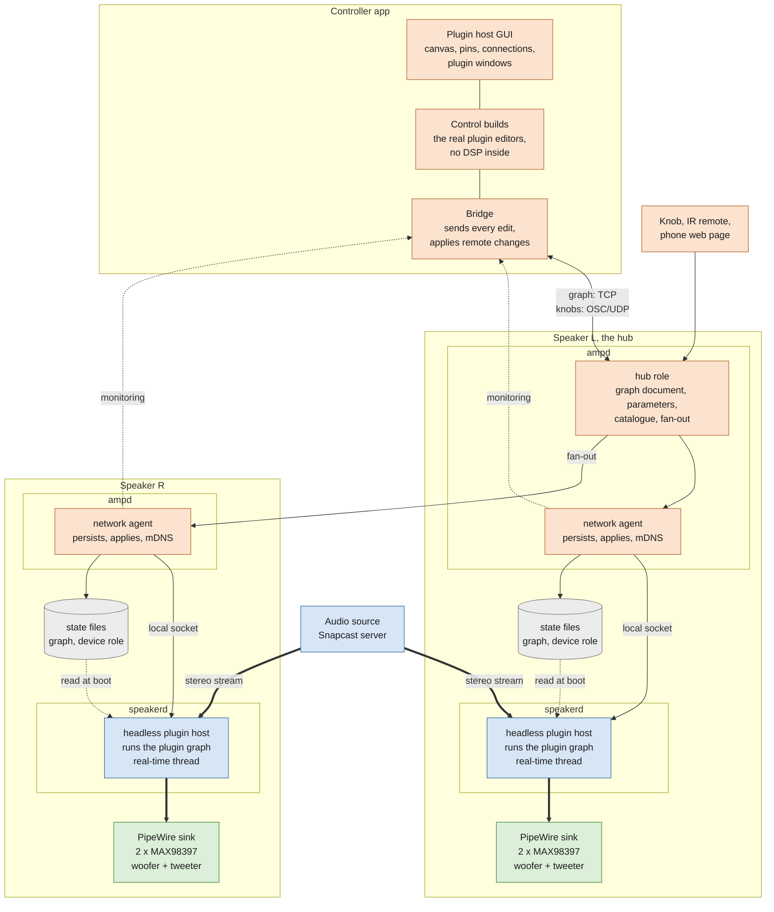

How to read it:

- **Orange is control, blue is audio, green is hardware, grey is files on disk.** Thick
  arrows carry audio, thin arrows carry settings. Dotted arrows carry data that is only read:
  state files at boot, and monitoring.
- **The controller holds no audio.** It is a plugin host whose plugins are editors only. Every
  edit leaves through the bridge to the hub.
- **Each speaker runs two daemons.** `speakerd` is the **headless plugin host**: it runs the
  plugin graph inside PipeWire. `ampd` is the speaker's **network agent**: it talks to the
  hub, keeps the state files and, on the left speaker, is the hub. Audio never passes through
  `ampd`, and `speakerd` never talks to the network.
- **The hub is a role of `ampd` on the left speaker.** It holds the truth and fans each
  change out to the agent on the right speaker. Without the controller, without the hub or
  without the network, each `speakerd` keeps playing from its own state files.
- **Monitoring goes the other way, and not through the hub.** Meters, level bars and scope
  traces belong to the speaker that measured them, so each speaker's `ampd` sends them
  straight to the controller (section 5).

## 1. Why this fits JUCE well

JUCE already draws the line this design needs. An `AudioProcessor` owns the parameters
(`AudioProcessorValueTreeState`) and `processBlock()`. An `AudioProcessorEditor` only reads
and writes those parameters through attachments. The editor never calls the DSP. So:

- a **control** build is the unchanged editor on top of a *proxy* processor: same parameter
  layout, empty `processBlock()`, no DSP code compiled in;
- a **headless** build is the processor with the DSP and no editor (`hasEditor()` false);
- the **complete** build is what you have today.

And the host side splits the same way. AudioPluginHost is a GUI (`GraphEditorPanel`,
`PluginWindow`) over a graph engine (`PluginGraph`, which is JUCE's `AudioProcessorGraph`)
plus a document format (`.filtergraph`: nodes with uids, per-channel connections, open
editors). The controller keeps the GUI and the document; the speaker keeps the engine and the
document. The document, sent over the network, is what makes them the same graph.

<!-- diagram: split -->
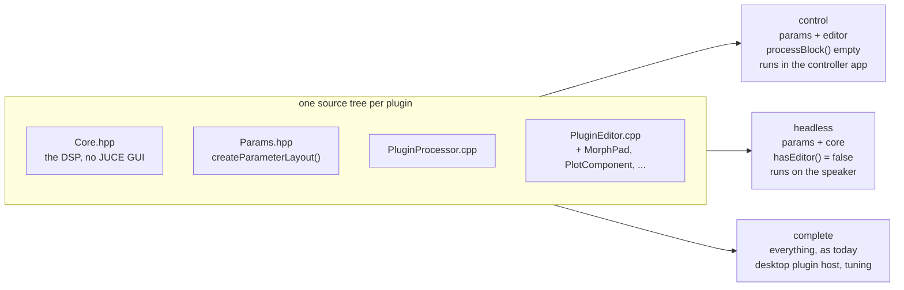

## 2. The pieces

Three programs make up the system. Each has one job, and each lacks something on purpose.

| Program | Runs on | What it is | What it never does |
|---|---|---|---|
| **Controller app** | laptop or tablet | the plugin host GUI | process audio |
| **`speakerd`** | every speaker | the headless plugin host | touch the network |
| **`ampd`** | every speaker | the speaker's network agent, and the hub on the left speaker | touch audio |

The controller and `speakerd` are the two halves of today's AudioPluginHost. The window goes
to the controller, the engine goes to the speaker, and the session document travels between
them:

<!-- diagram: halves -->
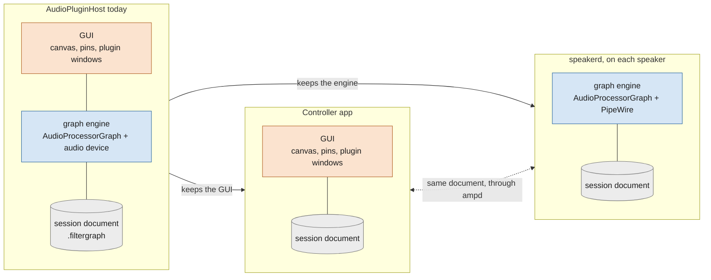

On the speaker, the line between the two daemons is simple: everything that can wait is in
`ampd`, everything that cannot is in `speakerd`.

<!-- diagram: inside -->
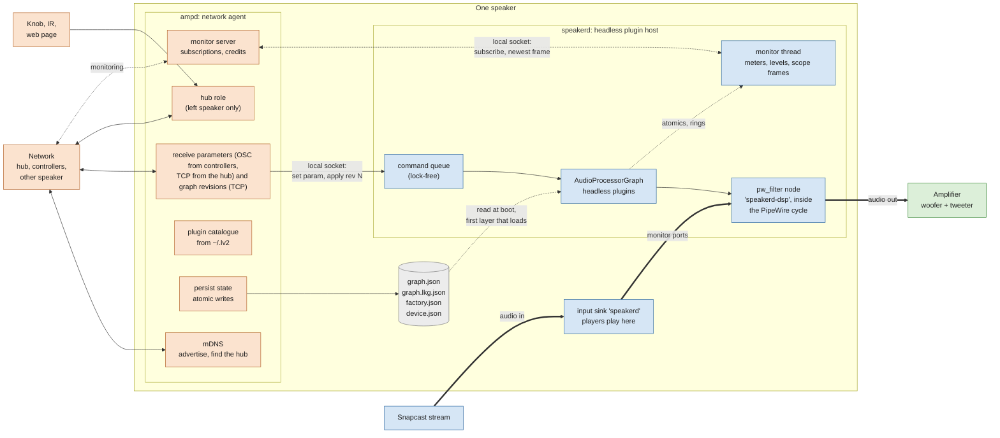

| | `speakerd` | `ampd` |
|---|---|---|
| What it is | the headless plugin host | the speaker's network agent |
| Job | runs the plugin graph | everything that talks to the outside |
| Owns | the running graph, its parameter values, the monitor producers | the state files, the network, the hub role, the catalogue, monitoring subscriptions |
| Talks to | PipeWire, and the local socket | the hub, controllers, mDNS, the web page, `speakerd` |
| Threads | one real-time audio thread that never blocks, plus a normal-priority monitor thread | ordinary threads, may block on network and disk |
| Needed for sound | yes | no |
| Starts | right after PipeWire, no network dependency | after `speakerd` |
| Restart cost | one fade, back on last known good | none audible |
| Language, where | JUCE C++, `dsp/juce_apps/speakerd/` | Python first, `firmware/ampd/` |

The local socket carries the same messages as the network, so `speakerd` cannot tell a
change from its own agent from a change relayed by the hub. That keeps `speakerd` small and
lets `ampd` be restarted or upgraded while music plays.

**Controller app.** A copy of `extras/AudioPluginHost` with three changes: the audio device
and the processing thread are removed (the graph is never prepared or run), the plugin list
is filtered to control builds, and a bridge object is attached. Everything the user sees is
the existing host: the same canvas, pins, connection dragging, the same plugin windows.

**Control builds.** Compiled into the controller as internal plugins, the way AudioPluginHost
compiles in its own "Audio Input" node, rather than loaded as LV2 or VST3 (section 7 explains
why). The proxy processor keeps the APVTS, so the editors work untouched. The bridge does not
live in the plugin: the host already sees every parameter of every node, so one bridge in the
host forwards them all. A control build knows nothing about the network.

**What step 3 built in the controller.** `dsp/juce_apps/controller/README.md` has the details.

- **No audio, by construction.** No audio device type is compiled in and `juce_audio_devices`
  is not linked; `AudioProcessorGraph` is kept only as the canvas's model and is never prepared.
  The plugin list is the control builds compiled in; nothing is scanned or loaded from disk.
- **A control build is compiled in from its control target.** The controller adds each plugin's
  own `CMakeLists.txt` and reads its `<plugin>_control` target (the shared-code target of
  `juce_add_plugin`) for its sources, its plugin definitions and its JUCE modules, and compiles
  those sources into itself with its own JUCE configuration, `createPluginFilter` renamed per
  plugin. Linking the target's static library instead does not work: it carries a second JUCE
  compiled as a plugin, whose public definitions redefine the application's
  (`JUCE_STANDALONE_APPLICATION`), and every plugin's library defines `createPluginFilter`.
  Adding a plugin is adding its name to one list.
- **The canvas mirrors the hub's document.** It is built from the hub's `state` on every
  connection, never pushed from the controller's own copy, and edits are refused while there is
  no state. A structural edit is proposed as the accepted document with the edit applied, so
  what the controller cannot show travels on untouched: a plugin without a control build is a
  placeholder node, never dropped. A rejected proposal is undone on the canvas.
- **A test mode** (`controller --hub HOST --script FILE`) runs commands and prints JSON lines, so
  rung 2 can drive the controller without a display; a fake hub in its `tests/` checks the bridge
  without `ampd`.

**speakerd: the headless plugin host.** `speakerd` is AudioPluginHost with the window
removed: the same graph engine (`AudioProcessorGraph`), the same session format, loading the
headless builds of the plugins. It adds only what an unattended host inside a speaker needs:

- **Native PipeWire audio.** The graph runs in a `pw_filter` node inside the PipeWire cycle.
  AudioPluginHost goes through the ALSA compatibility layer, which adds one or two periods of
  latency before the plugins even run. Players play into a sink in front of it (see below).
- **Starts on its own.** At boot it loads the first state layer that works (current, last
  known good, factory, passthrough) and reads the speaker's role from `device.json`. Nobody
  has to open a session.
- **A command socket instead of a GUI.** Parameter changes and graph revisions arrive from
  `ampd` over a local socket and reach the audio thread through a lock-free queue (built in
  step 3: the local link of [protocol.md](protocol.md)).
- **Safe structural changes.** Adding, removing or moving a plugin fades the output for about
  30 ms, so it never clicks.
- **The role-aware input.** It resolves the "Mine" input pin to FL or FR from the speaker's
  role (built in step 3: input channel 2).
- **Monitoring.** A normal-priority thread samples the plugins' meters and scope buffers, the
  output level of each amplifier channel, the amplifier telemetry, the time per node and the
  xrun count, and hands the newest of each to `ampd` (section 5). Nobody is watching a window,
  so the speaker reports on itself.

It hosts the plugins through JUCE's own LV2 or VST3 hosting, which understands JUCE's
parameters, so the DSP stays JUCE from end to end. It never touches the network.

**What step 2 decided.** `dsp/juce_apps/speakerd/README.md` has the details.

- **Two PipeWire nodes, not one.** The graph runs in one `pw_filter`, `speakerd-dsp`. Players
  play into a sink called `speakerd`, and its monitor ports feed the filter in the same cycle.
  WirePlumber 0.4.13, the boards' version, only links a player into an adapter node, one whose
  node format it can read. A `pw_filter` in PipeWire 0.3.65 cannot publish a node format, so a
  player sent to it lands on the default sink instead: the amplifier. `speakerd` links the
  sink to the filter, and the filter to the amplifier named in `device.json`, itself, from the
  registry, whenever the ports exist. `speakerd` creates the sink only when there is none, and
  creates it lingering: it stays when `speakerd` stops, so a stream stays on it, the amplifier
  gets silence, and the next `speakerd` adopts it. A lingering sink only exists once `speakerd`
  has run, so before any deploy a speaker must define the `speakerd` sink in its PipeWire
  configuration: a stream must never fall back to the amplifier. One `speakerd` per PipeWire:
  a second one finds `speakerd-dsp` and stops, since two would add up on the amplifier. The
  output is held at 0 until every link of both sides is active, so an amplifier that comes back
  under a playing stream hears the fade-in, not the stream at full level.
- **The graph document, version 1, is `.filtergraph` as JSON.** It has a revision number,
  nodes with uids, the plugin by format and identifier (for LV2, the URI), the plugin's own
  state as base64, and connections per channel between uids. Each node also carries its
  parameter values by parameter ID, in the plugin's own units. The input node has the
  reserved uid 1 (channels FL, FR) and the output node uid 2 (woofer, tweeter). Plugin nodes
  start at 16. A document with parameter values and no state works.
- **State crosses the URI boundary in the plugin's own format** (finding 1 of section 7).
  `speakerd` puts it under `<URI>:StateString` of whichever build it hosts, so the same
  document runs the headless build on a speaker and the complete build in the render mode.
- **Every new graph runs on 1 s of silence before it is heard.** A hosted LV2 plugin takes
  parameter values only while it processes (finding 2). JUCE's LV2 wrapper also prepares a
  plugin's DSP, its smoothing included, with the default values when it is instantiated. And
  JUCE's LV2 hosting re-instantiates the plugin in `prepareToPlay`. So the values are set after
  the graph is prepared, and the plugins run until their smoothing is over. After that the
  document is in force from the first audible sample.
- **A new revision is a whole new graph, for now.** It is built beside the running one,
  settled off the audio path on its own buffers, and swapped under the fade: a 30 ms fade-out, a
  pointer swap, a 30 ms fade-in. The plugins of the new graph start again from silence. Carrying
  the unchanged nodes, and their state, across (a diff) is a later refinement (section 4).
- **Parameter changes are applied on the audio thread.** JUCE's LV2 hosting takes a parameter's
  listener lock on the audio thread when a plugin echoes a change (`patch:Set`). The message
  thread takes the same lock when it sets a value, so in step 3 a change goes from the command
  queue to the audio thread and is applied there, never on the message thread while the graph
  runs.
- **Absolute caps.** NaN and infinity in the stream become 0 before any plugin sees them. What
  leaves `speakerd` has NaN and infinity as 0 and is clamped to +-1.0, whatever the graph does,
  or lower, to the ceiling of the device file's limits (below); passthrough is clamped to -20 dBFS.
- **An offline render mode**, `speakerd --render IN.wav OUT.wav`, runs the same graph from the
  same layers in blocks of the live quantum: the reference a live capture is compared with.

**What the step to the boards added.** Before step 3, so that `speakerd` can run on a real
speaker in place of AudioPluginHost:

- **An aarch64 build.** `tools/build.sh speakerd aarch64` and `tools/build.sh <plugin> aarch64`
  cross-compile in the development container into `build/aarch64/`, with the native JUCE install
  and the image's `:arm64` libraries, and never copy an aarch64 bundle into a `~/.lv2`. On the
  board `speakerd` needs only libpipewire and the C and C++ runtimes, no X11. Rendered under
  `qemu-aarch64-static`, it gives the x86_64 render's gains within 0.005 dB; the difference is
  the fused multiply-adds GCC uses on aarch64, in the plugin's filters.
- **Output limits in `device.json`, failing closed.** `"limits": { "gain_db": -20.0, "tweeter":
  "muted" }` is a fixed gain of at most 0 dB on both amplifier outputs that is also their
  ceiling (with -20, no sample above -20 dBFS, whatever the stream or the graph), and the tweeter
  as exact zeros. It applies after the graph (passthrough included, so passthrough is then at
  -40 dB), with constants the audio thread only reads. It is how a deploy caps the volume and
  mutes the tweeter until the first smoke test passes ([autonomous-development.md](autonomous-development.md),
  section 2). No limit at all is written out, `{ "gain_db": 0, "tweeter": "on" }`: **a
  `device.json` without `limits` plays at the fail-safe, -20 dB with the tweeter muted**, and so
  does one that is missing or invalid, where a key speakerd does not know (a misspelt `limits`)
  or a key given twice is invalid.
- **The board's current session, imported.** `speakerd --import-filtergraph FILE [--device
  DEVICE_JSON] [--prefer-headless]` reads an AudioPluginHost `.filtergraph` the way
  `PluginGraph::restoreFromXml` does and writes it as a graph document: Audio Input and Audio
  Output become the reserved input and output nodes (the speaker's `device.json` says which of
  the session's output channels is the woofer), each LV2 node a plugin node whose LV2 state is
  unwrapped into the plugin's own, and with `--prefer-headless` a complete or control build
  becomes its headless sibling. Anything that does not map (another format, MIDI, a channel the
  amplifier does not have), and anything unsafe on a speaker (the stream straight to the
  tweeter, a control build that passes it through), fails with the reason. Rendered, an imported
  session gives exactly what the same settings given as parameter values give, so "the same
  sound as today" is a document `speakerd` can play.
- **Installed on a board by `firmware/`.** `firmware/speakerd-setup.sh` installs a bundle (the
  aarch64 `speakerd`, the plugins, the installer) into a versioned folder of the audio user's
  home with a `current` and a `previous` link for rollback, runs `speakerd` as a systemd user
  unit with an empty `HOME` (so no old `~/.lv2` copy can shadow the deployed plugins), always
  writes `device.json` capped, refuses a `speakerd` older than 0.2.0 or a running
  AudioPluginHost, and turns the board's session into the factory layer with the import above.
  The unit's wrapper (`firmware/speakerd/speakerd-run`) keeps the crash history and picks the
  layer (section 8). A PipeWire drop-in defines the persistent `speakerd` sink, with
  `priority.driver = 0` so the amplifier, not a timer, clocks the graph, and snapclient is routed
  into it. `firmware/setup.sh` installs the whole audio side in boot order (PipeWire
  configuration, snapclient, `speakerd`; `ampd` from step 3), and `tools/board.sh` is the gated
  path an agent uses to reach a board (the `/board` skill).

**What step 3 decided for `speakerd`** (0.3.0; `dsp/juce_apps/speakerd/README.md` has the
details, [protocol.md](protocol.md) the messages):

- **The local link is a Unix socket speakerd listens on**, `$XDG_RUNTIME_DIR/speakerd/control.sock`
  (mode 0600; `--control-socket PATH` names another, `--no-control-socket` turns it off), one
  client at a time. speakerd starts listening once its PipeWire node is up and plays whether or
  not `ampd` is there; a socket it cannot make (another process listens there) is logged, never
  fatal. One normal-priority thread does the socket I/O and never blocks on it.
- **A parameter is resolved on the link thread and applied on the audio thread.** The link
  thread finds the hosted parameter by node uid and ID, checks `seq` and turns the value
  (a number, a choice's text, a switch's `true`/`false`) into the normalised value. The audio
  thread takes it from a lock-free inbox (one slot per parameter, newest wins, a slot queued at
  most once, so the queue always has room) at the top of the next cycle and sets it with
  `setValue`, which for JUCE's LV2 hosting takes no lock, so the step-2 rule holds: nobody sets
  a running graph's parameters from another thread.
  Measured on the virtual pair, every change lands on a cycle boundary, as a one-sample step,
  and twelve changes sent at random moments land within 17.4 ms of each other relative to their
  send times, less than one 21.3 ms cycle: each is in force from the next cycle.
- **A revision is applied by the existing swap path**, and applies are queued in order, at most
  8 (the one being built included; a ninth fails at once): a hub that rolls a failed revision
  back sends the previous one right behind it. A parameter that arrives while a revision is being built goes to the playing graph
  and again to the new one. The swap costs the two 30 ms fades and the rest of the cycle in
  which the fade-out ended (72.6 ms in all, measured); an apply that fails leaves the playing
  graph untouched, to the sample.
- **The monitor thread** samples only subscribed streams, each at its own rate up to 60 Hz.
  `output/level` is measured by the audio thread into a lock-free ring only while subscribed (3
  us per 1024-sample cycle on x86_64) and tracks a stepped tone within 0.01 dB; a plugin's
  monitor is the value JUCE's LV2 hosting last received from it (section 5).
- **A tweeter that plays only ever gets a crossover's high band.** With `device.json`'s tweeter
  on, `speakerd` refuses a layer or a revision in which anything else reaches the tweeter, by the
  same graph walk as the installer and `ampd` (a crossover is the crossover plugin, complete or
  headless, not a control build, not bypassed; only its output channel 1 may lead to the
  tweeter). With the tweeter muted nothing is checked. The virtual pair's measurements, which
  route one plugin to both channels, run with `--allow-tweeter-without-crossover`.

**ampd: the speaker's network agent.** `ampd` runs on every speaker next to `speakerd` and
does everything that talks to the outside: it advertises the speaker over mDNS, receives
parameter changes and graph revisions, hands them to `speakerd`, persists the state files that
`speakerd` reads at boot, builds the plugin catalogue, serves the monitoring subscriptions of open plugin windows, and
serves the knob, IR receiver and web page. It never touches audio.

**The hub** is a role of `ampd` on the left speaker: the one place that holds the truth. The
truth has two parts, the **graph document** with a revision number and the **parameter
values** keyed by node uid and parameter ID. The hub also keeps the **catalogue** (which plugin
builds each speaker has installed, each with its version and source identity, section 7) and
refuses a graph that references a plugin a speaker lacks.

## 3. A knob in a fake GUI

<!-- diagram: knob -->
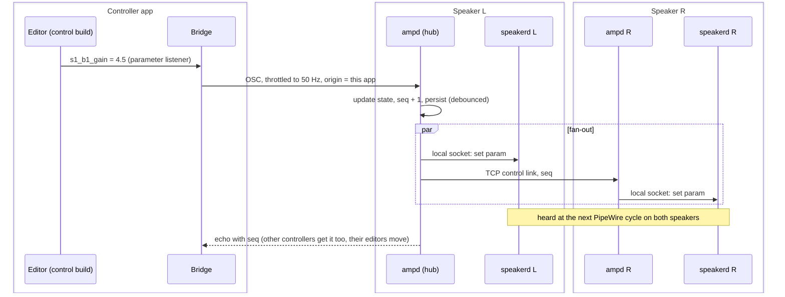

The gesture calls (`beginChangeGesture` / `endChangeGesture`) travel as well, so the hub can
mark a parameter "being dragged by controller X" and other controllers can grey it out rather
than fight over it.

**Who may turn a knob.** A pair shares a secret, set at install in each speaker's `ampd.json`
and given to each controller as a file; it never crosses the network. Every TCP connection
starts with a handshake in which both ends prove they know it, over fresh random numbers from
both sides, so neither a controller nor the right speaker believes a hub that cannot prove it,
and the hub believes no controller that cannot. Each connection then derives a token that every
OSC datagram carries: the hub takes knobs only from an authenticated controller, controllers
ignore echoes without their token, and the right speaker takes no OSC at all, only the hub's
TCP link. A controller connects to a hub without a secret only when told to (`--insecure`).
This authenticates the links; it does not encrypt them, so someone placed in the network path
could still alter messages after a handshake ([protocol.md](protocol.md), "Authentication").
Whatever reaches a speaker, the output cap, the tweeter mute and the tweeter rule are enforced
on the speaker itself.

## 4. Editing the graph

Graph edits are rarer and must be atomic, so they go over TCP as a new document revision.

<!-- diagram: graph -->
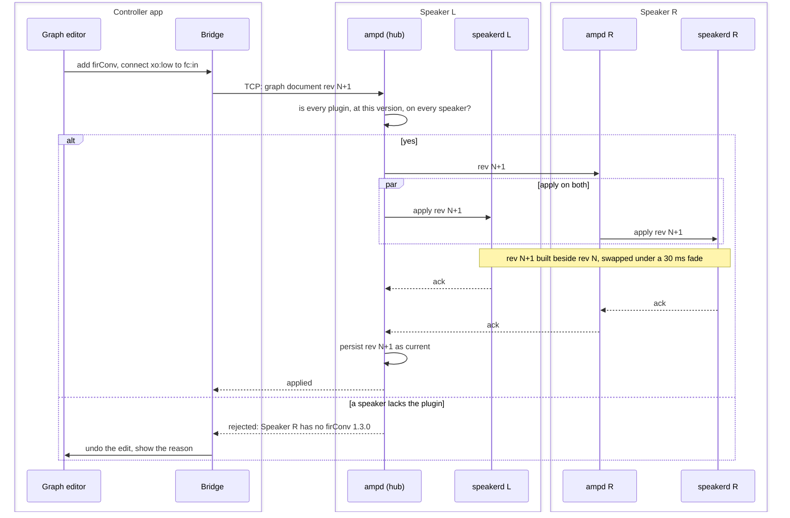

Since step 2, `speakerd` applies a revision as a whole new graph: it builds rev N+1 beside the
running rev N, prepares it and runs it on a second of silence off the audio path (section 2),
then swaps it in between a 30 ms fade-out and a 30 ms fade-in. The swap costs only the fades,
but every plugin of the new graph starts again from silence, so a delay line or a level
detector starts empty. `AudioProcessorGraph` can also add and remove nodes and connections
while it runs; carrying the unchanged nodes across (a diff against rev N, under the same fade)
is the later refinement that keeps their state. In step 3 the revision arrives as an `apply` on
the local link ([protocol.md](protocol.md)); `speakerd` answers `applied` once the new graph has
run a cycle, or `failed` with the reason while rev N plays on untouched, and queues an `apply`
that arrives while another is being built.

## 5. Monitoring: data from the speakers to the controller

Parameters and graph edits flow from the controller to the speakers. Monitoring flows the
other way: the live data a plugin window draws. Today an editor reads it straight from its
own processor. The `loudness` editor polls the detector level, the active setting and the live
shelf values at 60 Hz, and the `ampScope` editor reads a ring buffer that a capture thread
fills from the amplifier. In a control build the processor is a proxy with no DSP and no
hardware, so this data has to come from the speaker. One mechanism serves every case.

| Kind | Examples | Typical size and rate |
|---|---|---|
| **Values** | `loudness` level and active setting, the output level bar of each amplifier channel, CPU time per node | a few floats, 20 to 60 Hz |
| **Frames** | an `ampScope` trace, any plot drawn from a buffer | one envelope per screen, 20 to 30 Hz |
| **Records** | the full capture behind a stopped or triggered scope | a few MB, once, on request |

<!-- diagram: monitor -->
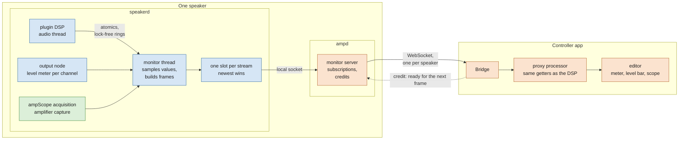

**The rules:**

- **Everything is measured on the speaker.** The DSP and the hardware live in `speakerd`, so
  meters, levels and scope captures are produced there. `ampScope`'s acquisition runs in its
  headless build inside `speakerd` and opens the amplifier's capture device exactly as it does
  today.
- **The audio thread does what it does today.** It writes atomics and lock-free ring buffers.
  A normal-priority monitor thread in `speakerd` reads them, turns them into values and
  frames, and never holds up the audio thread.
- **Monitoring belongs to one speaker.** Parameters are shared by the pair; the left and right
  levels are not. So monitoring does not pass through the hub. It goes from the speaker that
  measured it, through that speaker's `ampd`, straight to the controller. Each plugin window
  has a speaker selector: L, R, or both overlaid.
- **Nothing is produced unless a window shows it.** Opening a window subscribes to its
  streams; closing it unsubscribes. With no window open, monitoring costs nothing.
- **Frames are snapshots, and the newest wins.** A frame is a complete picture of the current
  view, so the speaker keeps only one pending frame per stream and overwrites it when a newer
  one is ready. The controller grants a credit after it has drawn a frame, and the speaker
  sends only against credits. A slow network lowers the frame rate; it never builds a queue,
  so what the window shows is never stale.
- **The transport is reliable.** One WebSocket per controller and speaker carries every
  stream, so nothing sent is lost. The traffic is marked for the Wi-Fi video access class,
  below the audio stream.
- **Events are guaranteed separately.** When a single or normal trigger fires, the speaker
  freezes that record and the controller fetches it in full. A captured transient can never be
  lost, whatever happens to live frames.

<!-- diagram: monitorseq -->
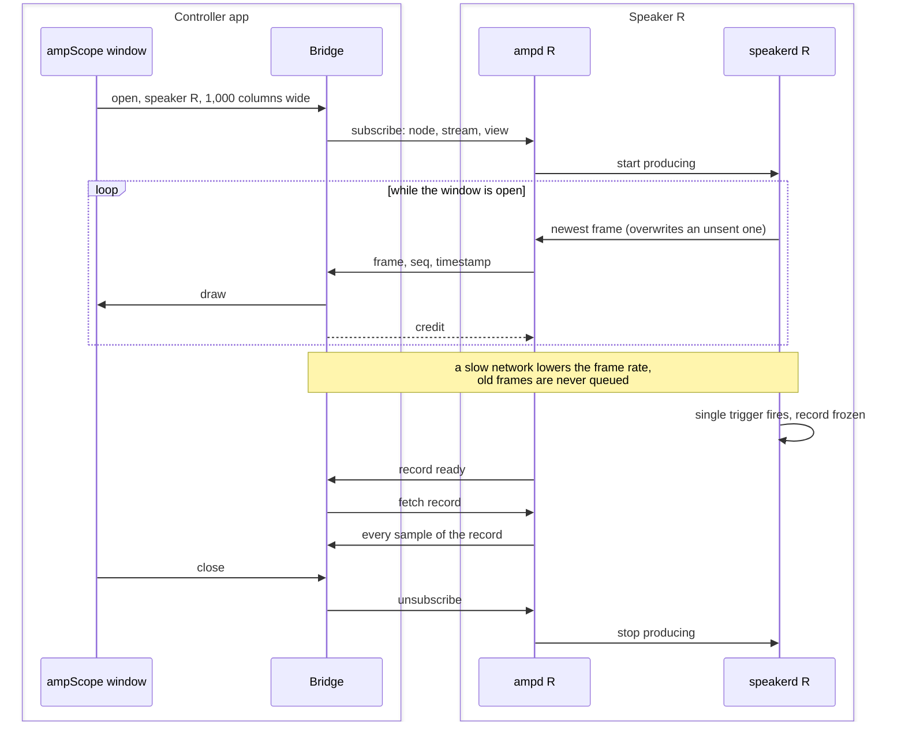

**What step 3 built in `speakerd`.** The monitor thread of the rules above, for values: the
local link's client subscribes to `output/level` and to `node/<uid>/<mon_id>` streams, each
sampled at its own rate (at most 60 Hz), and nothing is measured or sent for a stream nobody
subscribed to ([protocol.md](protocol.md), and the speakerd README). A plugin's monitor is a
parameter whose ID starts with `mon_`; JUCE's LV2 hosting keeps the value the plugin last
reported in an atomic, which the monitor thread reads. **The plugin must report it through the
parameter's listeners** (`setValueNotifyingHost`): JUCE's LV2 wrapper sends the host only the
parameters its listener heard change, so a value written with plain `setValue` never leaves the
plugin. `loudness` notifies them from inside its audio cycle when a value moved, so the host has
the value at the end of that cycle. Checked in the pinned JUCE (`juce_audio_plugin_client_LV2.cpp`,
`ParameterStorage`) and on the virtual pair with a throwaway plugin.

**Timing, built for the first board deploy.** `speakerd` measures every audio cycle: the time
in each plugin node (each is a thin wrapper around the hosted instance that times its
`processBlock`), in the whole graph and in the whole cycle, as fractions of the cycle's length,
and counts the late cycles (processing longer than the cycle) and the position jumps (a cycle
whose driver position does not follow on: an xrun or another driver, the only sign of an xrun
PipeWire 0.3.65 gives a filter). The audio thread only reads the monotonic clock and writes a
lock-free ring, under 1 us per cycle with eight nodes on x86_64. The clock read is the vDSO's
(45 ns on x86_64) on most kernels; on the board's Cortex-A73 the kernel's workaround for ARM
erratum 858921 very likely makes each one a real syscall, short and non-blocking (about a
microsecond), which is kept as a named exception to the no-syscall rule (`dsp/CLAUDE.md`):
`speakerd` logs the measured cost of a read at start. The monitor thread turns the ring into
the `speakerd/timing` stream, the `timing` of `status` (the last minute) and a log summary once
a minute, so the journal has the numbers without a controller.

**What a plugin declares.** A plugin's monitors are parameters whose IDs start with `mon_`
([protocol.md](protocol.md), "How a plugin publishes a monitor"), in all three builds,
declared after its other parameters, not automatable, of category output meter. `loudness`
declares two, in `PluginProcessor.cpp`, which every build compiles:

```text
// added with addParameter() after the APVTS, never through it: no saved state carries them
mon_levelDb        AudioParameterFloat  -120 to 0 dBFS   // read by getLevelDb()
mon_activeSetting  AudioParameterInt    0 to 3           // read by getActiveSetting()
```

The complete and headless builds publish them from the audio thread's atomics about 60 times a
second (`Monitors.h`): `setValue()`, then, under JUCE's LV2 wrapper only and when the stored
value moved by a step of its range (and once a second anyway),
`sendValueChangedMessageToListeners()`. JUCE's LV2 wrapper reports to the host only the
parameters its `AudioProcessorListener` heard change, and sends them in a `patch:Set` at the
end of the same `run()`: that is the value `speakerd` reads from its hosted parameter. The
notification has to come from inside `run()`: the wrapper destroys its listener before the
processor and walks the listeners without a lock, so a plugin thread notifying while the host
cleans up could call into a destroyed object, and run and cleanup never overlap. It costs the
audio thread an uncontended per-parameter lock and an atomic flag, what the wrapper itself
does for every parameter the host sets; that lock is the one named exception to "no lock on
the audio thread" (`dsp/CLAUDE.md`). Under any other wrapper (VST3 in a DAW) the plugin only
writes the value: no host there reads monitors, and JUCE's VST3 wrapper would answer a
notification on the audio thread by taking a mutex the message thread holds constantly. The control build's getters read the same parameters,
which the controller fills from the stream, so the editor code does not change. `plugin-check`
proves each step: the hosted headless build publishes what the complete build's getter reads,
also over 40 create, play and destroy cycles at three sample rates, no saved state carries a
monitor, and setting one moves the control build's getter.

Frame streams use a shared view-model class that turns a
ring buffer into a frame (trigger search, window selection, one min/max pair per pixel
column, the measurements). The complete build runs it locally; the headless build runs it on
the speaker and the control build draws what it receives. The monitor layout is part of a
plugin's interface: changing it raises the plugin's version (section 7), and step 4's catalogue
check covers it, so a GUI can never wait for a stream the speaker does not produce.

**Built into `speakerd`, for any graph.** Some monitors need no plugin:

- the output level of each amplifier channel, woofer and tweeter, peak and RMS, measured on
  the output node, for a level bar in the controller;
- the amplifier telemetry the driver publishes through its ALSA controls: supply voltage,
  temperature, fault flags;
- the time each node takes and the xrun count: built, as `speakerd/timing` (below).

**Same resolution as the complete build.** The native `ampScope` draws each pixel column as
the min/max envelope of the samples in it. The speaker computes that same envelope from the
same ring buffer, so a live trace in the controller is identical to the native one. Zooming
into a stopped capture uses the fetched record, so it shows the real samples.

| Stream | Size | Rate | Bandwidth per speaker |
|---|---|---|---|
| Values of every open plugin window | a few hundred bytes | 30 Hz | under 0.1 Mbit/s |
| Output level bar | 4 channels, peak and RMS | 30 Hz | negligible |
| `ampScope` frame | 10 to 20 kB (int16 min/max, enabled traces only) | 20 Hz | 1.6 to 3 Mbit/s |
| `ampScope` record | about 5 MB | once, on stop or trigger | under a second to fetch |

**Latency.** In steady state a frame reaches the window a one-way Wi-Fi trip after the speaker
produced it, a few milliseconds. On the speaker nothing waits: `ampd` relays each value as it
arrives from `speakerd`, at most at the window's rate, so a value leaves the speaker about a
millisecond after `speakerd` sampled it, and reaches the window a one-way Wi-Fi trip later.
`monitor_fanout` measures the speaker's part on the virtual pair, eight windows at 20 Hz on the
same x86_64 machine as the speaker (no network between them), against a limit of 5 ms: in
seven runs with `ampd` 0.1.1 (alone and in the whole suite, with a 10 s and a 30 s window), the
99th percentile was 0.63 to 1.43 ms on the hub's speaker and on the agent's; single values took
up to 10.2 ms in the whole suite (one moment of the machine). `ampd` 0.1.0's relay sent
each window's values on a clock of that window's own, so a value waited for the window's turn,
up to a whole period: about 50 ms at the 99th percentile at 20 Hz. When a packet is lost, TCP
retransmits it and that one frame arrives late; the next frame is fresh, because nothing queued
behind it. Lowering the minimum retransmit timeout on the speaker for the controller's subnet
(`ip route ... rto_min 20ms`) keeps the worst case near 20 ms instead of Linux's default 200
ms. No jitter buffer is used: an instrument should show the latest state, not an evenly delayed
one.

## 6. One graph, two speakers, two channels

The graph is shared by every speaker in the group, but one speaker plays left and the other
right. Today that is a wire from the FL or FR pin of the input node. Keep that mental model and
make the input node role-aware:

<!-- diagram: input -->
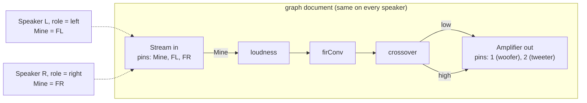

The **Mine** pin resolves per speaker from its device role (left, right, or a sum for a mono
speaker). Wiring FL or FR explicitly still works, for a graph that is deliberately asymmetric.
`speakerd` 0.3.0 implements it as input channel 2 of the graph document: the Engine makes Mine
from the stream every cycle (FL, FR, or (FL + FR) / 2 for a mono speaker), so every graph has it,
passthrough included, which plays Mine. Trim and delay per speaker are parameters of the input
node and are device state, not group state. The controller shows the group graph; a small per-speaker panel (role, trim, delay,
mute) sits beside it. Trim and delay are not in `device.json` yet: `speakerd` 0.2.0 rejects
keys it does not know (a misspelt `limits` must not pass silently), so they arrive with the
version that applies them.

## 7. Build system

`speaker_add_plugin()` takes the sources by role and produces one CMake target per build.
This is implemented; `loudness` uses it:

```cmake
speaker_add_plugin(loudness
    CODE    Loud
    INPUTS  1
    OUTPUTS 1
    SOURCES PluginProcessor.cpp                        # parameters, state: every target
    DSP     LoudnessDsp.cpp                            # left out of the control build
    EDITOR  PluginEditor.cpp MorphPad.cpp HostWindowTracker.cpp   # left out of the headless build
    MODULES juce_dsp
    TARGETS complete control headless)
```

| Target | Defines | Sources | Runs in |
|---|---|---|---|
| `loudness` | `SPEAKER_COMPLETE` | all | the desktop plugin host, tuning |
| `loudness_control` | `SPEAKER_CONTROL` | `SOURCES` + `EDITOR`; `prepareToPlay`, `reset` and `processBlock` are empty stubs | compiled into the controller app |
| `loudness_headless` | `SPEAKER_HEADLESS` | `SOURCES` + `DSP`; `hasEditor()` is false | `~/.lv2` on the speakers, hosted by `speakerd` |

The control and headless targets get their own plugin code (the last character of `CODE`
replaced by 1 or 2) and their own LV2 URI (`.../loudness_control`, `.../loudness_headless`), so
a host never confuses them with the complete plugin. Plugins that do not list `TARGETS` build
exactly as before, and `tools/build-podman.sh` keeps building the complete target only.

**Versions and source identities.** Every target of every plugin (complete, control and
headless, x86_64 and aarch64) embeds two things at build time, without any plugin source
having to change (`dsp/juce_plugins/README.md`, "Versions and source identity"):

- its plugin's **version**, the `project(... VERSION MAJOR.MINOR.PATCH)` of its
  `CMakeLists.txt`;
- its plugin's **source identity**, 12 hex characters over the inputs the plugin is compiled
  from, in this order: its own folder, each shared source folder it declares (`SHARED`,
  section 10.2), `dsp/juce_plugins/cmake`, and the pinned JUCE commit (the submodule's gitlink).
  For firConv, from the repository root:

  ```bash
  git rev-parse HEAD:dsp/juce_plugins/firConv HEAD:dsp/juce_plugins/shared/blockfir \
                HEAD:dsp/juce_plugins/cmake HEAD:dsp/juce_plugins/JUCE \
      | git hash-object --stdin | cut -c1-12
  ```

  with `-dirty` appended when `git status --porcelain` over the same paths prints anything
  (untracked files included), and `unknown` without git or outside a repository (as in
  `tools/build-podman.sh`'s container, which mounts only `dsp/juce_plugins/`). On a clean tree
  it is reproducible from git alone, also in a git worktree.

`dsp/juce_plugins/cmake/SourceId.cmake` is the one implementation: the build runs it at every
build, without a reconfigure, and rewrites the generated `SpeakerBuildInfo.h` only when the
identity changes. The version and the identity are readable in three places: in the binary,
as the string `bpi-build-info: <URI> version <version> source <source-id>` of every LV2 and
VST3 `.so`; in every LV2 bundle, as `buildinfo.ttl` next to `manifest.ttl`, written before JUCE
copies the bundle into `~/.lv2`:

```turtle
@prefix bpi: <https://github.com/AMuszkat/bpi_amp_dsp_tuning#> .

<https://github.com/AMuszkat/bpi_amp_dsp_tuning/firConv>
    bpi:version "0.0.2" ;
    bpi:sourceId "0123456789ab" .
```

and in `speakerd`'s log (from `speakerd` 0.3.1), one line per plugin node whenever it builds a
graph (section 10.3).
The manifest does not name `buildinfo.ttl` (no `rdfs:seeAlso`): no LV2 host reads it, so a
damaged file can never stop the plugin loading (named there, lilv parses it with the plugin's
data, and one parse error makes the plugin fail to instantiate); `speakerd` reads it directly.
The controller, which compiles the control builds' sources in, carries none yet.

**The version rule.** A plugin's version goes up whenever its sources (its folder, or a shared
folder it declares) change: the **patch** for a change that keeps the interface (parameter
IDs, ranges, defaults, monitors, state format) and changes the processing, output differences
within a stated tolerance included, or fixes a bug; the **minor** for an interface change that
keeps old saved states loadable; the **major** for one that breaks them; and the **patch** for
any other change to its sources (its README, its editor alone, a comment). A change to
`dsp/juce_plugins/cmake` or to the JUCE pin changes every source identity and no version.
`dsp/juce_plugins/tools/plugin-versions.sh list` prints every plugin's version and source
identity, as a build made at that moment embeds them; `plugin-versions.sh check [REF]` fails
(exit status 1) when a plugin whose sources differ between `git merge-base HEAD REF` (REF
defaults to `origin/develop`) and the working tree has not raised its version, and exits 2 on
any git or parse error. Rung 1 tests both commands on a scratch repository
(`dsp/juce_plugins/tests/plugin-versions`), and checks the identity in the bundles plugin-check
builds and in `loudness_headless` cross-built for aarch64 with its copy in the build's own
`copied/lv2`, which proves that JUCE's copy step runs after `buildinfo.ttl` is written
(`dsp/juce_plugins/tests/buildinfo`; not the copies in `~/.lv2`, which another build in the
same HOME may have written).

Step 4's catalogue carries both for every build a speaker has, and the hub will only apply a
graph when the controller's control build of each plugin agrees with the speakers' headless
build, so a GUI can never show a parameter, or wait for a monitor stream, that the speaker does
not have. Step 4 decides what agreeing compares: the source identity, or an interface hash (over
the parameter layout, the monitors and the state format) that step 4 would define, because a
processing-only change such as P1 (the shared block FIR of section 10.2, a patch) must not force
controllers to be rebuilt.

**What `plugin-check` verifies.** `dsp/juce_apps/plugin-check/run.sh loudness` builds the three
targets and loads them through JUCE's LV2 hosting. It checks that they expose the same 38
parameters (35 of the plugin's, its two `mon_` monitors and the bypass JUCE's LV2 hosting
adds), that the monitors are declared and published as section 5 says and stay out of every
saved state, that only the headless build lacks an editor, that saved state moves between the
control and headless builds in both directions, that the headless build set up only from the
control build's saved state outputs exactly what the complete build outputs (bit for bit),
that the control build leaves audio untouched, and that the control editor opens on its own:

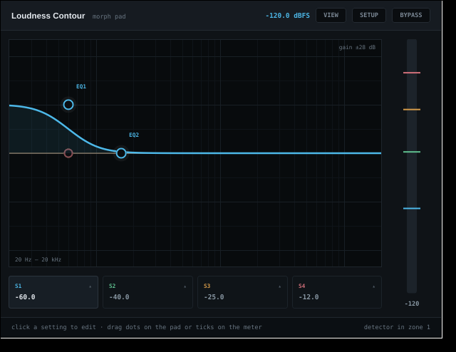

The level meter reads -120 dBFS because nothing measures anything in a control build; the
monitoring channel (section 5) is what will fill it.

**Two findings from step 1 that shape the rest:**

- **LV2 state carries the plugin's URI.** JUCE saves an LV2 plugin's state as a preset whose
  subject and state key are built from the plugin URI, and the control and headless builds
  have different URIs: restored unchanged into the other build, state is silently ignored.
  So the graph document stores each node's state in the plugin's own format (what its
  `getStateInformation()` returns), and `speakerd` wraps it into the LV2 state of the headless
  build it hosts, and unwraps it when reporting back. `plugin-check` proves the translation
  works by rewriting the URI.
- **A hosted LV2 plugin only receives parameter changes while it processes audio.** Changes set
  through the host travel on the plugin's atom port during `processBlock`. That is no problem
  for `speakerd`, which always processes. It is for the controller, which never processes, and
  LV2 hosting also gives no access to a plugin's own getters, which the monitoring channel
  needs to fill (`getLevelDb()` and friends). Hence the controller **compiles its control
  builds in** as internal plugins: it can then reach each processor directly, set parameters
  through its APVTS and fill its monitor getters. The same build is what a phone or tablet
  needs anyway, since iOS and Android cannot load plugins dynamically. The LV2 and VST3
  bundles of the control build are still produced, for `plugin-check` and the desktop host.

## 8. Working without the controller

**Requirement.** A speaker must boot, play and keep its settings with no controller app
running, no hub reachable and no network at all. The controller is for changing things, never
for running them.

The design already puts the truth on the speakers. Making the requirement hold needs four
explicit rules.

**Rule 1: every speaker carries everything it needs to play.** Three layers of state live on
each speaker, and `speakerd` loads the first one that works:

<!-- diagram: state -->
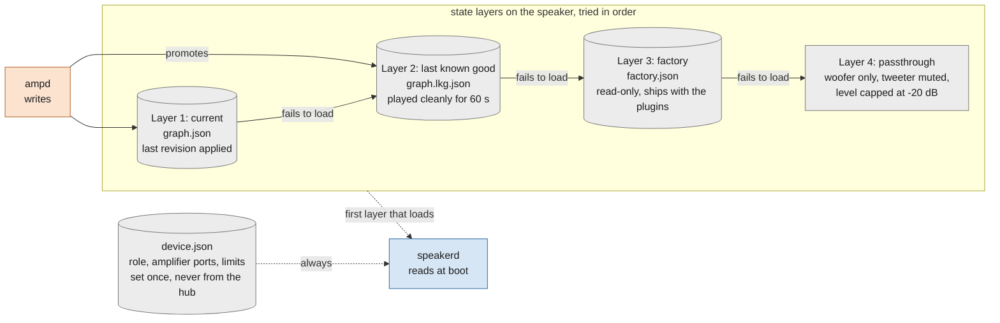

- **Current** is written on every accepted change, atomically (write a temporary file,
  `fsync`, rename), so a power cut can never leave half a file.
- **Last known good** is promoted from current once a revision has played for a minute
  without a crash or an xrun storm. A bad graph sent from the controller therefore costs one
  restart, not a silent speaker.
- **Factory** ships with the plugin build, so a freshly flashed speaker plays its measured
  tuning out of the box.
- **Passthrough** is the last resort when no plugin loads at all. With no crossover running,
  a full-range signal would reach the tweeter, so this mode sends the Mine pin to the woofer
  output only, mutes the tweeter and caps the level. Mine is FL on a left speaker, FR on a
  right one, and (FL + FR) / 2 on a mono one. It reaches the woofer 20 dB down and is clamped
  there, so nothing in passthrough is louder than -20 dBFS, even a stream above full scale; the
  output limits of the device file apply on top (-40 dBFS with a deploy's -20 dB). It is loud in
  the logs, and should also show on the identify LED or chime.

A layer **loads** when it parses, every plugin in it is found and instantiated and takes its
state (its state changes, when the document's state differs from it) and parameter values,
every connection is possible, and the graph has no loop. `speakerd` says on stderr why
each layer before the one it uses failed.

The device file is local and never comes from the hub. A speaker always knows whether it is
left or right, even alone on a shelf. It also carries the output limits a deploy sets (section
2), and they fail closed: a device file that says nothing about limits plays at the fail-safe,
its output at -20 dB at most and its tweeter muted, and a device file that is missing or invalid
plays mono at the same fail-safe. Lifting the limits is written in the file, never implied by
its absence.

**Rule 2: nothing on the audio path waits for the network.** The boot order is fixed and
local:

<!-- diagram: boot -->
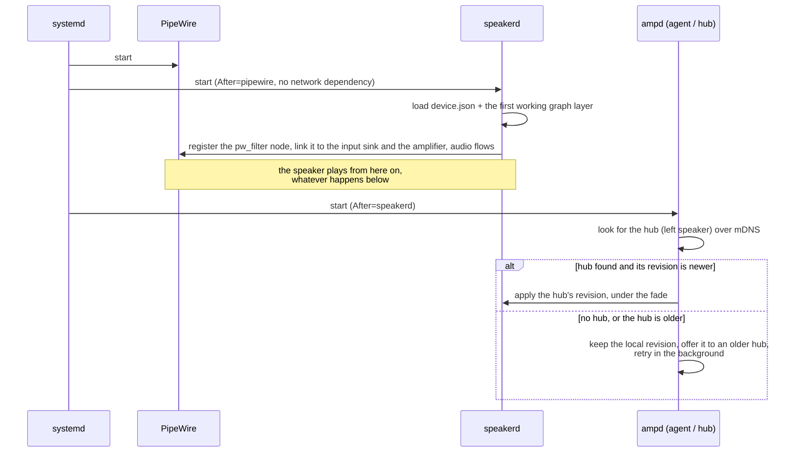

**Rule 3: the hub is a speaker, and a pair has a fixed leader.** The left speaker is the hub.
A pair needs no election; dynamic election is only needed with more than two speakers. The
controller app only ever connects to the hub. Closing the app changes
nothing; the hub keeps the state and keeps serving it. When the controller reconnects, it
loads the hub's state; it never pushes its own old copy.

**Rule 4: what you need day to day works without the app.** Volume, mute, preset and source
are reachable without the controller app:

- a knob, button or IR receiver on the hub speaker, through the same code path as the app;
- the small web page the hub serves, for a phone with nothing installed;
- the last volume is persisted like every other value, and comes back at a safe ceiling
  after a power cycle.

**What happens when something is missing:**

| Missing | What the speakers do |
|---|---|
| Controller app | Nothing changes. Both speakers play their current revision. |
| Network | Each speaker plays its current revision with its own role. No new changes until it returns. Audio from Snapcast stops (it is network audio), a local input keeps working. |
| Hub (left speaker off) | The right speaker keeps its revision. With `partner-lost = sum` in its device file (planned: `speakerd` 0.2.0 rejects keys it does not know, so this arrives with the version that applies it) it switches to an L+R mix, so a single speaker still plays the whole song. |
| Right speaker off | The hub keeps working, the app shows the speaker as offline, changes queue and are applied when it returns. |
| Both speakers rebooted, out of sync | The hub's revision wins when they meet. If the right speaker is newer (it was changed while the left was off), the hub adopts it, because revisions carry a timestamp and an origin. |
| A graph that crashes `speakerd` | systemd restarts it on last known good within a second. After three crashes in a minute it starts on factory and tells the hub; after three more on factory, on passthrough. `speakerd` writes no file, so it keeps no count of its own crashes: the unit's wrapper (`firmware/speakerd/speakerd-run`) does, and starts it with `--from last-known-good`, `--from factory` or `--from passthrough`. |
| `ampd` restarts | Audio keeps playing. Control and monitoring pause for about a second; open plugin windows resubscribe on their own. |

**One dependency to keep in mind.** The requirement covers the control side. On the audio
side, Snapcast still needs its server. If that server is a computer, the speakers are silent
when it is off, controller or not. Running `snapserver` on the hub speaker removes that dependency; it is a separate decision
and not part of this design yet.

## 9. Native or web?

Native, and specifically JUCE. The whole point of the fake GUIs is to reuse the editors you
already have (`MorphPad`, the plot components, `ampScope`'s views). A web controller would
mean rewriting each of them in JavaScript and keeping the two in step forever. A JUCE
controller runs on Linux, macOS, Windows, iOS and Android from the same code.

A web page keeps one job: a small status and preset page served by the hub, for the phone that
has nothing installed. It shows the chain, master volume, mute and presets. It does not try to
be the plugin host.

## 10. The software stack: modules, threads and how the layers talk

Section 2 says what the three programs are and what each lacks on purpose. This section goes
one level down: what each program is made of, which thread does what inside it, and every
boundary between two pieces, with what crosses it, in which format, and what happens when the
far side is gone. The READMEs of each program hold the details and the measurements; this is
the map between them.

**How to read the diagrams of this section.** Every box says what kind of thing it is, in the
«guillemets» of its first line, and its shape says the same:

| Kind | Shape | What it is |
|---|---|---|
| «process» | a frame when its insides are drawn, a double-sided box when not | a program running as one Linux process: `speakerd`, `ampd`, `pipewire`, the controller |
| «module», «modules» | a plain box | a source module of ours, compiled into the process that contains it: a C++ class with its header and its `.cpp`, or a Python class; «modules» is a group of them, a layer |
| «library» | rounded, dashed | third-party code linked into a process: JUCE's modules, libpipewire, Python's standard library |
| «bundle» | rounded, solid | one of our LV2 plugin bundles, a shared library with its `.ttl` files, that `speakerd` loads into its own process at run time; or a control build, compiled into the controller |
| «thread» | a hexagon | a thread of a process |
| «structure» | a slanted box | a data structure in memory that two threads of one process share |
| «files» | a cylinder | files on disk |
| «units» | a plain box, yellow | systemd units |
| «kernel», «device» | a plain box, green | below user space: drivers, and the hardware itself |

Colour stays what it was in section 1: orange for control, blue for audio, green for hardware,
grey for storage and hand-offs, yellow for the service manager. An arrow between two boxes of one
process is a call. An arrow between two processes is a «socket», labelled with its port or its
path, or a file that one writes and the other reads: no two processes share memory except
`speakerd` and `pipewire`, which exchange audio buffers through PipeWire's shared memory.

### 10.1 The stack, layer by layer

<!-- diagram: stack -->
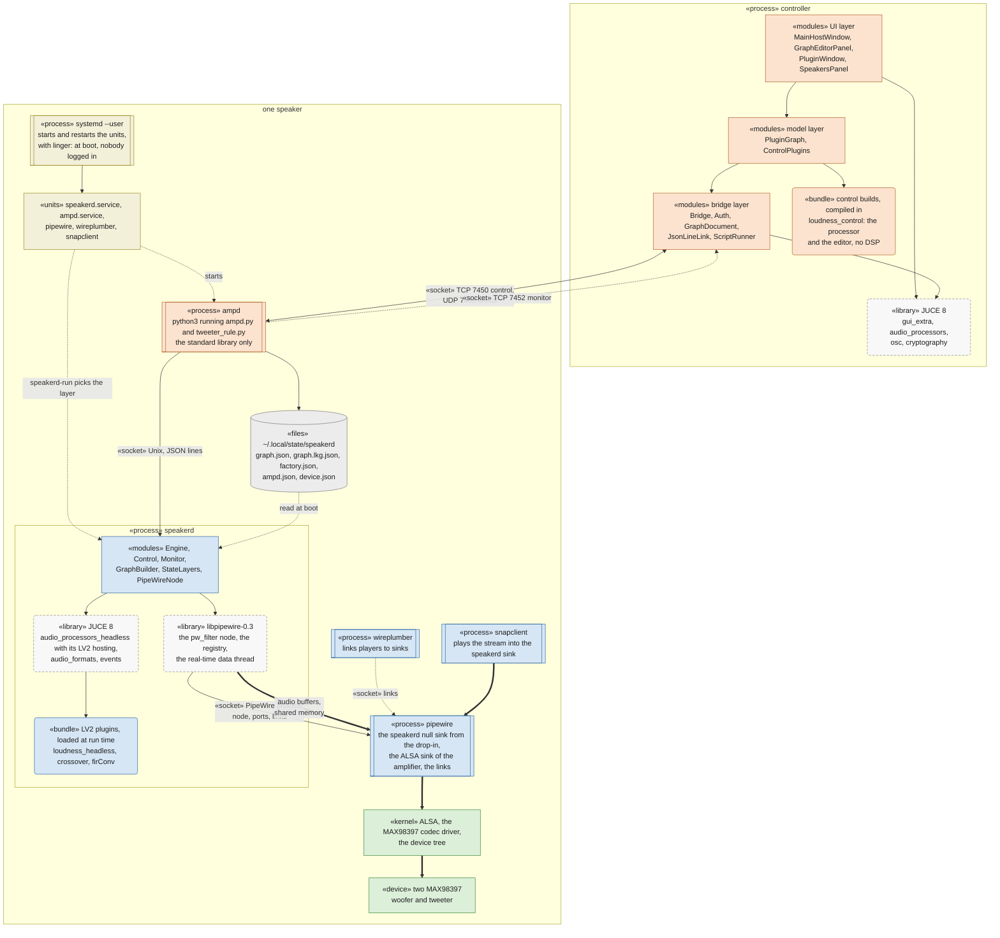

Six processes on a speaker, all in the audio user's systemd session, and one on the desktop,
the controller: a JUCE application, drawn open like `speakerd`, the JUCE console application
that hosts the plugins. In both, our own modules sit on libraries, and the plugins are not
processes but bundles the process loads. The lines that leave a process are sockets; the lines
inside it are calls.

| Piece | Kind | Written in, built on | Needs | Never |
|---|---|---|---|---|
| the controller app | one process on the desktop, `controller`, a JUCE application | C++, JUCE 8 (`juce_gui_extra`, `juce_audio_processors`, `juce_osc`, `juce_cryptography`); no `juce_audio_devices` | the hub's address and the pair's secret | process audio, scan or load a plugin from disk, hold a graph of its own |
| control builds | not a process: `loudness_control`, a plugin's processor and editor sources, compiled into the controller's binary | the same JUCE modules as the controller | nothing of the speaker | contain DSP (`processBlock` is empty) |
| `ampd` | one process on each speaker: `python3` running `ampd.py` and `tweeter_rule.py`, as a systemd user unit | Python 3.9, the standard library only (a board has no pip) | `speakerd`'s socket, `ampd.json`; the hub's address when it is an agent | touch audio; change `device.json` |
| `speakerd` | one process on each speaker, a JUCE console application, as a systemd user unit started through `speakerd-run` | C++, JUCE 8 (`juce_audio_processors_headless` with its LV2 hosting, `juce_audio_formats`) and libpipewire-0.3 | PipeWire and the bundles named on its command line | touch the network; write a file |
| headless builds | not a process: LV2 bundles (`loudness_headless.lv2`: `libloudness_headless.so` and its `.ttl`), loaded into `speakerd`'s process at run time by JUCE's LV2 hosting; complete builds the same way, without a window | a plugin's processor and DSP sources, JUCE's LV2 wrapper | the host's `patch:Set` for parameters | open an editor (`hasEditor()` is false) |
| the audio server | two processes, the distribution's, as systemd user units: `pipewire` (0.3.65, the graph and the devices) and `wireplumber` (0.4.13, the session manager that links players to sinks) | C | the drop-in that declares the `speakerd` sink | know anything about plugins |
| the service manager | `systemd --user`, one process for the audio user's session, kept alive by linger | | linger for the audio user | keep a start limit |
| kernel and hardware | ALSA, the MAX98397 codec driver, the device tree; the two amplifiers | `firmware/` | | |

### 10.2 The plugins: one source tree, three targets

A plugin is split into three groups of sources, and `speaker_add_plugin()`
(`dsp/juce_plugins/cmake/SpeakerPlugin.cmake`) builds up to three targets from them:

<!-- diagram: plugin-targets -->
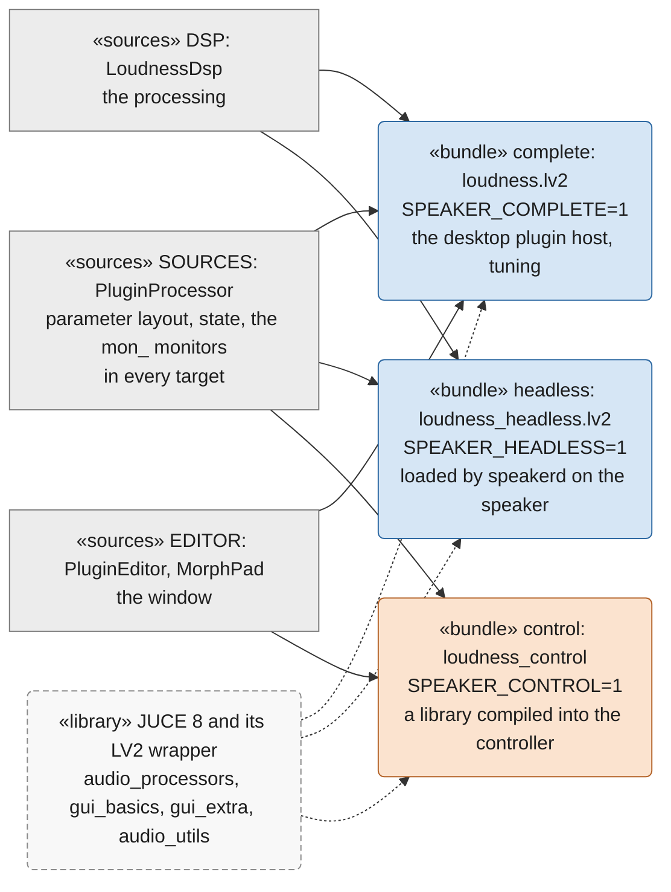

What holds the three together is the **processor's contract**: the same parameters in the same
order with the same IDs, ranges and units, the same saved state, and the same monitors (`mon_`
parameters, declared last with `addParameter()`, never through the APVTS, `loudness/Monitors.h`).
The control build in the controller and the headless build on the speaker never meet; they
agree only because they compile the same `PluginProcessor`. `plugin-check`
(`dsp/juce_apps/plugin-check`) is the test of that contract: it loads the three builds, compares
their parameter tables and state round trips, renders the complete and headless builds on the
same signal, and reads the monitors through `<plugin>/plugin-check.monitors.h`.

**Shared source folders.** Code that several plugins compile lives in
`dsp/juce_plugins/shared/<name>/`, header-only, and a plugin names the folders it compiles with
`SHARED <name>` in its `speaker_add_plugin()` call, which puts each on the include path of all
its targets and makes it an input of the plugin's source identity (section 7): a change in a
shared folder changes the identity of every plugin that declares it, and asks each of them for
a new version. The first is `shared/blockfir`, P1: `BlockFir.h`, the direct-form FIR that
firConv (its 61-tap pre-LP and 2001-tap inverse) and crossover (its two 259-tap bands) compile
in place of `juce::dsp::FIR::Filter`. It computes 16 outputs per pass over the taps with GCC
vector types, each output's taps added in ascending order as `FIR::Filter` does, from a linear
history allocated in `prepareToPlay`, and processes a block longer than the prepared size in
chunks. On x86_64 it is bit-identical to `FIR::Filter`; on aarch64 every tap is one fused
multiply-add, while `FIR::Filter` mixes fused and unfused taps from sample to sample, so the
FIRs' outputs differ by at most -131 dB re their peak (crossover's output by -129 dB).
firConv's output on aarch64 moves by up to -59 dB re peak, below 50 Hz: its float32 high-pass
biquads, with poles close to z = 1, turn any rounding change before them, even of one ulp,
into a difference at the level of their own low-frequency rounding noise, as they did before
(today's aarch64 build differs from the x86_64 one as much). Its test,
`dsp/juce_plugins/tests/blockfir` (rung 1, outside every plugin's identity), builds it with the
plugins' flags and checks it bit for bit against a reference whose arithmetic is written out,
on x86_64 and on aarch64 under qemu. Both plugins went from 0.0.1 to 0.0.2: a patch, the
processing changed and the interface did not. [p1-block-fir.md](p1-block-fir.md) explains, with
figures, why the block FIR is about sixteen times cheaper and how its output differs.

Two things cross the plugin boundary at run time, both through JUCE's LV2 hosting inside
`speakerd`: parameter values go **in** as `patch:Set` atoms, applied inside the plugin's `run()`;
monitor values come **out** on the plugin's atom output, once the wrapper's listener heard the
value move (`monitors::publish()`, the one lock allowed on the audio thread, `dsp/CLAUDE.md`).
Audio goes in and out as the `AudioProcessorGraph`'s buffers. Nothing else does: a headless
plugin knows no socket, no file and no clock.

### 10.3 speakerd: modules and threads

`speakerd` is one process with four threads, and its design is which thread may touch what.

| Module | Job | Thread |
|---|---|---|
| `Main` | command line, signals, the live mode's controller timer, the render mode | main |
| `StateLayers` | the boot order: `current`, `last-known-good`, `factory`, passthrough; the first that loads | main |
| `GraphDocument` | the document, version 1: parsing, checks, the tweeter rule | main, link |
| `GraphBuilder`, `LV2State` | the document as an `AudioProcessorGraph`: hosted instances, connections, the plugins' own state | main |
| `PluginBundles` | which bundle each plugin URI runs from (read once at start, by lilv's rules) and that bundle's build identity (`buildinfo.ttl`); the Turtle reader | main |
| `Engine` | the running graph, the audio-thread entry point, the Mine channel, the parameter inbox, the level and timing rings, the fades, the hand-over | audio (process), main (swap) |
| `TimedNode`, `Timing` | a hosted plugin as a graph node, with its processing time; the statistics | audio, monitor |
| `PipeWireNode` | the `speakerd` input sink, the `speakerd-dsp` `pw_filter` node, the registry watch and the four links, the output gate | PipeWire loop |
| `LocalLink` | the Unix socket: one client, JSON lines, a bounded send buffer | link |
| `Control` | what arrives over the link: parameters (lookup, `seq`, the inbox), revisions (the apply queue, build, swap, answer), `status` | link (lookup), main (build) |
| `Monitor` | subscriptions, `output/level`, the plugins' `mon_` values, `speakerd/timing` | monitor |
| `DeviceConfig`, `Samples` | `device.json` with its limits; the absolute caps | main (read once), audio (apply) |
| `Render`, `FilterGraph` | the offline render; an AudioPluginHost session as a document | main |

<!-- diagram: speakerd-threads -->
```mermaid
flowchart LR
    classDef ctl fill:#fbe3cf,stroke:#b4642a,color:#1d1d1d
    classDef aud fill:#d6e6f5,stroke:#2f6aa3,color:#1d1d1d
    classDef sto fill:#ececec,stroke:#7a7a7a,color:#1d1d1d
    classDef hw fill:#dcefd9,stroke:#3d8a3a,color:#1d1d1d
    classDef sys fill:#f3f0d9,stroke:#9a8a2a,color:#1d1d1d
    classDef lib fill:#f8f8f8,stroke:#8a8a8a,color:#1d1d1d,stroke-dasharray:5 3
    classDef rt fill:#dcefd9,stroke:#3d8a3a,color:#1d1d1d

    link{{"«thread» link<br/>LocalLink's own: socket I/O, JSON,<br/>parameter lookup"}}:::aud
    main{{"«thread» main<br/>JUCE's message loop: boot layers,<br/>build, settle, swap"}}:::aud
    pwl{{"«thread» PipeWire loop<br/>libpipewire's, speakerd-pw: registry,<br/>links, node state"}}:::aud
    mon{{"«thread» monitor<br/>Monitor's own: drains the rings,<br/>samples mon_, sends values"}}:::aud
    audio{{"«thread» audio<br/>libpipewire's real-time data thread,<br/>in speakerd's process: Engine::process<br/>once per quantum"}}:::rt

    inbox[/"«structure» parameter inbox<br/>lock-free: one slot per parameter,<br/>a queue of the slots with a new value"/]:::sto
    queue[/"«structure» apply queue<br/>at most 8"/]:::sto
    rg[/"«structure» running graph<br/>one atomic pointer,<br/>fade handshake by serial number"/]:::sto
    rings[/"«structure» level ring, timing ring<br/>single producer, single consumer"/]:::sto
    sendbuf[/"«structure» send buffer<br/>bounded: 64 MiB drops the client,<br/>256 KiB drops a value"/]:::sto

    link -- "param" --> inbox --> audio
    link -- "apply" --> queue --> main
    main -- "built and settled beside" --> rg --> audio
    audio --> rings --> mon
    mon --> sendbuf --> link
    main -- "applied, failed" --> sendbuf
    pwl -- "links active: output gate" --> audio
    pwl -- "quantum, rate" --> main
```

All five threads belong to `speakerd`'s one process. Two of them are made by libpipewire on
`speakerd`'s behalf: the loop thread that talks to the `pipewire` daemon, and the real-time data
thread on which PipeWire calls the filter's process function once per quantum, the audio thread
(not a thread of the daemon: `client-rt.conf` is what asks the kernel for its real-time
priority). The other three are `speakerd`'s own: the main thread, which runs JUCE's message
loop, and one each for the local link and the monitor. The grey boxes are not threads but the
structures the threads share.

The rule behind the diagram: **the audio thread owns nothing it has to wait for.** Values reach
it through the inbox (newest wins, never full, never lost), the graph through one atomic
pointer after a fade handshake, and what it measures leaves through rings. It never allocates,
never takes a lock that another thread holds while the graph runs, and makes no syscall but the
timing's clock reads (the named exceptions, `dsp/CLAUDE.md`). Everything slow happens on the
main thread beside the running graph: a new revision is built, primed at the quantum and settled
on a second of computed silence, and only then swapped in under two 30 ms fades. The PipeWire
loop thread never touches the graph; it tells the engine whether every link is active (the
output gate) and tells the main thread when the quantum or the rate changed, so the graph is
primed anew before the audio thread sees the new block size. The limits of `device.json` are
constants of the engine, read once at start; no message changes them.

**Which build each node runs.** Each time a layer, an `apply` or the render builds a graph,
`speakerd` (from 0.3.1, the first version that logs them) logs, on the main thread and never on
the audio thread, one line per plugin node as soon as it is instantiated (so also for the nodes
a layer or an `apply` instantiated before it failed), with the version and the source identity
of section 7 read from the bundle's `buildinfo.ttl`:

```
plugin node <uid>: <URI>, version <version>, source <source-id>, bundle <bundle dir>
```

JUCE's LV2 hosting does not say which bundle a URI came from, so `speakerd` finds it itself
(`PluginBundles`), once at start, right after JUCE's LV2 hosting loaded lilv's world: it reads
the manifests of the default paths, then of the `--lv2-bundle`s, by lilv's rules, which keep the
first bundle of a URI unless a later one has a newer `lv2:minorVersion`/`lv2:microVersion`
(JUCE writes them from the plugin's version, its last two numbers). With versions that now
differ, a newer `--lv2-bundle` replaces an older copy in `~/.lv2` rather than being refused (an
equal or older one is ignored, and `speakerd` stops with status 2). A bundle without an
identity is logged as one, with the reason:

```
plugin node <uid>: <URI>, no build identity (an older build), bundle <bundle dir>
plugin node <uid>: <URI>, no build identity (buildinfo.ttl unreadable), bundle <bundle dir>
plugin node <uid>: <URI>, no build identity (bundle not found)
```

### 10.4 ampd: one event loop, two roles

`ampd` is one asyncio event loop on one thread, plus a one-thread executor that writes files,
so a slow disk holds up no connection. Its classes:

| Class | Job |
|---|---|
| `Core` | the configuration (`ampd.json`), the document and its revision, the layers on disk (`graph.json` at most once a second while values change, `graph.lkg.json` after 60 s without a restart, `factory.json` read only), the executor |
| `Conn` | one JSON-lines connection, control, monitor or local: line limits, a bounded write buffer that counts documents apart from values |
| `Handshakes`, `server_handshake()`, `proof()`, `osc_token()` | the authentication of docs/protocol.md: nonces, the two HMAC proofs, the session key, the OSC token |
| `Speakerd` | the client of the local link: `hello` and `status`, `param`, `apply` with a future per revision (10 s), reconnecting every second |
| `Role` | what both roles share: following `speakerd` when it says hello on another revision than ampd's (it fell back to a layer), re-sending values when it restarted on ampd's |
| `Hub(Role)` | the left speaker: the controllers and agents as `Peer`s, the `seq` counter, echoes, gestures (5 s timeout), proposals one at a time, the catalogue of plugins some speaker has loaded (`seen`), `state` to every controller |
| `Agent(Role)` | the right speaker: connects to the hub every second, forwards its `param` and `apply` to `speakerd`, reports `speakerd`'s layer and revision, ignores OSC |
| `Monitor`, `MonitorClient`, `Subscription` | the monitor link's server: the union of the clients' subscriptions, at the highest rate any asked, is what `speakerd` is asked for. It keeps the newest line of each stream (a value of a subscribed stream, at most 64 KiB, its numbers finite, nothing else) as `speakerd` sent it, or encoded once more, for all the clients, when it does not start with `{` or holds `NaN` or `Infinity`. It flushes once per pass of the event loop, so of the lines read at once only the newest of each stream goes out, never encoded again for each client, to each subscriber whose token bucket (one per client and stream, filling at its rate, starting with one token, which the newest value takes, and holding at most two) has one. A new subscription gets the newest value at once; a client further than 256 KiB behind skips values; no task or timer per client |
| `Knobs` | the UDP socket: OSC datagrams, checked for the token of an authenticated controller at that address |
| `tweeter_rule` | the one Python definition of the tweeter rule, shared with the installer's `setup-helper.py` |

What the hub does with a change decides the whole system's behaviour, so here it is in order.
A **parameter** arrives from a controller (TCP, or OSC with a valid token); the hub stamps the
next `seq`, applies it to its own document, sends it to its own `speakerd` over the local link
and to every agent over TCP (agents get no OSC), echoes it to every controller (over OSC to the
ones that gave an `osc_port`, with that connection's token), and schedules the persistence of
`graph.json`. A **proposal** of a revision takes the hub's one revision lock; the hub checks that
the base is its revision, that the document parses, that the tweeter rule holds, and that
every plugin in it is in the catalogue; then it sends `apply` to its own `speakerd` and to every
agent that is online, waits for their answers (10 s each), and answers `applied` when all of them
did, or `rejected` with the first failure's reason, after sending the previous revision back to
the speakers that had applied the new one. A speaker that was offline catches up when its agent
reconnects: the hub sends it the current revision and its values.

### 10.5 The controller: UI, model, bridge

The controller keeps AudioPluginHost's shape and replaces its engine with the bridge. Three
layers, every one on the message thread:

<!-- diagram: controller-layers -->
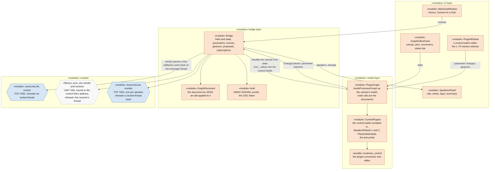

The direction of the arrows is the point. An edit on the canvas changes `PluginGraph` first (the
user sees it at once), `Bridge` hears the change and turns it into a proposal; the answer either
keeps the canvas or puts it back to the accepted document. A `state` or `graph` from the hub goes
the other way: `Bridge` rebuilds `PluginGraph` from the document, and the UI follows the model.
The model therefore never holds a truth of its own: before the first `state` and while the hub
is away, every edit is undone at once. The only threads besides the message thread are the
links' socket threads: `JsonLineLink::send()` queues a line and wakes its thread, callbacks come
back through an `AsyncUpdater`, so the knobs never wait for a peer. `ScriptRunner` is the test
mode: the same bridge, driven by a file of commands instead of the mouse, printing one JSON line
per step; the virtual pair's `test_controller_end_to_end` and the controller's own tests use it.

### 10.6 Every boundary

| Boundary | Transport | Who opens it, and retries | What crosses it | When the far side is gone |
|---|---|---|---|---|
| controller to hub, **control** | TCP 7450, JSON lines, both ends prove the secret | the controller, every second | `hello`/`welcome`, `state`; `param` (`seq` 0, the controller's `origin`), `gesture` `begin`/`end`, `graph` proposals; back: `applied`/`rejected`, echoes of `param`, `graph` and `state` of other controllers | edits are undone at once; the next connection takes the hub's `state`, pushes nothing |
| controller to hub, **knobs** | UDP 7451, OSC `/bpi/param` `,isfiss`, the session's token last | the controller's socket, bound to the control link's local address | one datagram per value while a slider is held, at most 50 a second per parameter; echoes back to the controller's `osc_port` | a lost datagram is nothing: the gesture's last value goes over TCP |
| controller to each speaker, **monitor** | TCP 7452, JSON lines, the speaker proves its name | the controller, one link per speaker, every second | `subscribe`/`unsubscribe` by stream name and rate; `value` with `t` and `v` | the speakers panel says so; the plugin windows keep their last values |
| hub to agent | TCP 7450, the same link as a controller's, `role` agent, no OSC | the agent, every second | `param` stamped with the hub's `seq`, `apply` of a revision; back: the speaker's `hello`, layer, revision, `applied`/`failed` | the hub marks the speaker offline; revisions apply among the speakers that are up; the agent catches up on reconnection |
| `ampd` to `speakerd`, **the local link** | Unix socket `$XDG_RUNTIME_DIR/speakerd/control.sock`, mode 0600, JSON lines, one client | `ampd`, every second; `speakerd` listens | `hello`, `status`; `param`, `apply`, `subscribe`; back: `applied`, `failed`, `value`, `error` | `ampd` gone: `speakerd` plays on, unchanged. `speakerd` gone: `ampd` reconnects and, on the hello, follows the revision it plays or re-sends the values |
| `speakerd` to a plugin | in process: JUCE's LV2 hosting, `AudioProcessorGraph::processBlock` | `speakerd`, when a graph is built | audio buffers; parameters in as `patch:Set` inside `run()`; monitors out on the atom port | a bundle that does not load fails the layer or the `apply`; the old graph plays on |
| `speakerd` to PipeWire | libpipewire: the `speakerd-dsp` `pw_filter` node, the registry, four links of its own; `client-rt.conf` for the real-time thread | `speakerd`, at start; relinks whenever the ports come back | the stream in from the `speakerd` sink's monitors, the two amplifier channels out; the quantum and rate | the amplifier away: the output gate holds 0 and the plugins run on; PipeWire away: exit 3, systemd restarts on the same layer |
| players to the `speakerd` sink | a PipeWire stream (snapclient, `client-rt.conf`'s target) | WirePlumber links it | the stereo stream | nothing plays; `speakerd` keeps its node and its links |
| PipeWire to the amplifier | the ALSA sink of the MAX98397 driver, `priority.driver` 1000: the hardware clock drives the graph | PipeWire | 48 kHz, quantum 1024 on the boards | |
| systemd to `speakerd` | `speakerd.service`: `ExecStart` `speakerd-run`, `ExecStopPost` `speakerd-run --record-exit` | systemd, at boot with linger; `Restart=on-failure` in 1 s, no start limit | the layer to start from (`--from`), chosen from a history of starts and exits on tmpfs: a crash steps down a layer, exit 3 (PipeWire) stays, a clean stop goes back to `current` | |
| `ampd` and `speakerd` to disk | `~/.local/state/speakerd/`: `graph.json`, `graph.lkg.json`, `factory.json`, `ampd.json`, `device.json`, written atomically | `ampd` writes the graph layers; the installer writes `device.json`, `factory.json` and `ampd.json`; `speakerd` only reads, at boot | the document, the role, the amplifier's ports, the limits, the secret | a layer that does not load is skipped for the next one |
| the installer to a board | `ssh`/`scp` of a bundle; the installed `setup/` scripts run on the board | a person (`firmware/setup.sh --mode target-remote`), or `tools/board.sh` behind the deploy gate | one version under `~/.local/lib/speakerd/<id>/` (`bin/`, `lv2/`, `setup/`, `extra/`), the `current` and `previous` symlinks, the units, the drop-in | `rollback` switches the symlink back, capped |

Two conventions make all of this one system. **Every TCP and Unix link speaks the same JSON
lines** (one object per line, an `op` in each, unknown keys and ops ignored, 32 MiB closes the
connection), so `ampd` reuses one `Conn` for three links and the controller one `JsonLineLink`
for two, and a peer of a newer protocol can add a key without breaking an older one. **Every
value of a parameter travels in the plugin's own units** (dB, Hz, a choice's index or text), as
the document stores it; only `speakerd`'s link thread, at the last step, turns it into the
hosted parameter's normalised value.

### 10.7 Two flows, end to end

A knob held in a plugin window of the controller, heard on both speakers:

<!-- diagram: flow-knob -->
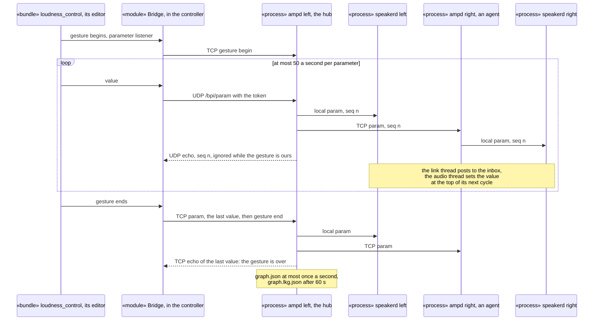

A connection dragged on the canvas, applied on both speakers or on neither:

<!-- diagram: flow-edit -->
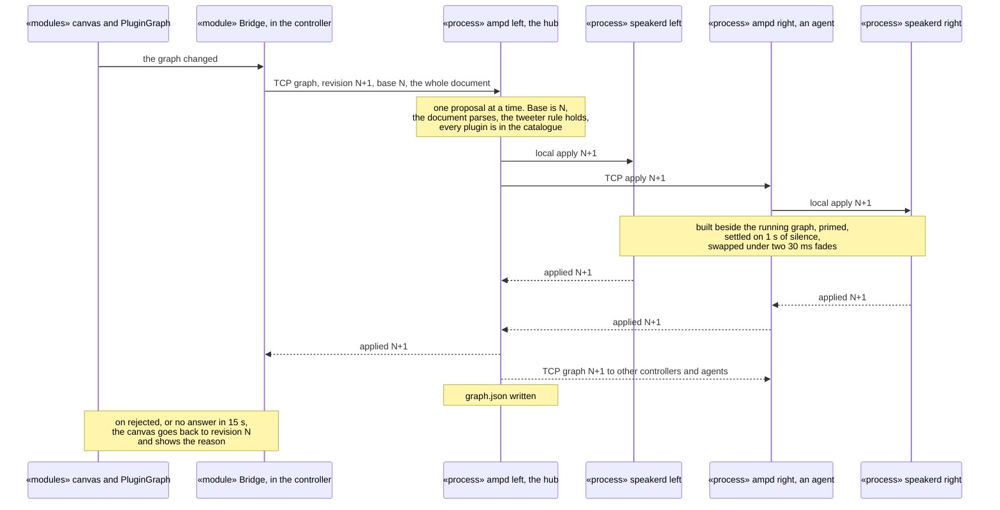

And the flow with nobody there, a speaker booting with no network: systemd starts
`speakerd-run`, which reads the history of starts and exits and picks the layer; `speakerd`
reads `device.json`, tries `graph.json`, then `graph.lkg.json`, then `factory.json`, then plays
passthrough, applying the tweeter rule to each when the tweeter is on; it creates its node,
links to the amplifier when its ports appear, and fades in once every link is active. `ampd`
starts after it, connects to the socket, reads the `hello` and follows the revision `speakerd`
plays. Nothing in that sequence waits for the network, the hub or the controller.

### 10.8 Where safety lives

Each rule is enforced at the lowest layer that can hold it, so that nothing above can undo it.

- **The output cap and the tweeter mute** are `device.json`'s limits, applied by `speakerd`'s
  engine on the audio thread as constants fixed at start, after the graph and the fades, with
  NaN and infinity turned to 0 and every sample clamped to the ceiling. No message on any link
  changes them; only the installer's `limits --person-present`, run by a person at the board,
  rewrites the file and restarts `speakerd`.
- **The tweeter rule** (only a crossover's high band reaches the tweeter while it is on) is
  checked in three places that must agree: `speakerd` when it loads a layer or an `apply`
  (C++, `GraphDocument`), the hub before it applies a proposal and the installer before it
  writes a factory graph (both `firmware/speakerd/tweeter_rule.py`); the virtual pair checks the
  two implementations against each other.
- **The catalogue**: the hub refuses a revision naming a plugin no speaker has loaded, so a
  revision is never applied on one speaker and failed on the other for a missing bundle.
- **Authentication**: every TCP link starts with the two HMAC proofs of the pair's secret, every
  OSC datagram carries the session's token, agents ignore OSC, and the secret itself is never
  on a command line, in a log or in a tracked file.
- **Real time**: the audio thread's isolation of section 10.3, and the two named exceptions.
- **Loss of the layer above**: a plugin that fails to load leaves the old graph playing;
  `speakerd` that crashes comes back on the next layer; `ampd` that is gone leaves `speakerd`
  playing; a hub that is gone leaves the agents and both speakers playing; a controller that is
  gone changes nothing. Each layer is built to be the last one standing.

### 10.9 Where the code lives

| Piece | Path |
|---|---|
| DSP cores, the three plugin targets, `speaker_add_plugin()`, `Monitors.h` | `dsp/juce_plugins/` |
| shared source folders of the plugins (the block FIR of firConv and crossover) and their tests | `dsp/juce_plugins/shared/`, `dsp/juce_plugins/tests/` |
| the version and source identity of every plugin; the version rule's check; their tests | `dsp/juce_plugins/cmake/SourceId.cmake`, `dsp/juce_plugins/tools/plugin-versions.sh`, `dsp/juce_plugins/tests/{buildinfo,plugin-versions}` |
| `plugin-check`, `speakerd`, the controller app (JUCE applications, one build system) | `dsp/juce_apps/` |
| `ampd`, its systemd unit | `firmware/ampd/` |
| `speakerd`'s unit, `speakerd-run`, the installer's JSON helper, the tweeter rule | `firmware/speakerd/` |
| PipeWire configuration, the `speakerd` sink drop-in, the installers | `firmware/pipewire/`, `firmware/*.sh` |
| the protocol between the three programs | `docs/protocol.md` |
| the virtual pair, its harness and the scenarios | `tests/vpair/` |
| builds, tests and the development container | `tools/` |

Board addresses, user names and deploy targets stay in the gitignored `dsp/config/local.env`
and `firmware/local.mk` files, as before.

## 11. Roadmap

<!-- diagram: roadmap -->
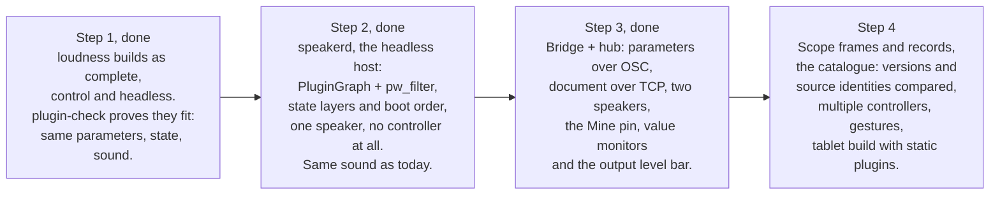

Step 1 is done: the editor survives being detached from its DSP, and the headless build
sounds exactly like the complete one. Step 2 is the first point where a speaker runs with no
X11, and it is built to run with no controller from day one: the controller only appears in
step 3. The virtual pair in `tests/vpair/` is where step 2 is tested first.

Step 2 is done. On a virtual speaker `speakerd` with `loudness_headless` gives the complete
build's gain on both amplifier channels, measured within 0.0001 dB (required within 0.05 dB)
from 40 Hz to 6 kHz and at two levels (`test_speakerd_same_sound`); a broken layer falls back
to the next one (`test_speakerd_state_layers`); with no loadable layer the tweeter is silent
and the woofer never exceeds -20 dBFS, even for an input above full scale
(`test_passthrough_safety`); and it plays whatever starts first and survives the amplifier
going away (`test_speakerd_start_order`).
`speakerd` now builds for the boards (aarch64), caps its output from `device.json` and imports
the AudioPluginHost session a board plays today (section 2), and `firmware/` installs it with
its persistent sink, its systemd unit and its crash rule, capped (section 2, "Installed on a
board"). The first deploy to a real board stays with a person
([autonomous-development.md](autonomous-development.md), section 8).

Step 3 is done. On the virtual pair the real controller, in its script test mode, drives the
real `ampd` and `speakerd` of both speakers (`test_controller_end_to_end`): a knob turned in the
controller is heard on both speakers within the knob latency budget (`test_knob_latency`, 5 ms
apart at quantum 128), a graph edit is applied on both or on neither and a rejection puts the
canvas back (`test_graph_edit`, `test_drag_during_revision`), the meters match the recorded
levels within 0.05 dB (`test_meter_values`), two controllers see each other's gestures
(`test_two_controllers`), the hub's loss leaves both speakers playing (`test_hub_down`), and a
wrong secret is refused at every link (`test_ampd_protocol`). `firmware/` installs `ampd` beside
`speakerd`, and the second stage of the first deploy (firmware/CLAUDE.md) brings the controller
to a real pair.
