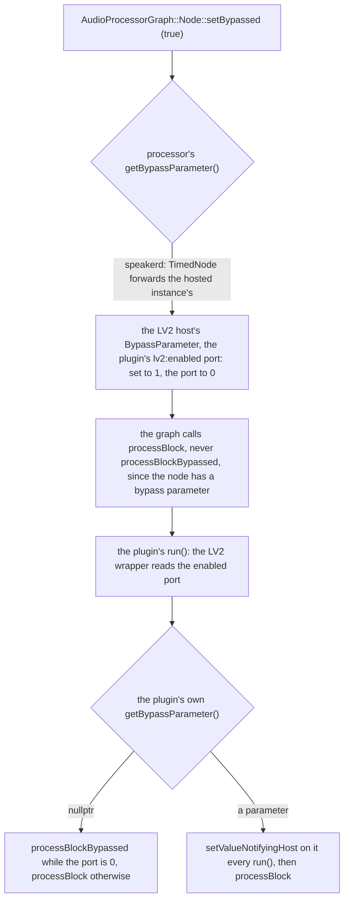

# How a node bypass reaches an LV2 plugin (JUCE 8.0.12)

What happens, link by link, when a host built on JUCE bypasses a JUCE plugin it hosts as LV2:
speakerd's `graphNode->setBypassed (true)` for a document node with `"bypassed": true`, or a
DAW's bypass button. Read in the pinned source and confirmed by `speakerd --render` of firConv
and crossover bypassed (`dsp/juce_plugins/tests/bypass`). Paths are under
`dsp/juce_plugins/JUCE/modules/`.

## The chain

1. **The graph.** `Node::setBypassed` (`juce_AudioProcessorGraph.h`, about line 146) sets the
   processor's bypass parameter when it has one, and its own flag. When rendering, the graph
   calls `processBlockBypassed` only for a bypassed node whose processor has **no** bypass
   parameter (`juce_AudioProcessorGraph.cpp`, about line 893); with one, it calls `processBlock`
   and leaves the bypass to the parameter.
2. **The host side of LV2.** JUCE's LV2 hosting (`format_types/juce_LV2PluginFormatImpl.h`) looks
   for an input control port designated `lv2:enabled` and, if there is one, makes it the
   instance's bypass parameter: `BypassParameter`, which inverts it (bypass 1 is enabled 0;
   about line 2954), returned by the instance's `getBypassParameter()` (about line 3628). The
   instance's own `processBlockBypassed` just runs the plugin (`processBlockImpl`) when it has
   that parameter (about line 3493): the plugin decides. speakerd's `TimedNode` forwards
   `getBypassParameter()` to the hosted instance, so its graph sees the same parameter.
3. **The port.** JUCE's LV2 wrapper writes an `lv2:enabled` input port into every plugin's
   `dsp.ttl`, unconditionally (`juce_audio_plugin_client/juce_audio_plugin_client_LV2.cpp`,
   about line 1337, default 1). So every JUCE plugin hosted as LV2 has a host-side bypass,
   which is why plugin-check counts one more parameter than the plugin declares.
4. **The plugin side.** In the wrapper's `run()` (about line 597): if the plugin returns a bypass
   parameter, the wrapper calls `setValueNotifyingHost (enabled ? 0 : 1)` on it **on every
   run()** and then `processBlock`; if it returns `nullptr`, it calls `processBlockBypassed`
   while the port is 0 and `processBlock` otherwise.

So a plugin that wants its own bypassed output (a gain kept, a latency matched) only needs to
override `processBlockBypassed`. It is reached from every host path: this LV2 chain,
`AudioProcessorGraph` hosting the processor directly (no bypass parameter, so the graph calls
it), and JUCE's VST3 wrapper, which adds its own bypass parameter when the plugin has none and
calls `processBlockBypassed` when it is set.

## Why our plugins do not declare a bypass parameter

JUCE's own advice for a plugin with a bypass parameter is to return it from
`getBypassParameter()` and honour it in `processBlock` (`processors/juce_AudioProcessor.h`, the
comments of `processBlock` and `getBypassParameter`). Under the LV2 wrapper that costs, on the
audio thread, every cycle whether the bypass changed or not (step 4):

- `setValueNotifyingHost`, which takes the parameter's listener lock
  (`AudioProcessorParameter::sendValueChangedMessageToListeners`) and calls every listener (an
  APVTS adapter, a `ParameterAttachment`, which posts a message from a thread that is not the
  message thread);
- the wrapper's `ParameterStorage` marks the parameter changed, so the plugin sends the host a
  `patch:Set` for it after every run(), and the host's `LV2Parameter` calls its own listeners
  under its lock (`setDenormalisedValueWithoutTriggeringUpdate`).

The repository allows one lock on the audio thread, the monitors' (`dsp/CLAUDE.md`), so firConv
and crossover have no bypass parameter and override `processBlockBypassed` only. The audible
result is the same on every path, the plugin's state cannot carry a bypass, and the parameter
layouts did not change.

## The default bypass, and state

- `AudioProcessor::processBlockBypassed`, not overridden, keeps the input channels as they are,
  clears the output channels beyond the inputs, and asserts that the plugin reports no latency
  (`juce_AudioProcessor.cpp`, `processBypassed`). For firConv (1 in, 1 out) that was the input,
  unscaled; for the crossover (1 in, 2 out), the input on output 1 and silence on output 2.
- The LV2 host's `getStateInformation` is lilv's state of the instance, which carries the value
  of every input control port (`PortMap::getState`), the `enabled` port included: a state saved
  from a bypassed instance restores the bypass with it. speakerd is not exposed: it moves only
  the plugin's own `StateString`, wrapped into the fresh instance's current LV2 state, and sets
  the bypass after it (`dsp/juce_apps/speakerd/LV2State.cpp`, `GraphBuilder.cpp`).
